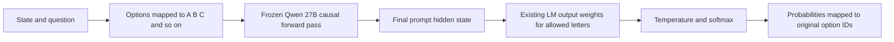

# Native 27B decision readout design

**Native 27B means using the frozen Qwen3.8-27B model's existing language-model output weights to score answer letters.** It uses normal causal attention, disables thinking, and trains no decision head. The only fitted parameter is a global calibration temperature.

The completed native run scores **77.1359%** on the fixed 11-benchmark composite. The native plus reversed-option probability pool scores **79.4905%**. These are different inference recipes using the same frozen backbone.

## Decision flow



1. **Render the request.** A fixed system prompt asks for the best option letter. The user message contains the state, question instructions, and each option's letter, semantic ID and meaning. Boolean questions expose True/False alternatives; ordered scores expose their supplied levels. Ground-truth labels do not enter the model prompt.
2. **Encode once.** Apply the pinned model's chat template with `enable_thinking=False`, including the assistant generation prefix. Each allowed letter must be exactly one tokenizer token. The implementation supports 2–26 alternatives and rejects inputs exceeding 8,192 tokens without truncation.
3. **Run the frozen model.** Compute hidden states with ordinary causal attention. Select the hidden state at the last real prompt token, using each row's actual length rather than its padded length. There is no generated explanation or answer-token decoding loop.
4. **Use the existing pretrained output layer.** Select the LM output-weight rows corresponding to the allowed letters and project the final hidden state onto them. These are the same allowed-letter logits obtained by projecting to the entire vocabulary and selecting those entries; the code avoids constructing the full vocabulary vector.
5. **Normalize and map back.** For allowed-option logits `z`, return `softmax(z / T)` and associate each probability with the original semantic option ID. Boolean output uses the probability assigned to True; choice and score outputs use the corresponding distribution.

These probabilities are normalized over the supplied alternatives. They are not the unrestricted next-token probabilities over the entire vocabulary.

## Prompt example

For a Boolean request, the user-message structure is equivalent to:

```text
STATE:
<supplied evidence>

QUESTION:
Is the claim supported?

OPTIONS:
A: option_id=true, meaning=True
B: option_id=false, meaning=False
```

The actual implementation serializes the options as structured records. The fixed system instruction asks for only the selected letter. We read the model's logits for A and B directly rather than sampling a letter and treating the sampled answer as a probability.

## Training and calibration

- Backbone: `Qwen/Qwen3.8-27B`, pinned revision `1d4bf0f2ff6012fd82039f2fa52739d0dd7c60c0`.
- Backbone and pretrained LM output weights stay frozen; **zero optimizer updates** to either.
- No new joint, pointer or classification head is trained. The 6,262 v3 training examples used by E4/E5 are not used to train this native readout.
- One positive scalar temperature is fitted on the existing **857 nonbenchmark calibration examples**, with all 11 benchmark datasets/tasks excluded. Native T is approximately **1.3424**.
- The 809 permitted dev examples measure transfer. Native was a fixed prompt/readout experiment, not an epoch-checkpoint selection exercise.
- The complete 2,111-example test panel is used only for evaluation; benchmark labels do not fit the temperature.

Positive scalar temperature preserves a strict argmax. Probability calibration quality is recorded separately from decision accuracy.

## Native plus reverse

The pooled recipe makes **two forward passes through the same frozen model**:

1. Native option order with local letter assignments.
2. Reversed option order, with letters reassigned to the reversed list.

Map both probability vectors back to the same semantic option IDs. Average the **uncalibrated** probabilities equally:

`u[i] = (p_native[i] + p_reverse[i]) / 2`

Then apply one separately fitted calibration temperature to their log probabilities:

`p_final = softmax(log(u) / T_pool)`

The pool's fitted temperature is approximately **0.9887**. It does not average separately temperature-scaled native and reverse probabilities. The second pass changes displayed position and letter assignment, allowing the average to reduce sensitivity to those choices. It introduces no task-specific routing or trained ensemble weights.

## Relation to E4 and E5

| Ledger label | Frozen base | Decision readout | Backbone attention | Forward passes per decision |
| --- | --- | --- | --- | ---: |
| E4 optimized | Qwen3.8-27B | Trained joint schema head, using v3 training data | Native causal | 1 backbone pass plus trained-head computation |
| E5 bidirectional | Qwen3.8-27B | Trained joint schema head, same v3 data and recipe | Full-attention layers bidirectional; recurrent/convolution paths still causal | 1 backbone pass plus trained-head computation |
| Native 27B | Qwen3.8-27B | Existing pretrained LM letter logits; no head training | Native causal | 1 |
| Native plus reverse | Qwen3.8-27B | Equal semantic probability pool of two pretrained readouts | Native causal | 2 |

“Native attention” in E4 describes its attention behavior. **“Native 27B” in the performance ledger names the whole pretrained-readout recipe.** E4 and Native 27B share a backbone but use different readouts and prompt formats; their score difference is not an isolated test of training alone.

The final bounded-thinking experiment is another distinct recipe: it generates up to 128 reasoning tokens before obtaining answer-letter logits. It is not what the ledger's completed Native 27B column means.

## Code and durable evidence

- [Prompt, tokenizer contract, selected output weights and batched forward pass](../scripts/pretrained_readout.py).
- [Native evaluation and calibration protocol](../scripts/evaluate_pretrained_readout.py).
- [Semantic alignment and equal probability pooling](../scripts/readout_order_pool.py).
- [Completed native run configuration](../outputs/test/readout-fast-qwen38-27b-v1/config.json).
- [Pool decision and diagnostics](../outputs/autoresearch/readout-order-decision.json).
- [Readout results](readout-results.md) and [central performance ledger](performance-ledger.md).

The optimized kernels used for these runs are a separately recorded numerical runtime. Using the pretrained readout does not imply numerical equivalence to the earlier fallback-kernel runs.
