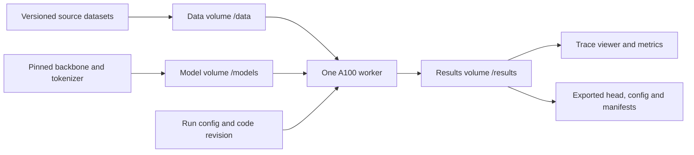

# Decision model research log

Use this log to connect each experiment to a hypothesis, evidence, and a decision.
Replace bracketed fields as work progresses. Planned experiments are not results.

## Objective and constraints

Train a decision model using an open source LLM backbone in PyTorch and Hugging
Face Transformers. Use one Modal A100; avoid full fine-tuning. Evaluate the 11
benchmarks reported for `perplexity-ai/pplx-decider-v1-27b`. Explain improvements
and failures through controlled experiments and trace analysis.

- GPU access window: [start and end, including timezone]
- GPU memory and compute budget: [verified capacity and authorized GPU hours]
- Modal workspace / environment: [names]
- Primary backbone and immutable revision: [model / commit]
- Training method: [frozen head / permitted parameter-efficient adaptation]
- Research owner: [name]
- POC: [name and preferred check-in cadence]

## Evaluation contract

Freeze the protocol before comparing runs. Never train or calibrate on datapoints
from the evaluation datasets. Track any benchmark inspection or repeated selection
against benchmark results; use independent development data for iteration.

| Benchmark | Dataset revision and split | Subset IDs / manifest hash | Question type and label mapping | Metric | Status |
| --- | --- | --- | --- | --- | --- |
| WinoGrande | [ ] | [ ] | [ ] | Accuracy | Pending |
| FinancialPhraseBank | [ ] | [ ] | [ ] | Accuracy | Pending |
| RAGTruth | [ ] | [ ] | [ ] | Accuracy | Pending |
| JudgeBench | [ ] | [ ] | [ ] | Accuracy | Pending |
| BBH | [ ] | [ ] | [ ] | Accuracy | Pending |
| JevBench public hard | [ ] | [ ] | [ ] | Accuracy | Pending |
| TabFact | [ ] | [ ] | [ ] | Accuracy | Pending |
| ContractNLI | [ ] | [ ] | [ ] | Accuracy | Pending |
| Circa | [ ] | [ ] | [ ] | Accuracy | Pending |
| Belebele | [ ] | [ ] | [ ] | Accuracy | Pending |
| TruthfulQA binary | [ ] | [ ] | [ ] | Accuracy | Pending |

- Harness revision and prompt templates: [commit / paths]
- Aggregation: [explicit formula, weights, BBH subtask handling]
- Unavailable or failed examples: [denominator and failure policy]
- Uncertainty: [paired bootstrap unit, seed, interval method]
- Calibration: [NLL, Brier score, ECE bin definition; independent calibration split]
- Serving: [batch size, token lengths, warm/cold p50 and p95 latency, throughput,
  peak memory, hardware, precision, repetitions]
- API behavior: [Choice, Noul and ordered Score validation; confidence formulas]
- Reference comparability: [matched protocol or clearly labelled unmatched result]

Reference: [pplx-decider model card](https://huggingface.co/perplexity-ai/pplx-decider-v1-27b).
Its currently reported Overall must be reconciled with the individual rows before
using it as our aggregation target. Archive the source revision used.

## Data provenance and separation

| Role | Source and revision | License / restrictions | Examples and task mixture | Label construction | Manifest / hash |
| --- | --- | --- | --- | --- | --- |
| Train | [ ] | [ ] | [ ] | [ ] | [ ] |
| Development | [ ] | [ ] | [ ] | [ ] | [ ] |
| Calibration | [ ] | [ ] | [ ] | [ ] | [ ] |
| Final evaluation | [ ] | [ ] | [ ] | [ ] | [ ] |

Record exact and near-duplicate screening, document or source grouping, synthetic
generation provenance, exclusions, and checks against every evaluation dataset.
Distinguish known exclusions from unknown base-model pretraining contamination.

## System design

- Dataset preparation and leakage checks: [entrypoint]
- Frozen feature cache: [key includes model, tokenizer, prompt and data hashes]
- Model and decision head: [pooling, option representation, trainable parameters]
- Run isolation and checkpoint publishing: [paths and atomic completion marker]
- Observability and exports: [trace schema, viewer and export command]
- One-GPU scheduling and shutdown: [serialization and idle policy]

## Experiment register

| Run | Hypothesis / single changed factor | Baseline | Development result | Evaluation status | GPU minutes | Decision |
| --- | --- | --- | --- | --- | --- | --- |
| [ID] | [ ] | [ ] | Not run | Not run | [ ] | [ ] |

## Experiment entry template

### [Run ID and date]

**Question and hypothesis:** [What outcome would support or reject the hypothesis?]

**Motivation:** [Failure traces or prior result motivating this change.]

**Controlled comparison:** [Baseline ID, changed factor, constants, seeds.]

**Reproduction:** [Code commit, clean/dirty state, exact command, config path,
dependency lock or image digest, dataset/model revisions, artifact location.]

**Recipe:** [Trainable parameters, loss, optimizer, learning rates, batch size,
accumulation, steps/epochs, precision, sequence limit, sampling and calibration.]

**Results:** [Per-benchmark metrics and denominators; development and final test
clearly separated; runtime, feature extraction time, training time and memory.]

**Failure analysis:** [Representative trace IDs, error groups and counts,
label ambiguity, order sensitivity, truncation and out-of-domain behavior.]

**Interpretation:** [Evidence, alternative explanations, limitations.]

**Decision and next test:** [Keep/reject/inconclusive, with rationale.]

## Research conclusions

- Best supported finding: [claim and experiment IDs]
- Negative result worth explaining: [claim and experiment IDs]
- Measured improvement over starting baseline: [paired result and interval]
- Remaining limitations: [data, evaluation, calibration, serving]
- Final reproduction command and checkpoint: [ ]
- Presentation figures: [accuracy/calibration, latency tradeoff, failure analysis]
