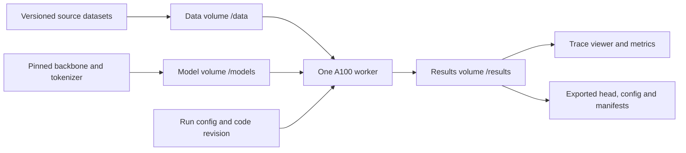

# Decision model research log

Use this log to connect each experiment to a hypothesis, evidence, and a decision.
Replace bracketed fields as work progresses. Planned experiments are not results.

## Objective and constraints

Train a decision model using an open source LLM backbone in PyTorch and Hugging
Face Transformers. Use one Modal A100. Start with a strictly frozen LLM backbone
and train only the decision head. Evaluate the 11
benchmarks reported for `perplexity-ai/pplx-decider-v1-27b`. Explain improvements
and failures through controlled experiments and trace analysis.

- GPU access window: [start and end, including timezone]
- GPU memory and compute budget: [verified capacity and authorized GPU hours]
- Modal workspace / environment: [names]
- Primary backbone and immutable revision: [model / commit]
- Initial training method: frozen LLM backbone; train only the decision head.
- Follow-up training: consider LoRA or base-model fine-tuning after establishing
  the frozen-backbone baseline and analyzing its limitations. Full fine-tuning
  remains outside the original trial brief; record any agreed scope change before
  running it.
- Research owner: [name]
- POC: [name and preferred check-in cadence]

## Evaluation contract

Freeze the protocol before comparing runs. Never train or calibrate on datapoints
from the evaluation datasets. Track any benchmark inspection or repeated selection
against benchmark results; use independent development data for iteration.

| Benchmark | Dataset revision and split | Subset IDs / manifest hash | Question type and label mapping | Metric | Status |
| --- | --- | --- | --- | --- | --- |
| WinoGrande | [ ] | [ ] | [ ] | Accuracy | Pending |
| FinancialPhraseBank | [ ] | [ ] | [ ] | Accuracy | Pending |
| RAGTruth | [ ] | [ ] | [ ] | Accuracy | Pending |
| JudgeBench | [ ] | [ ] | [ ] | Accuracy | Pending |
| BBH | [ ] | [ ] | [ ] | Accuracy | Pending |
| JevBench public hard | [ ] | [ ] | [ ] | Accuracy | Pending |
| TabFact | [ ] | [ ] | [ ] | Accuracy | Pending |
| ContractNLI | [ ] | [ ] | [ ] | Accuracy | Pending |
| Circa | [ ] | [ ] | [ ] | Accuracy | Pending |
| Belebele | [ ] | [ ] | [ ] | Accuracy | Pending |
| TruthfulQA binary | [ ] | [ ] | [ ] | Accuracy | Pending |

- Harness revision and prompt templates: [commit / paths]
- Aggregation: [explicit formula, weights, BBH subtask handling]
- Unavailable or failed examples: [denominator and failure policy]
- Uncertainty: [paired bootstrap unit, seed, interval method]
- Calibration: [NLL, Brier score, ECE bin definition; independent calibration split]
- Serving: [batch size, token lengths, warm/cold p50 and p95 latency, throughput,
  peak memory, hardware, precision, repetitions]
- API behavior: [Choice, Noul and ordered Score validation; confidence formulas]
- Reference comparability: [matched protocol or clearly labelled unmatched result]

Reference: [pplx-decider model card](https://huggingface.co/perplexity-ai/pplx-decider-v1-27b).
Its currently reported Overall must be reconciled with the individual rows before
using it as our aggregation target. Archive the source revision used.

## Existing decision models: architectures and reported performance

### Literature review — 2026-10-14

**Evidence status:** Published code, model cards and author-reported results;
none reproduced in this trial. Sources below are mutable release pages accessed
on this date, not pinned experimental artifacts. Pin checkpoint and harness
revisions before running any comparator. “Lana” is interpreted as Laya; OpenJev
names several unrelated implementations, distinguished by owner below.

There is convergence on the interface: state plus natural-language questions and
request-defined options in, typed probabilities out without answer generation.
There is no established consensus on the best backbone, head, attention layout
or training objective. These independent implementations do not establish
TypeSafe's private Jev architecture or reproduce its proprietary training recipe.

### Backbone and decision mechanism

Compatibility below is an engineering assessment, not a measured ablation.
Strictly frozen means the effective backbone is unchanged: training LoRA while
freezing original weights is parameter-efficient adaptation, not head-only
training. Cached features must include the exact question/options and prompt
layout; head-only learning still pays for backbone feature extraction.

| Model / implementation | Underlying pretrained model | Decision architecture and training | Compatibility with a frozen LLM backbone | Source |
| --- | --- | --- | --- | --- |
| Clef 27B | Qwen/Qwen3.8-27B, including vision encoder | Joint schema transformer head over backbone hidden states; evidence routing and joint option/field processing; per-question softmax. Post-trained backbone; head-only training must not be assumed. | Compatible in principle: freeze backbone and train joint head. Larger head and token-level feature cache than a linear readout; published results do not establish head-only quality. | [Card](https://huggingface.co/Cloudflare/clef), [head implementation](https://huggingface.co/Cloudflare/clef/blob/main/joint_schema_model.py) |
| Clef-Flash 9B | Qwen/Qwen3.5-9B, including vision encoder | Smaller multimodal member of the joint schema head family. | Compatible in principle, as for Clef; smaller backbone lowers extraction cost. Freeze vision encoder too if using images. Head-only quality remains untested. | [Card](https://huggingface.co/Cloudflare/clef-flash) |
| pplx-decider-v1-27b | Qwen/Qwen3.8-27B | Final prompt hidden state feeds a bias-free 255-output linear readout initialized from single-token answer-code LM-head rows. Invalid option slots are masked. Released code permits full backbone training. This description is for v1, not v1.1. | Direct fit: freeze backbone and train only the existing linear readout on cached final-position features. Change optimizer/gradient scope; released full-training results do not predict head-only gains. | [Card](https://huggingface.co/perplexity-ai/pplx-decider-v1-27b), [code](https://huggingface.co/perplexity-ai/pplx-decider-v1-27b/blob/main/source/src/autojev/model.py) |
| Kev — jaredpalmer | Current family: Qwen3.5/Qwen3.8; earlier family: Qwen3 | LoRA plus pointer head scoring option representations against a decision representation. Pure-attention bases use question-isolating masks; hybrid bases use independent rows with serving-time prefix reuse, including recurrent state. LoRA and head train together. | Head-only variant is feasible: disable LoRA updates and train pointer head on frozen option/decision features. Active LoRA changes the effective backbone despite frozen base weights, preventing a static feature cache. | [Repository](https://github.com/jaredpalmer/kev) |
| Laya | ModernBERT-large for English; mmBERT-base for multilingual | Bidirectional encoder plus two transformer head layers and option-marker scorer; one score per option's MASK marker, then softmax. Approximately 421M total English parameters and 322M multilingual. Documented recipe fine-tunes encoder and head with proper-scoring-rule reinforcement learning. | Compatible with a frozen encoder, but not a drop-in frozen causal LLM: ModernBERT/mmBERT are bidirectional encoders. Replacing them with a causal LLM requires adapting marker layout/readout and testing evidence visibility. | [Card and architecture](https://huggingface.co/convaiinnovations/laya#architecture) |
| Open-Jev — Zefan-Cai | Qwen3.5 2B/9B and Qwen3.8 27B family | LoRA plus shared scalar candidate head initialized from Yes-minus-No readout. Independent sequence per candidate; normalize across candidates. Soft cross-entropy plus 0.1 Brier; separate calibration temperature. Prefix caching is experimental. | Head-only variant is feasible: omit or freeze LoRA and fit scalar scorer on cached candidate features. Candidate expansion increases extraction cost. Released LoRA results are not frozen-head evidence. | [Repository](https://github.com/Zefan-Cai/Open-Jev) |
| OpenJev-4B — ejhshen / shenjunhao | Text backbone of Qwen/Qwen3.5-4B | Independent option branches plus Option Set Interactor and shared head, designed for permutation equivariance. Full-parameter SFT followed by REINFORCE-Analysis; not a frozen-head recipe. | Compatible in principle: freeze Qwen and train Option Set Interactor/shared head on frozen branch features. Full SFT/RL recipe needs changed optimizer scope; head-only performance is unverified. | [Repository](https://github.com/ejhshen/OpenJev), [card](https://huggingface.co/shenjunhao/OpenJev-4B) |
| Bespoke Nimble 9B, original release | Qwen3.5-9B | Answer-code probabilities from selected LM-head rows, without a new pointer head. Adapter training recipe; CUDA scorer inspected performs independent full-prompt prefill per field. Later v2–v4 releases are distinct checkpoints. | Frozen inference works directly. Head-only learning requires exposing selected LM-head rows as a separate trainable readout or adding a head; adapter training is not a strictly frozen effective backbone. | [Repository](https://github.com/bespokelabsai/nimble), [CUDA scorer](https://github.com/bespokelabsai/nimble/blob/main/nimble/scoring/cuda_scorer.py) |
| djev — Davipar | Google's DiffusionGemma | Compact answer canvas, one denoising read, allowed-token probabilities. Serving method over existing weights, not a newly trained checkpoint. | Already uses unchanged weights for inference. No separate trained head is supplied; head-only learning would require adding a readout. DiffusionGemma is not a drop-in causal-LLM backbone. | [Repository](https://github.com/Davipar/djev-dev) |
| OpenJev — zhihz | Frozen Qwen3-4B-Instruct-2507 | Next-token answer-label scoring without decision-model training. Questions run sequentially and re-encode context in the documented implementation. | Already a frozen-LLM inference baseline. To learn beyond temperature fitting, add a trainable answer-code readout or candidate head; current wrapper does not train one. | [Repository](https://github.com/zhihz/openjev) |

### Performance evidence and comparison boundaries

These results belong to different protocols. Do not rank all rows as one
leaderboard or attribute gains to head architecture alone: backbone capacity,
post-training, data, prompts and evaluation cohorts also differ.

**Perplexity's required 11-benchmark suite.** Its card reports accuracy for Jev,
Qwen3.8-27B and pplx-decider v1; Decider measurements used the Perplexity API.

| Accuracy (%) | Jev | Qwen3.8-27B | pplx-decider-v1-27b |
| --- | ---: | ---: | ---: |
| WinoGrande | 90.70 | 73.10 | 83.30 |
| FinancialPhraseBank | 76.98 | 75.68 | 84.18 |
| RAGTruth | 77.27 | 61.53 | 88.80 |
| JudgeBench | 78.57 | 68.86 | 78.29 |
| BBH | 94.27 | 72.80 | 82.80 |
| JevBench public hard | 73.27 | 72.28 | 70.30 |
| TabFact | 89.80 | 78.60 | 90.60 |
| ContractNLI | 77.45 | 80.78 | 80.78 |
| Circa | 84.60 | 87.00 | 89.20 |
| Belebele | 95.00 | 93.20 | 94.00 |
| TruthfulQA binary | 92.00 | 82.80 | 85.40 |
| Published Overall; aggregation unresolved | 84.51 | 74.76 | 85.71 |
| Our arithmetic mean of the displayed 11 rows | 84.54 | 76.97 | 84.33 |

Source: [Perplexity card](https://huggingface.co/perplexity-ai/pplx-decider-v1-27b).
The mean is our calculation from rounded published values, not a reproduced
evaluation. Exact subsets, conversions and weighting must be established.
Decider improves over the displayed base on many tasks but loses on JevBench
hard; improvement is not uniform.

**Cloudflare's internal Decision Index 0.2.1 run.** Selected rows illustrate
different strengths. Metrics are intentionally preserved, not relabeled accuracy.

| Metric | Clef | Clef-Flash | Jev | DiffusionGemma Jev | Kev 9B | Laya |
| --- | ---: | ---: | ---: | ---: | ---: | ---: |
| BANKING77 macro-F1 (%) | 94.2 | 90.9 | 79.7 | 74.3 | 84.8 | 14.3 |
| ContractNLI macro-F1 (%) | 81.4 | 84.3 | 71.7 | 76.0 | 57.8 | 29.0 |
| WinoGrande accuracy (%) | 93.5 | 97.5 | 92.0 | 73.6 | 73.2 | 50.5 |
| BBH accuracy (%) | 73.7 | 68.9 | 92.9 | 70.7 | 65.2 | 34.1 |
| Request median latency (ms) | 209.3 | 38.8 | 524.1 | 84.4 | 51.4 | 5.8 |

Source: [Cloudflare card](https://huggingface.co/Cloudflare/clef#decision-index).
These are vendor-run observations, not matched A100 measurements. Verify hardware,
serving conditions and checkpoint identities before interpreting speed ratios.
The DiffusionGemma comparator is not proven identical to Davipar's runtime.
ContractNLI F1 here cannot be directly compared with Perplexity's accuracy.

**Other author-reported evaluations.**

- [ejhshen OpenJev-4B](https://huggingface.co/shenjunhao/OpenJev-4B): MMDM hard
  accuracy 85.57% over 4,351 items; hard Brier 0.1864 on the common 4,294-item
  probability cohort; soft Brier 0.0391 on 610 items. JevBench public accuracy
  88.31% over 231 items, including 75.68% on 111 hard items. The card discloses
  that MMDM combines former development/test sets and is not a new blind test.
- [Zefan-Cai Open-Jev 27B v1.1](https://github.com/Zefan-Cai/Open-Jev): public
  JevBench 197/231 (85.28%), hard 80/111 (72.07%). This is its own evaluation;
  do not silently merge it with the ejhshen or Perplexity JevBench protocols.
- [Laya](https://huggingface.co/convaiinnovations/laya): on its 2,000-decision
  typed-decisions evaluation, the English base checkpoint reports 0.362 accuracy
  versus 0.766 for a checkpoint fine-tuned on that benchmark's training split;
  majority-class baseline is 0.461. Its T4 one-question latency is reported as
  39.5 ms English / 32.8 ms multilingual. Domain adaptation and zero-shot transfer
  must be reported separately.
- [Nimble original release](https://github.com/bespokelabsai/nimble): reported
  H100 median 106.0 ms on 120 contrastive-holdout examples; its 324-item M5 Pro
  run reports 444.0 ms. These are distinct cohorts/hardware, not a portable
  serving claim. Later-release Decision Index results need their own records.
- zhihz OpenJev is an untrained scoring baseline; no verified result on the
  required 11-benchmark protocol was found in this review. Davipar djev likewise
  has no reproduced trial result. Missing measurements are not zero scores.

### Implications for the trial

**Decision — 2026-10-14:** Begin with a strictly frozen LLM backbone and head-only
training. Consider base-model fine-tuning or LoRA as a follow-up step if controlled
results indicate that adapting the representations is warranted. Keep the frozen
model as the matched baseline, and account for added training cost and regressions.

Start with a frozen backbone and LM-head-initialized answer-code readout, then
compare a shared candidate scorer on the same backbone and independent data.
Treat a joint schema transformer as a later capacity ablation. This is a proposed
experiment order, not evidence that the simpler head wins.

Measure option permutations, unrelated-question additions, input length and
option count alongside accuracy, calibration and runtime. A batch of independent
branches is not the same compute cost as encoding a shared state once. Hybrid
backbones require isolation of recurrent/convolution state as well as attention;
an attention mask alone is insufficient. Laya's published sequential layouts
also differ from its optional trained parallel layout, so a head without positional
encoding does not by itself establish order invariance for the complete model.
See [Kev](https://github.com/jaredpalmer/kev) and
[Laya option-order analysis](https://github.com/NandhaKishorM/laya#option-order).

Schema validity, normalized probabilities and calibration are separate properties.
“RLCD” labels different public objectives and implementations; do not infer a
shared proprietary algorithm or guaranteed out-of-domain calibration. Use a
separate calibration fold and matched baselines to test these claims ourselves.

## Data provenance and separation

| Role | Source and revision | License / restrictions | Examples and task mixture | Label construction | Manifest / hash |
| --- | --- | --- | --- | --- | --- |
| Train | [ ] | [ ] | [ ] | [ ] | [ ] |
| Development | [ ] | [ ] | [ ] | [ ] | [ ] |
| Calibration | [ ] | [ ] | [ ] | [ ] | [ ] |
| Final evaluation | [ ] | [ ] | [ ] | [ ] | [ ] |

Record exact and near-duplicate screening, document or source grouping, synthetic
generation provenance, exclusions, and checks against every evaluation dataset.
Distinguish known exclusions from unknown base-model pretraining contamination.

## System design

- Dataset preparation and leakage checks: [entrypoint]
- Frozen feature cache: [key includes model, tokenizer, prompt and data hashes]
- Model and decision head: [pooling, option representation, trainable parameters]
- Run isolation and checkpoint publishing: [paths and atomic completion marker]
- Observability and exports: [trace schema, viewer and export command]
- One-GPU scheduling and shutdown: [serialization and idle policy]

## Experiment register

| Run | Hypothesis / single changed factor | Baseline | Development result | Evaluation status | GPU minutes | Decision |
| --- | --- | --- | --- | --- | --- | --- |
| [ID] | [ ] | [ ] | Not run | Not run | [ ] | [ ] |

## Experiment entry template

### [Run ID and date]

**Question and hypothesis:** [What outcome would support or reject the hypothesis?]

**Motivation:** [Failure traces or prior result motivating this change.]

**Controlled comparison:** [Baseline ID, changed factor, constants, seeds.]

**Reproduction:** [Code commit, clean/dirty state, exact command, config path,
dependency lock or image digest, dataset/model revisions, artifact location.]

**Recipe:** [Trainable parameters, loss, optimizer, learning rates, batch size,
accumulation, steps/epochs, precision, sequence limit, sampling and calibration.]

**Results:** [Per-benchmark metrics and denominators; development and final test
clearly separated; runtime, feature extraction time, training time and memory.]

**Failure analysis:** [Representative trace IDs, error groups and counts,
label ambiguity, order sensitivity, truncation and out-of-domain behavior.]

**Interpretation:** [Evidence, alternative explanations, limitations.]

**Decision and next test:** [Keep/reject/inconclusive, with rationale.]

## Research conclusions

- Best supported finding: [claim and experiment IDs]
- Negative result worth explaining: [claim and experiment IDs]
- Measured improvement over starting baseline: [paired result and interval]
- Remaining limitations: [data, evaluation, calibration, serving]
- Final reproduction command and checkpoint: [ ]
- Presentation figures: [accuracy/calibration, latency tradeoff, failure analysis]

## 2026-10-14 — Freeze training dataset v2

Marked the current six-source dataset as **v2**, without changing its bytes.
The release contains 2,553 unique records: ANLI 500, RACE 500, ReClor 500,
MultiRC 500, HelpSteer2 pairwise comparisons 500, and JEEBench math MCQs 53.
There are 2,053 Choice questions and 500 Noul questions, one question per record;
no Score questions. This preserves all 1,303 prior selected records and adds 250
per non-JEE source.

Dataset: `data/training/train-2553-six-sources-quality-preference.jsonl`

SHA-256: `338a3584e896a17b011155c066387bb396879dd4a8f539aaf2c86a94fd257fd8`

Release manifest: `data/training/manifests/dataset-v2.json`. Active selection:
`configs/active-training-dataset.json`. Expansion replay:
`.venv/bin/python scripts/expand_six_source_training.py`.

Sampling seeds: additional native rows **20261020**; HelpSteer2 pair ranking and
A/B swaps **20261019**; retained choice permutation seed **20261016**.
HelpSteer2 uses helpfulness + correctness + coherence totals, excluding ties;
complexity and verbosity are excluded. Scores are not exposed in model inputs.
Training requests use the normalized benchmark schema, with descriptions attached
to option criteria. Labels remain keyed by option ID.

Validation: all IDs unique; all existing records preserved; all requests validated;
new examples passed exact/16-word-shingle local benchmark-overlap screening.
This screen does not establish freedom from paraphrases or shared source ancestry.
Detailed reports: `outputs/training-expansion-2553-audit.json` and
`outputs/helpsteer2-pairwise-audit.json`.

Cache status: earlier Qwen3.5-9B regeneration targets the older 4,303-record pool,
not this complete v2 release. Matching cached requests can be reused by ID/hash;
additional records and pairwise inputs require extraction. No new performance
result is claimed by this dataset version marker.

### v2 Modal upload verified

Uploaded all 2,553 v2 records, release manifest, schema and audit reports to
workspace `ac-worktrials`, profile `ac-worktrial`, environment `worktrial-lance`,
Volume `ac-worktrial-training-data`. Dataset path:
`/dataset-v2-338a3584e896/train-v2.jsonl`. All eight uploaded files were read back
and SHA-256 verified. Receipt: `outputs/modal-dataset-v2-upload.json`.

### Independent v2 Qwen3.5-9B cache run

Launched `ap-wGC1r6FV3DC3liHDLeV0mR` on A100-80GB in `ac-worktrials/worktrial-lance`, profile `ac-worktrial`. Code commit `211e185`. Same pinned backbone and forward settings as prior extraction. Preflight: 2,553 records, 1,308,918 tokens, maximum 2,514, no truncation. Per-record causal-mask observations and full backbone metadata enabled. Separate output `/hidden-cache/qwen35-9b-dataset-v2-338a3584e896`; checksum-verified local exporter started. Completion pending; receipt `outputs/hidden-cache-qwen35-9b-dataset-v2/launch.json`.

### v2 extraction stopped; batch-size comparison

At user request, stopped app `ap-wGC1r6FV3DC3liHDLeV0mR`; 768 completed records preserved in committed shards. Launched separate A100 comparison `ap-KanKTAKf6btmm7S17IyCQz`, code commit `295b1f7`. Compare every completed record using fresh batch-1 vs length-bucketed batch-4 on the same GPU/runtime, with saved batch-1 cache as control. Evaluate hidden states, actual backbone vocabulary logits at option-span endpoints, and the fixed diagnostic head used in extraction (not a trained checkpoint); include forward-only speed and allocated-memory peaks. Right-padding and original attention-mask handling retained. Results pending.

### Batch-4 comparison completed — 768 preserved v2 records

Fresh batch-1 exactly reproduced saved batch-1 states (maximum absolute error 0).
Batch-4 was **1.566x faster** for backbone forwards: 76.003s vs 48.531s,
4,401 vs 6,892 valid tokens/s. Peak allocated memory: 19.691GB vs 20.714GB.
Length bucketing limited padding to 1,995 additional tokens.

Batch-4 was not numerically equivalent: maximum hidden-state absolute difference
32.875; maximum backbone vocabulary-logit difference at option endpoints 3.03125.
Fixed diagnostic-head logit max difference 0.016461; probability max difference
0.003126; 24/768 diagnostic-head predictions changed (3.125%). The diagnostic head
is randomly initialized, not a trained checkpoint: these flips do not measure
trained-model accuracy. Sources: ANLI 250, RACE 250, MultiRC 250, ReClor 18; no
HelpSteer2 or JEEBench records had been completed at stop time.

Report: `outputs/hidden-cache-qwen35-9b-dataset-v2/batch4-comparison.json`.
Do not silently mix batch-4 states into the original cache or claim identical logits.
Original extraction remains stopped; this diagnostic does not resume extraction.

### Batch-8 and flipped-prediction probability analysis

Completed all 768 preserved records. Batch-8 forward 45.153s, fresh batch-1 control 103.645s; 7,407 valid tokens/s and 22.085GB peak allocated. Fresh batch-1 again exactly matches saved states. Control timing varies between runs (76.003s in batch-4 test), so compare absolute batched throughput as well as within-run ratios. Batch-8 is about 7.5% higher throughput than batch-4 in these separate runs. Diagnostic head flips 28/768; median maximum candidate probability change among flips 0.00049281, maximum 0.00163338. Batch-4 flips 24/768; median 0.00052425, maximum 0.00221851. These are small absolute probability movements and near-tie effects on a randomly initialized diagnostic head, not trained-checkpoint validation. Reports: `batch8-comparison.json` and `flipped-prediction-probability-deltas.json` under `outputs/hidden-cache-qwen35-9b-dataset-v2/`. Original extraction remains stopped.

### Full v2 batch-four cache launched

User selected batch 4 after numerical comparisons. New independent app `ap-a9Rabou1FyUBKeEQr39yYM`, A100-80GB, profile `ac-worktrial`, environment `worktrial-lance`; commit `fdce31a`. All 2,553 v2 records, same pinned Qwen3.5-9B and BF16/SDPA settings. Sort by token length then record ID; right-pad batches of 4, permit final remainder, discard padding from saved tensors. Preserve observed mask metadata and batch composition per record. Original batch-1 cache remains separate. Exporter started for `/hidden-cache/qwen35-9b-v2-batch4-338a3584e896`; completion pending.

### Full v2 batch-four cache generated

Modal extraction completed all 2,553 v2 records in length-sorted batches of four.
All three cache/direct diagnostic-head parity probes had zero error; causal future-suffix probe passed; cached-head backward verified. Remote manifest saved at `outputs/hidden-cache-qwen35-9b-v2-batch4/remote-manifest.json`. Local checksum-verified export remains running; no Modal artifacts cleaned.

### v2 batch-four local export verified

Completed local export of all 2,553 records: 253 files, 10,839,310,144 bytes. All manifest SHA-256 checks passed; cached-head backward verified. Receipt `outputs/hidden-cache-qwen35-9b-v2-batch4/completion.json`. Local directory `data/hidden-cache/qwen35-9b-v2-batch4`. Modal copy retained.

### Expand v2 to 1,000 records per non-JEE source

User selected existing v2 sources, not Tasksource candidates. Added 500 new examples each from ANLI, RACE, ReClor, MultiRC and quality-only HelpSteer2 comparisons; JEEBench stays at all 53. Total 5,053 unique records (4,053 Choice; 1,000 Noul). All 2,553 existing records unchanged; 2,500 additions separately materialized. Sampling continues SHA-ranked selection with native seed 20261020, HelpSteer seed 20261019, schema permutation seed 20261016. Local overlap screen and normalized request validation passed. Frozen v2 manifest preserved; expanded manifest `data/training/manifests/dataset-v2-expanded-1000.json`. Dataset SHA256 `dc951c7508394b464816fb07a80b73f7fdf8f6e99a91970d83055f968e73ee69`.

Uploaded expanded set and additions to `/v2-expanded-1000-dc951c750839` in `ac-worktrial-training-data`, environment `worktrial-lance`, profile `ac-worktrial`. Additions readback checksum verified. New A100 Qwen3.5-9B batch-four app `ap-dReKH7p4rtlOAgWllCFgQe`, code commit `77f453f`, targets 2,500 new records only; combine with prior verified 2,553-row batch-four cache by ID. Separate remote cache `/hidden-cache/qwen35-9b-additions-2500-batch4-cf5d3798fefb`; local exporter started. Completion pending.

### Failed additions run archived and cleaned; retry submitted

Resubmitted the same full 2,500-record batch-four extraction as detached app `ap-AohSa1P1m6kwN8x9dvZIvR`, with fresh output directory `/hidden-cache/qwen35-9b-additions-2500-batch4-cf5d3798fefb-retry2`. Dataset, backbone, seed, batching and forward settings unchanged. Retry code and cleanup code committed as `0c098b5`.

At user request, archived all failed-run artifacts (576 completed records) locally and verified every downloaded file SHA-256, including shard checks against its progress manifest, then removed only `/hidden-cache/qwen35-9b-additions-2500-batch4-cf5d3798fefb` from the training-data volume. Local files preserved under `data/hidden-cache/qwen35-9b-additions-2500-batch4`; receipt `outputs/hidden-cache-qwen35-9b-additions-2500-batch4/cleanup.json`. Shared model/data volumes, completed v2 cache and retry outputs remain intact.

### v2.1 release and full cache assembly queued

Designated expanded 5,053-row set as **v2.1** (original v2 2,553 + new 2,500; five sources at 1,000 each plus JEEBench 53). Dataset bytes unchanged from expanded pool, SHA256 `dc951c7508394b464816fb07a80b73f7fdf8f6e99a91970d83055f968e73ee69`. Uploaded dataset and manifest to `/dataset-v2.1-dc951c750839`. Release manifest `data/training/manifests/dataset-v2.1.json`; active config updated.

Additions retry completed all 2,500 records. Queued detached CPU assembly app `ap-M4FKVboEEpdI2FJWHIMHne`, commit `2d60a26`, environment `worktrial-lance`, profile `ac-worktrial`. Merge existing full batch-four caches without re-forwarding, preserve source metadata and batch membership, require matching backbone/runtime/adapter identities, checksum every parent/copied file, match all dataset IDs/request hashes/targets, merge lexical rows with exact overlap equality. Output `/hidden-cache/qwen35-9b-v2.1-batch4-dc951c750839`; publish completion manifest only after validation. Local exporter started. GPU not needed for assembly; no new training run.

### Exhaustive Tasksource text 5+-choice inventory

Pinned typed-decisions revision `ba6870201b9e9eb9dd39553e6e2c33c272d8a4bd`. Audited every current full/default Parquet shard via source/kind/options/id/question column reads; vision excluded from final report at user request. Found 197 text source views with >=5-choice questions, 545,183 qualifying full/train decisions. Historical filtered-full has 85 such source views and 295,667 qualifying Choice decisions. Configs overlap and counts must not be summed. Brief source descriptions, option counts, split/config counts, source provenance, runtime-limit flags and preliminary benchmark relationships saved in `outputs/tasksource-source-audit/ALL-text-sources-five-plus-options.{html,csv,json}`. No new training rows admitted. Immutable repository LFS hashes recorded; selective column audit does not rehash full remote shards. Historical filtered report shard checksums are stale relative to current pinned files.

### Dataset v3 built, uploaded and caches queued

User selected Implicatures, CICERO and CaseHOLD. Added 875/1,000/1,000 unique processed examples respectively to all 5,053 v2.1 records, yielding **7,928** total. Implicatures had 880 eligible source groups; five duplicate normalized states excluded, leaving 875. Select one Choice decision per source group and normalized state; prefer direct rendering; one-hot hard labels only. SHA-ranked sampling and option permutation seed **20261022**. Two-row-per-source validation preview uses seed **20261023**, exact stored JSONL bytes.

Pinned Tasksource revision `ba6870201b9e9eb9dd39553e6e2c33c272d8a4bd`; filtered Parquet hashes verified against immutable LFS metadata (historical report hashes stale). New candidates screened against all 11 local benchmark corpus hashes: normalized exact >=8 words; 5-word-shingle Jaccard >=0.85 or containment >=0.95 with >=20 shared distinct shingles and bottom-eight anchors. No selected-candidate overlap found. Source provenance reviewed: Implicatures dialogue corpus with generated distractors; CICERO DailyDialog/DREAM/MuTual; CaseHOLD caselaw. This is not a proof against paraphrases/undocumented shared ancestry. Audit `outputs/dataset-v3-audit.json`; release `data/training/manifests/dataset-v3.json`; dataset SHA256 `ef15c46f49192cafe5d35a1b0567e1a33cc13807fb5c2ca4d50e1fdbc6beec81`.

Uploaded `/dataset-v3-ef15c46f4919/train-v3.jsonl` plus separate additions, audit, manifest and samples. Additions checksum verified by readback. A100 batch-four pinned Qwen3.5-9B extraction app `ap-8JIlbJGadYcjrgPbcfXAEi` targets 2,875 new examples. Detached CPU assembly `ap-1cpvLHPQbjPWicAGXjSWV2` waits for that cache, then combines with verified v2.1 cache to `/hidden-cache/qwen35-9b-v3-batch4-ef15c46f4919`. Code commit `4cf3bea`; environment `worktrial-lance`, profile `ac-worktrial`. Local full-cache exporter started. Completion pending.
