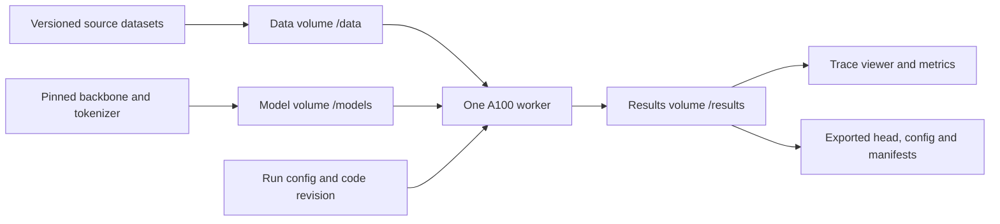

# Decision model research log

Use this log to connect each experiment to a hypothesis, evidence, and a decision.
Replace bracketed fields as work progresses. Planned experiments are not results.

## Objective and constraints

Train a decision model using an open source LLM backbone in PyTorch and Hugging
Face Transformers. Use one Modal A100. Keep every LLM backbone strictly frozen throughout the trial
and train only the decision head. Full fine-tuning, LoRA and all other backbone
adapters are out of scope. Synthetic data generation and synthetic training
corpora are also out of scope; use public data with existing human labels. Evaluate the 11
benchmarks reported for `perplexity-ai/pplx-decider-v1-27b`. Explain improvements
and failures through controlled experiments and trace analysis.

- GPU access window: [start and end, including timezone]
- GPU memory and compute budget: [verified capacity and authorized GPU hours]
- Modal workspace: `ac-worktrials`; profile: `ac-worktrial`; environment: `worktrial-lance`.
- Persistence: version control code/configs/seeds/traces/metrics/documents outside
  Modal; export large tensors locally and verify checksums before resource cleanup.
  Do not revert research code or results when cleaning Modal.
- Primary backbone and immutable revision: [model / commit]
- Training method: strictly frozen backbone; decision-head parameters only, plus
  a scalar temperature fitted on a separate calibration partition.
- Initial architecture: joint schema head; feed-forward and pointer head ablations.
- Initial backbones: Qwen3.5-9B and Qwen3.8-27B, revisions to be pinned.
- Conditional backbones: Gemma 4, all available sizes; Muse Glimmer; Nemotron,
  including eligible MoE checkpoints. Expand after a measured backbone effect.
- Attention lever: native causal versus a feasible attention-mask ablation;
  explicitly track any causal recurrent/convolution paths left unchanged.
- Data constraint: public sources and deterministic typed conversions; no generated
  examples, teacher labels, synthetic training corpora or model-authored distractors.
- Research owner: [name]
- POC: [name and preferred check-in cadence]

## Evaluation contract

Freeze the protocol before comparing runs. Never train or calibrate on datapoints
from the evaluation datasets. Track any benchmark inspection or repeated selection
against benchmark results; use independent development data for iteration.

| Benchmark | Dataset revision and split | Subset IDs / manifest hash | Question type and label mapping | Metric | Status |
| --- | --- | --- | --- | --- | --- |
| WinoGrande | [ ] | [ ] | [ ] | Accuracy | Pending |
| FinancialPhraseBank | [ ] | [ ] | [ ] | Accuracy | Pending |
| RAGTruth | [ ] | [ ] | [ ] | Accuracy | Pending |
| JudgeBench | [ ] | [ ] | [ ] | Accuracy | Pending |
| BBH | [ ] | [ ] | [ ] | Accuracy | Pending |
| JevBench public hard | [ ] | [ ] | [ ] | Accuracy | Pending |
| TabFact | [ ] | [ ] | [ ] | Accuracy | Pending |
| ContractNLI | [ ] | [ ] | [ ] | Accuracy | Pending |
| Circa | [ ] | [ ] | [ ] | Accuracy | Pending |
| Belebele | [ ] | [ ] | [ ] | Accuracy | Pending |
| TruthfulQA binary | [ ] | [ ] | [ ] | Accuracy | Pending |

- Harness revision and prompt templates: [commit / paths]
- Aggregation: [explicit formula, weights, BBH subtask handling]
- Unavailable or failed examples: [denominator and failure policy]
- Uncertainty: [paired bootstrap unit, seed, interval method]
- Calibration: [NLL, Brier score, ECE bin definition; independent calibration split]
- Serving: [batch size, token lengths, warm/cold p50 and p95 latency, throughput,
  peak memory, hardware, precision, repetitions]
- API behavior: [Choice, Noul and ordered Score validation; confidence formulas]
- Reference comparability: [matched protocol or clearly labelled unmatched result]

Reference: [pplx-decider model card](https://huggingface.co/perplexity-ai/pplx-decider-v1-27b).
Its currently reported Overall must be reconciled with the individual rows before
using it as our aggregation target. Archive the source revision used.

## Existing decision models: architectures and reported performance

### Literature review — 2026-10-14

**Evidence status:** Published code, model cards and author-reported results;
none reproduced in this trial. Sources below are mutable release pages accessed
on this date, not pinned experimental artifacts. Pin checkpoint and harness
revisions before running any comparator. “Lana” is interpreted as Laya; OpenJev
names several unrelated implementations, distinguished by owner below.

There is convergence on the interface: state plus natural-language questions and
request-defined options in, typed probabilities out without answer generation.
There is no established consensus on the best backbone, head, attention layout
or training objective. These independent implementations do not establish
TypeSafe's private Jev architecture or reproduce its proprietary training recipe.

### Backbone and decision mechanism

Compatibility below is an engineering assessment, not a measured ablation.
Strictly frozen means the effective backbone is unchanged: training LoRA while
freezing original weights is parameter-efficient adaptation, not head-only
training. Cached features must include the exact question/options and prompt
layout; head-only learning still pays for backbone feature extraction.

| Model / implementation | Underlying pretrained model | Decision architecture and training | Compatibility with a frozen LLM backbone | Source |
| --- | --- | --- | --- | --- |
| Clef 27B | Qwen/Qwen3.8-27B, including vision encoder | Joint schema transformer head over backbone hidden states; evidence routing and joint option/field processing; per-question softmax. Post-trained backbone; head-only training must not be assumed. | Compatible in principle: freeze backbone and train joint head. Larger head and token-level feature cache than a linear readout; published results do not establish head-only quality. | [Card](https://huggingface.co/Cloudflare/clef), [head implementation](https://huggingface.co/Cloudflare/clef/blob/main/joint_schema_model.py) |
| Clef-Flash 9B | Qwen/Qwen3.5-9B, including vision encoder | Smaller multimodal member of the joint schema head family. | Compatible in principle, as for Clef; smaller backbone lowers extraction cost. Freeze vision encoder too if using images. Head-only quality remains untested. | [Card](https://huggingface.co/Cloudflare/clef-flash) |
| pplx-decider-v1-27b | Qwen/Qwen3.8-27B | Final prompt hidden state feeds a bias-free 255-output linear readout initialized from single-token answer-code LM-head rows. Invalid option slots are masked. Released code permits full backbone training. This description is for v1, not v1.1. | Direct fit: freeze backbone and train only the existing linear readout on cached final-position features. Change optimizer/gradient scope; released full-training results do not predict head-only gains. | [Card](https://huggingface.co/perplexity-ai/pplx-decider-v1-27b), [code](https://huggingface.co/perplexity-ai/pplx-decider-v1-27b/blob/main/source/src/autojev/model.py) |
| Kev — jaredpalmer | Current family: Qwen3.5/Qwen3.8; earlier family: Qwen3 | LoRA plus pointer head scoring option representations against a decision representation. Pure-attention bases use question-isolating masks; hybrid bases use independent rows with serving-time prefix reuse, including recurrent state. LoRA and head train together. | Head-only variant is feasible: disable LoRA updates and train pointer head on frozen option/decision features. Active LoRA changes the effective backbone despite frozen base weights, preventing a static feature cache. | [Repository](https://github.com/jaredpalmer/kev) |
| Laya | ModernBERT-large for English; mmBERT-base for multilingual | Bidirectional encoder plus two transformer head layers and option-marker scorer; one score per option's MASK marker, then softmax. Approximately 421M total English parameters and 322M multilingual. Documented recipe fine-tunes encoder and head with proper-scoring-rule reinforcement learning. | Compatible with a frozen encoder, but not a drop-in frozen causal LLM: ModernBERT/mmBERT are bidirectional encoders. Replacing them with a causal LLM requires adapting marker layout/readout and testing evidence visibility. | [Card and architecture](https://huggingface.co/convaiinnovations/laya#architecture) |
| Open-Jev — Zefan-Cai | Qwen3.5 2B/9B and Qwen3.8 27B family | LoRA plus shared scalar candidate head initialized from Yes-minus-No readout. Independent sequence per candidate; normalize across candidates. Soft cross-entropy plus 0.1 Brier; separate calibration temperature. Prefix caching is experimental. | Head-only variant is feasible: omit or freeze LoRA and fit scalar scorer on cached candidate features. Candidate expansion increases extraction cost. Released LoRA results are not frozen-head evidence. | [Repository](https://github.com/Zefan-Cai/Open-Jev) |
| OpenJev-4B — ejhshen / shenjunhao | Text backbone of Qwen/Qwen3.5-4B | Independent option branches plus Option Set Interactor and shared head, designed for permutation equivariance. Full-parameter SFT followed by REINFORCE-Analysis; not a frozen-head recipe. | Compatible in principle: freeze Qwen and train Option Set Interactor/shared head on frozen branch features. Full SFT/RL recipe needs changed optimizer scope; head-only performance is unverified. | [Repository](https://github.com/ejhshen/OpenJev), [card](https://huggingface.co/shenjunhao/OpenJev-4B) |
| Bespoke Nimble 9B, original release | Qwen3.5-9B | Answer-code probabilities from selected LM-head rows, without a new pointer head. Adapter training recipe; CUDA scorer inspected performs independent full-prompt prefill per field. Later v2–v4 releases are distinct checkpoints. | Frozen inference works directly. Head-only learning requires exposing selected LM-head rows as a separate trainable readout or adding a head; adapter training is not a strictly frozen effective backbone. | [Repository](https://github.com/bespokelabsai/nimble), [CUDA scorer](https://github.com/bespokelabsai/nimble/blob/main/nimble/scoring/cuda_scorer.py) |
| djev — Davipar | Google's DiffusionGemma | Compact answer canvas, one denoising read, allowed-token probabilities. Serving method over existing weights, not a newly trained checkpoint. | Already uses unchanged weights for inference. No separate trained head is supplied; head-only learning would require adding a readout. DiffusionGemma is not a drop-in causal-LLM backbone. | [Repository](https://github.com/Davipar/djev-dev) |
| OpenJev — zhihz | Frozen Qwen3-4B-Instruct-2507 | Next-token answer-label scoring without decision-model training. Questions run sequentially and re-encode context in the documented implementation. | Already a frozen-LLM inference baseline. To learn beyond temperature fitting, add a trainable answer-code readout or candidate head; current wrapper does not train one. | [Repository](https://github.com/zhihz/openjev) |

### Performance evidence and comparison boundaries

These results belong to different protocols. Do not rank all rows as one
leaderboard or attribute gains to head architecture alone: backbone capacity,
post-training, data, prompts and evaluation cohorts also differ.

**Perplexity's required 11-benchmark suite.** Its card reports accuracy for Jev,
Qwen3.8-27B and pplx-decider v1; Decider measurements used the Perplexity API.

| Accuracy (%) | Jev | Qwen3.8-27B | pplx-decider-v1-27b |
| --- | ---: | ---: | ---: |
| WinoGrande | 90.70 | 73.10 | 83.30 |
| FinancialPhraseBank | 76.98 | 75.68 | 84.18 |
| RAGTruth | 77.27 | 61.53 | 88.80 |
| JudgeBench | 78.57 | 68.86 | 78.29 |
| BBH | 94.27 | 72.80 | 82.80 |
| JevBench public hard | 73.27 | 72.28 | 70.30 |
| TabFact | 89.80 | 78.60 | 90.60 |
| ContractNLI | 77.45 | 80.78 | 80.78 |
| Circa | 84.60 | 87.00 | 89.20 |
| Belebele | 95.00 | 93.20 | 94.00 |
| TruthfulQA binary | 92.00 | 82.80 | 85.40 |
| Published Overall; aggregation unresolved | 84.51 | 74.76 | 85.71 |
| Our arithmetic mean of the displayed 11 rows | 84.54 | 76.97 | 84.33 |

Source: [Perplexity card](https://huggingface.co/perplexity-ai/pplx-decider-v1-27b).
The mean is our calculation from rounded published values, not a reproduced
evaluation. Exact subsets, conversions and weighting must be established.
Decider improves over the displayed base on many tasks but loses on JevBench
hard; improvement is not uniform.

**Cloudflare's internal Decision Index 0.2.1 run.** Selected rows illustrate
different strengths. Metrics are intentionally preserved, not relabeled accuracy.

| Metric | Clef | Clef-Flash | Jev | DiffusionGemma Jev | Kev 9B | Laya |
| --- | ---: | ---: | ---: | ---: | ---: | ---: |
| BANKING77 macro-F1 (%) | 94.2 | 90.9 | 79.7 | 74.3 | 84.8 | 14.3 |
| ContractNLI macro-F1 (%) | 81.4 | 84.3 | 71.7 | 76.0 | 57.8 | 29.0 |
| WinoGrande accuracy (%) | 93.5 | 97.5 | 92.0 | 73.6 | 73.2 | 50.5 |
| BBH accuracy (%) | 73.7 | 68.9 | 92.9 | 70.7 | 65.2 | 34.1 |
| Request median latency (ms) | 209.3 | 38.8 | 524.1 | 84.4 | 51.4 | 5.8 |

Source: [Cloudflare card](https://huggingface.co/Cloudflare/clef#decision-index).
These are vendor-run observations, not matched A100 measurements. Verify hardware,
serving conditions and checkpoint identities before interpreting speed ratios.
The DiffusionGemma comparator is not proven identical to Davipar's runtime.
ContractNLI F1 here cannot be directly compared with Perplexity's accuracy.

**Other author-reported evaluations.**

- [ejhshen OpenJev-4B](https://huggingface.co/shenjunhao/OpenJev-4B): MMDM hard
  accuracy 85.57% over 4,351 items; hard Brier 0.1864 on the common 4,294-item
  probability cohort; soft Brier 0.0391 on 610 items. JevBench public accuracy
  88.31% over 231 items, including 75.68% on 111 hard items. The card discloses
  that MMDM combines former development/test sets and is not a new blind test.
- [Zefan-Cai Open-Jev 27B v1.1](https://github.com/Zefan-Cai/Open-Jev): public
  JevBench 197/231 (85.28%), hard 80/111 (72.07%). This is its own evaluation;
  do not silently merge it with the ejhshen or Perplexity JevBench protocols.
- [Laya](https://huggingface.co/convaiinnovations/laya): on its 2,000-decision
  typed-decisions evaluation, the English base checkpoint reports 0.362 accuracy
  versus 0.766 for a checkpoint fine-tuned on that benchmark's training split;
  majority-class baseline is 0.461. Its T4 one-question latency is reported as
  39.5 ms English / 32.8 ms multilingual. Domain adaptation and zero-shot transfer
  must be reported separately.
- [Nimble original release](https://github.com/bespokelabsai/nimble): reported
  H100 median 106.0 ms on 120 contrastive-holdout examples; its 324-item M5 Pro
  run reports 444.0 ms. These are distinct cohorts/hardware, not a portable
  serving claim. Later-release Decision Index results need their own records.
- zhihz OpenJev is an untrained scoring baseline; no verified result on the
  required 11-benchmark protocol was found in this review. Davipar djev likewise
  has no reproduced trial result. Missing measurements are not zero scores.

### Implications for the trial

**Decision — 2026-10-14:** Strictly frozen backbones for every experiment. No
full fine-tuning, LoRA or other backbone adaptation. Start with a joint schema
head, compare feed-forward and pointer heads, and use public human-labelled data
converted deterministically to typed decisions. No synthetic training data.
Published competitors' adapted-backbone results remain external comparators;
they are not evidence for the quality of our frozen-head recipe.

Compare Qwen3.5-9B and Qwen3.8-27B under the same joint-head design, training
mixture and development/calibration protocol. Differences mix checkpoint
pretraining/generation and size; do not call this a pure scaling experiment.
Measure trained performance and improvement over each own untrained baseline.
Use paired group-aware intervals and repeated head seeds to distinguish an effect
from example noise or optimization variability.

The provisional backbone expansion gate is at least a 1 percentage point
independent-development task-macro accuracy gain with a paired 95 percent interval
excluding zero and consistent seed direction, or a material calibration/serving
advantage at comparable accuracy. Fill in the latter thresholds before running.
Then investigate verified Gemma 4 sizes, Muse Glimmer and Nemotron/MoE within the
remaining budget. An inconclusive result is not evidence that backbones are equal.
See the [proof-of-concept plan](proof-of-concept.md) for experiment dependencies,
architecture definitions, attention feasibility and training-recipe hypotheses.

Measure option permutations, unrelated-question additions, input length and
option count alongside accuracy, calibration and runtime. A batch of independent
branches is not the same compute cost as encoding a shared state once. Hybrid
backbones require isolation of recurrent/convolution state as well as attention;
an attention mask alone is insufficient. Laya's published sequential layouts
also differ from its optional trained parallel layout, so a head without positional
encoding does not by itself establish order invariance for the complete model.
See [Kev](https://github.com/jaredpalmer/kev) and
[Laya option-order analysis](https://github.com/NandhaKishorM/laya#option-order).

Schema validity, normalized probabilities and calibration are separate properties.
“RLCD” labels different public objectives and implementations; do not infer a
shared proprietary algorithm or guaranteed out-of-domain calibration. Use a
separate calibration fold and matched baselines to test these claims ourselves.

**Probability mapping decision — 2026-10-14:** Keep per-question softmax over
valid answer logits for all three primitives. Clef and pplx-decider use it with
strong published results, so reuse this established approach before investigating
other mappings. Their results support feasibility, not a causal claim that
softmax is the best mapping. Jev's internal parameterization remains unverified.
Retain full distributions; derive Noul, Choice and expected ordinal Score from
them. Loss design and temperature calibration remain separate levers, including
an ordinal-aware loss experiment if Score failures justify it. See the
[output-contract decision](proof-of-concept.md#output-contract) for pinned code
references and implementation requirements.

## Data provenance and separation

**Experiment sequence decision — 2026-10-14:** The first trained experiment
(E1) uses supervised head training followed by temperature scaling. Fit a
positive scalar temperature by minimizing NLL on an independent calibration
partition; evaluate raw and calibrated probabilities on separate development
evaluation items. Follow with RLCD-style tuning of the head's logits, keeping
the backbone frozen. Preregister the reward/objective, update algorithm and
training partition before that follow-up, and compare matched raw and calibrated
results against E1. No benchmark test labels enter either logit tuning or
temperature fitting. This is our proposed sequence, not a verified reproduction
of Jev's proprietary RLCD; the follow-up algorithm remains to be specified.

| Role | Source and revision | License / restrictions | Examples and task mixture | Label construction | Manifest / hash |
| --- | --- | --- | --- | --- | --- |
| Train | [ ] | [ ] | [ ] | [ ] | [ ] |
| Development | [ ] | [ ] | [ ] | [ ] | [ ] |
| Calibration | [ ] | [ ] | [ ] | [ ] | [ ] |
| Final evaluation | [ ] | [ ] | [ ] | [ ] | [ ] |

Record exact and near-duplicate screening, document or source grouping, existing
human annotation provenance, exclusions, and checks against every evaluation
dataset. Synthetic training data and new model-generated labels are out of scope.
Distinguish known exclusions from unknown base-model pretraining contamination.

## System design

See the [training system design](training-system-design.md) and its editable
Excalidraw diagram. Public dataset sources are unspecified. Audit existing public
data with an LLM judge, optionally augmented by algorithmic checks and human
adjudication. Preserve original labels and audit provenance; this does not authorize
synthetic-example generation. Use pinned Nimble converters where available and
persist typed inputs, labels and manifests in the Modal data Volume.

- Dataset preparation and leakage checks: [entrypoint]
- Frozen feature cache: [key includes model, tokenizer, attention mode, layout, precision and data hashes; specify token-level versus pooled storage]
- [ ] Deferred TODO: assess hidden-state caching when repeated head experiments need it; benchmark one shard first and extract the full cache overnight only if warranted. No overnight job is scheduled.
- Model and decision head: [pooling, option representation, trainable parameters]
- Run isolation and checkpoint publishing: [paths and atomic completion marker]
- Observability: Modal resource metrics/container logs; W&B training instrumentation
  and run comparisons; persisted JSONL evaluation traces and artifact metadata.
  Checkpoint weights retain their native binary format. Join with run/checkpoint/
  example IDs; retain timestamps and hashes. Phoenix is out of scope.
- Exports: [JSONL schema, artifact manifest, checkpoint paths and export command]
- One-GPU scheduling and shutdown: [serialization and idle policy]

## Experiment register

**Tracking decision — 2026-10-14:** W&B is the single source of tracking for
experiments: run configuration, training/development metrics, final calibration
results and artifact references. Modal logs/resource diagnostics support execution;
JSONL and checksummed local exports retain durable evidence. They are not separate
experiment trackers. See [E1 implementation](first-experiment-training.md).

**E1 implementation — 2026-10-14:** Supervised frozen-backbone joint-head loop,
temperature fitting, schema adapter, approved grouped splitter and export code
added. W&B is the tracker. Initial data: environment `worktrial-lance`, Volume
`ac-worktrial-training-data`, `/typed-5000-3b3d8db82da7/typed-5000.jsonl`, SHA256
`3b3d8db82da7595565ad48c8cb7da981821097324c151169cf64c4c11fc3ea36`.
The identical local copy passed schema/adapter validation: 5000 records and 5500
fields (3875 Choice, 1000 Noul, 625 Score). The supplied training-point schema is
pinned unchanged. Approval and grouped train/dev/calibration partitions are still
required. CPU checks validate the loop; no GPU training result is claimed.

| Run | Hypothesis / single changed factor | Baseline | Development result | Evaluation status | GPU minutes | Decision |
| --- | --- | --- | --- | --- | --- | --- |
| E0 | Fixed manifests and untrained baselines are reproducible | Same manifest repeated | Planned | Planned | [ ] | Resolve coverage before selection |
| E1 | Joint head learns useful decisions from frozen Qwen3.5-9B features; temperature scaling improves calibration | Untrained Qwen3.5-9B; raw trained-head probabilities | Planned | Planned | [ ] | Inspect learning and raw versus calibrated results |
| E1 follow-up | RLCD-style head-only logit tuning improves decision distributions beyond temperature scaling | E1 temperature-scaled head, with matched data and evaluation | Planned; objective/algorithm TBD | Planned | [ ] | Separate logit-training gains from calibration gains |
| E2 | Frozen backbone choice materially changes transfer quality or cost | Matched joint heads on Qwen3.5-9B and Qwen3.8-27B | Planned | Planned | [ ] | Apply preregistered expansion gate |
| E3 | Routing and option representations matter beyond a feed-forward readout | Joint, feed-forward and pointer heads on one common backbone | Planned | Planned | [ ] | Retain supported accuracy/cost tradeoff |
| E4 | Feasible noncausal full-attention paths improve evidence use | Identical causal checkpoint/head/data protocol | Planned | Planned | [ ] | Audit remaining causal operations |
| E5 | A trace-motivated data or recipe change improves its predicted slice | Best supported head/backbone recipe | Planned | Planned | [ ] | Change one factor and report regressions |
| Conditional | Another verified frozen backbone improves the measured tradeoff | Gemma 4 sizes, Muse Glimmer, Nemotron/MoE | Not scheduled | Not scheduled | [ ] | Requires gate or targeted hypothesis |

## Experiment entry template

### E0a Frozen Qwen3.8 with random joint heads October 14 2026

**Question:** What performance does the original frozen Qwen3.8-27B deliver
through Clef's native joint-head architecture before any head training, and how
sensitive is that result to head initialization?

**Protocol:** Three CPU-FP32 head initializations, seeds 20261014, 20261015 and
20261016, converted to BF16. Original Qwen checkpoint and pinned Clef head code;
no released Clef weights or adaptation. Run all three on the same existing
2,111-example panel spanning the 11 tasks. Backbone inference is shared per row.
The native pretrained lexical prior is retained, so this is not a pure chance
classifier. No head training or calibration fitting occurs.

**Evidence:** [Results table](../outputs/baselines-20261014/results.md).
Detailed [methodology and artifact layout](random-joint-baseline.md) are recorded
separately from the results. Report mean and sample standard deviation across
seed accuracies, not ensemble accuracy.

**Result:** completed 2,111 attempts for each of the three seeds, with 2,110 valid
predictions per seed. One ContractNLI item exceeded the common 8,192-token ceiling.
Coverage-adjusted 11-suite macro accuracy is **44.59 percent ± 1.36 percentage
points** (sample standard deviation across initializations); the individual seed
scores are 43.11, 45.79 and 44.87 percent in saved seed order. Strict complete-valid macro
is withheld; the table also reports valid-only macro accuracy of 44.61 percent. The GPU worker used 23.51 minutes including loading and all heads,
with 54.52 GiB peak allocated memory; backbone parameters were unchanged.

**Interpretation:** this establishes the requested before-training joint-head
control, not the capability of the backbone's original pretrained answer-token
readout. Initialization sensitivity differs by task. Use the same seeds for
matched head-training comparisons and retain the single context rejection in
coverage accounting. No architecture or recipe was selected from these results.

### 2026-10-14 — PPLX v1 model-card discrepancy and protocol hypotheses

The sampled baseline differs from the published PPLX v1 accuracy by more than
three percentage points on five benchmarks (measured minus reported):
TruthfulQA binary 68.00% versus 85.40% (-17.40 pp), Circa 76.50% versus 89.20%
(-12.70 pp), RAGTruth 77.50% versus 88.80% (-11.30 pp), FinancialPhraseBank
92.50% versus 84.18% (+8.32 pp), and ContractNLI 84.50% versus 80.78%
(+3.72 pp). Each measured row uses the frozen 200-example panel. These are
protocol-dependent baseline comparisons, not a verified reproduction of the
publisher's evaluation.

Plausible explanations remain hypotheses: TruthfulQA's independent binary
classification of MC2 candidates may differ from the publisher's unspecified
binary conversion; Circa's fine-grained `goldstandard1` may differ from its
collapsed `goldstandard2`; RAGTruth's mixture of QA, summarization and data-to-text,
response generators, quality filters and interpretation of `implicit_true`
annotations may differ. FinancialPhraseBank's unanimous-agreement subset may
be easier than the broader agreement configurations. ContractNLI uses the
official test split and full contracts; sampling, hypothesis/class mixture or
document presentation could explain its smaller positive difference, but no
specific mismatch is established. Sampling variation applies to every row.

Using the entire eligible source pool under each declared conversion remains
a defensible assumption when no publisher subset is specified: it avoids
selecting an easier subset to match a published score. This describes the
available evaluation pool, not the completed run, which sampled 200 examples
per benchmark (and used all 111 public-hard JevBench examples). Retain the
existing pool definitions and frozen panel; do not choose filters or label
conversions based on which best reproduces the card.

The [PPLX v1 card](https://huggingface.co/perplexity-ai/pplx-decider-v1-27b)
states that its measurements used the Perplexity API, whereas our run used the
pinned released checkpoint locally. We have not found exact IDs/checksums,
conversions or API evaluation prompts for its 11-suite table. Dataset references:
[TruthfulQA](https://github.com/sylinrl/TruthfulQA),
[Circa](https://github.com/google-research-datasets/circa),
[RAGTruth](https://github.com/ParticleMedia/RAGTruth),
[FinancialPhraseBank](https://huggingface.co/datasets/takala/financial_phrasebank),
and [ContractNLI](https://stanfordnlp.github.io/contract-nli/).

### [Run ID and date]

**Question and hypothesis:** [What outcome would support or reject the hypothesis?]

**Motivation:** [Failure traces or prior result motivating this change.]

**Controlled comparison:** [Baseline ID, changed factor, constants, seeds, paired
example/group IDs; preregister practical effect threshold and predicted slice.]

**Reproduction:** [Code commit, clean/dirty state, exact command, config path,
dependency lock or image digest, dataset/model revisions, artifact location.]

**Recipe:** [Head-only trainable parameters and frozen-backbone verification,
public-data mixture, loss, optimizer, learning rates, batch size,
accumulation, steps/epochs, precision, sequence limit, sampling and calibration.]

**Results:** [Per-benchmark and per-development-family metrics and denominators;
raw/calibrated NLL and Brier; paired intervals and seed variability; development
and final test separated; runtime, extraction time, training time and memory.
For MoE include total/active parameters. Record gate outcome before expanding.]

**Failure analysis:** [Representative trace IDs, error groups and counts,
label ambiguity, order sensitivity, truncation and out-of-domain behavior.]

**Interpretation:** [Evidence, alternative explanations, limitations.]

**Decision and next test:** [Keep/reject/inconclusive, with rationale.]

## Research conclusions

- Best supported finding: [claim and experiment IDs]
- Negative result worth explaining: [claim and experiment IDs]
- Measured improvement over starting baseline: [paired result and interval]
- Remaining limitations: [data, evaluation, calibration, serving]
- Final reproduction command and checkpoint: [ ]
- Presentation figures: [accuracy/calibration, latency tradeoff, failure analysis]

### 2026-10-14 — Modal environment correction and cleanup

User directive across sessions: use workspace `ac-worktrials`, profile
`ac-worktrial`, environment `worktrial-lance` for future work. Default profile
environment, export defaults, reproduction commands, global and repo AGENTS.md
now record this. Research code and results are preserved outside Modal.

Exported and verified all 20 result-volume files (1,544,897,454 bytes), including
three initial head tensors whose SHA-256 hashes match the run configs. Existing
local traces/configs matched byte-for-byte. Large tensor archive stays outside
Git at `outputs/modal-archive-20261014`; its checksum manifest is versioned at
`outputs/modal-cleanup-20261014.json`. Both trial-created volumes were deleted
from `ac-worktrial`; all four apps were already stopped with zero tasks. Modal
refused deletion of the empty environment because `lmathias` lacks workspace
manage access. A workspace administrator must remove the remaining environment
entry. No research code or measured results were reverted.

### 2026-10-14 — Why the backbone has no sampling temperature

**Decision and terminology.** E1 computes hidden states from a frozen backbone in
`eval()` mode under `no_grad()`, then trains the joint-schema head. It never calls
a token-generation sampler. A generation temperature rescales next-token logits;
it is not a parameter of this hidden-state forward pass. Therefore the precise
statement is “backbone sampling temperature is inapplicable,” rather than “the
backbone temperature is fixed at zero or one.” Evaluation mode disables dropout;
it does not promise bitwise reproducibility across CUDA kernels or hardware.

**Precedent for frozen features.** Peters et al., *Deep Contextualized Word
Representations* (NAACL 2018), §§2–3.3, freeze the pretrained language-model
weights and feed internal representations into supervised task models. This
supports extracting features without sampling generated answers. ELMo is a
bidirectional LSTM with different downstream models; it is precedent for the
feature-extraction pattern, not evidence that our Qwen/joint-head architecture is
optimal. Keeping E1's feature extractor fixed also isolates the effect of head
training within our compute budget; that is our experimental rationale.
[Primary paper](https://aclanthology.org/N18-1202.pdf).

**Precedent for the head's temperature.** Guo et al., *On Calibration of Modern
Neural Networks* (ICML 2017), §4.2 and §5, explicitly train with T=1 and then fit
a positive scalar on held-out labels by minimizing NLL. Their temperature scaling
uses `softmax(z/T)` and preserves the winning class. This directly supports our
head-training/calibration separation. The paper evaluates vision and document
classification, not our mixed typed-decision workload; transfer of calibration
benefits must be measured. [Primary paper](https://proceedings.mlr.press/v70/guo17a/guo17a.pdf).

**Our protocol and limits.** Select the head by raw development NLL; freeze it;
fit one global T using only the separate calibration partition's observed class
or ordinal-level labels. No annotated confidence targets are needed. Our search
bounds [0.05, 20] and T=1 fallback are implementation choices, not a replication
of the paper's optimizer. Positive T preserves class/level argmax, but can change
expected ordinal scores and their MAE. Report raw and calibrated NLL, Brier and
ECE, plus primitive/source slices; calibration-partition scores are in-sample
fit diagnostics. One scalar may miss differences across sources, option counts
and task types, and held-out calibration does not guarantee transfer under
benchmark distribution shift. No benchmark labels enter temperature fitting.

### 2026-10-14 — E1 calibrated benchmark evaluation

**Experiment E1.** [W&B run `nulun3tv`](https://wandb.ai/lmathias/ac-worktrial-decisions/runs/nulun3tv)
contains the training curves, calibrated test summaries, and a brief run
description covering the setup, selection rule, fitted temperature and test
coverage. The W&B description was saved and read back successfully.

Locked the epoch-2 checkpoint from `e1-qwen35-9b-seed20261014-6f89ea4`
(SHA-256 `3e555fcb36d2ee6eead5b65f91192bced591c3cd913c6a1fbbc7aed2151ca9ec`)
and the independently fitted temperature **T = 0.7951034687010863** before
benchmark evaluation. No benchmark labels were used to fit or select these.
The trained model is frozen Qwen3.5-9B plus a 121,762,820-parameter joint head,
training seed 20261014. Training stopped after four epochs; development NLL
selected epoch 2.

Evaluated all 2,111 frozen panel examples spanning the 11 named tasks: 2,110 valid
outputs and one ContractNLI request rejected by the common 8,192-token limit, with
no truncation. Calibrated suite-macro accuracy is **57.35%** counting that miss as
wrong (**57.38%** valid-only). Macro NLL **0.8638**, Brier **0.5343**, and 15-bin
ECE **0.1560** average the 11 suite metrics. BBH accuracy first averages its
subtasks; BBH probability metrics use its valid examples. These are our existing
sampled-panel results, not full vendor benchmark scores. Only calibrated test
metrics are reported, per user request.

See [per-benchmark calibrated results](../outputs/test/e1-qwen35-9b-test-d4bd899/results.md)
and the updated [baseline comparison](../outputs/baselines-20261014/results.md).
Configs, aggregate results, checksums and completion receipt are in the
test run directory. Full-precision prediction traces are preserved locally in
ignored `outputs/model-artifacts/e1-qwen35-9b-test-d4bd899`, not published. The A100 evaluation took 475.42 seconds and confirmed all
model parameters unchanged. Complete training artifacts, including head and
optimizer tensors, were exported locally and checksum-verified; large tensors
are in ignored `outputs/model-artifacts/e1-complete-verified`, with receipts
and small artifacts versioned under `outputs/training/`.

The Qwen3.8-27B feature-cache job was paused with 1,024 committed records in
16 shards verified present. The unfinished shard may be recomputed. Resume
checks preserve all semantic/runtime settings while permitting physical GPU UUID
changes and preserving prior metadata; its patch and app receipt are in the
test run directory. Evaluation app: `ap-Q3iqnaZKah90WUUzvemhAD`.

Interpretation: this checkpoint still trails the released models on the sampled
panel. Its post-hoc calibration is not a guarantee of reliability: macro ECE is
15.60 percentage points and JudgeBench ECE is 33.94 points. Calibration fitted on
training-source tasks need not transfer to all benchmark domains. The prior
random-head baseline used a different 27B backbone, so its comparison cannot
isolate the causal effect of head training on this 9B model.

Cache restart `ap-Hs26tS2rsRAPdQs5HZoFRq` accepted 1,216 committed records
(the final stop preserved additional shards beyond the initial inspection),
with only the physical GPU UUID differing from the original worker.

### 2026-10-14 — E1-cache: matched cached-feature replication

Purpose: isolate the repeated frozen-backbone forward cost by repeating E1 with
its already-extracted full-token BF16 hidden states. Keep Qwen3.5-9B revision,
5,000 requests, grouped splits, seed 20261014, native head initialization, head
architecture, microbatch/accumulation, AdamW schedule, clipping, epoch limit, early
stopping, development selection and independent temperature fitting unchanged.
The initial head must match E1 SHA-256
`2fe908f8ac0f25f81238b4f4c59b23377dc27665532741483b043a1b99bcf957`
before any optimizer step. No benchmark fitting or retuning is introduced.

Use the complete `nulun3tv-qwen35-9b-3b3d8db82da7` cache: final per-token hidden
states and sparse original output-embedding rows, not pooled/quantized features.
It contains 5,000 records, 5,500 decisions and 2,593,829 tokens. Its extraction
probes found zero cached-versus-live head-logit error and verified head backward.
Verify all file hashes, requests, tokens, question spans, targets and split IDs.
Preload the approximately 21.3 GB cache on the A100 to avoid random shard I/O.

Hypothesis: the same head updates/metrics within numerical reproducibility limits
with lower repeated-training time. A CPU regression test using the real head and
BF16 features produces identical live/cached losses and final head tensors. GPU
bitwise identity is not assumed across hardware/kernels. Record cache loading
and verification separately from training throughput; cache creation is a one-off
cost and must not be hidden in an end-to-end speed comparison. Evaluation and
calibration use their original separate partitions. Completed; results below.

E1-cache completed: [W&B `6zmdgxjx`](https://wandb.ai/lmathias/ac-worktrial-decisions/runs/6zmdgxjx),
[comparison table](../outputs/training/e1-cached-qwen35-9b-seed20261014-057b5b1/comparison.md).
Configuration, split manifest, byte-identical initial head, initial development
metrics, and the batch order/decision counts/LR of all 212 matched steps were
verified equal. The same 13,467 decisions took 2,527.12 seconds in E1 optimizer
windows versus 314.80 seconds cached: **8.03x matched-work speedup** (median paired
throughput speedup 7.51x). Both timings include head forward, backward and optimizer;
this is not a kernel-level forward/backward profile.

Cache verification/GPU loading took 185.83 seconds (3.10 min), separately. Training
plus development evaluations took 403.05 seconds (6.72 min) cached versus 3,953.86
seconds (65.90 min) in E1; those totals are not matched work: the unchanged stopping
rule ended the cached run at epoch 3 / 212 steps, selecting epoch 1, versus E1's
epoch 4 / 282 steps and selected epoch 2. Existing cache extraction reported
1,752.85 seconds (29.21 min), excluding its earlier initialization/metadata work;
it is an additional one-off cost, not included in the speedup.

Calibrated development accuracy: 66.73% cached versus 66.93% E1; NLL 0.8507 versus
0.8645, Brier 0.4409 versus 0.4526, ECE-15 0.0378 versus 0.0722. The same fitting
procedure produced T=0.9673249664 rather than E1's 0.7951034687. Do not interpret
these metric differences as a causal quality benefit of caching: optimization
trajectories were not bitwise identical, despite matching configuration and seed.

A separate trained-head GPU diagnostic covered Noul, Choice, Score and long inputs
(up to 2,508 tokens). All four probes had bit-identical stored/live hidden states,
lexical rows, logits and losses. Maximum cached/live gradient difference was
1.91e-6; repeated live backward also varied (up to 9.54e-7). This supports cache
correctness while directly observing CUDA backward variation; it does not prove
that every trajectory difference has the same cause. The CPU matched-training
fixture produced identical final head tensors. Cache buffers stayed unchanged.

All completed run artifacts, including optimizer/RNG and head tensors, were
exported locally and verified against their checksums. Full metrics/traces and
large tensors remain in ignored `outputs/model-artifacts/`; configurations,
aggregate summaries, parity summary and comparison are versioned. No new benchmark
score is claimed for this training-system replication.

### E2 — v2 cached data, four-record microbatches, five full epochs

Purpose: measure head learning on the normalized v2 six-source public dataset using the frozen Qwen3.5-9B cache. User requested this run after E1-cache. Dataset and batching change together, so differences do not isolate either cause. No benchmark test evaluation is included in this launch.

Protocol: `configs/e2-qwen35-9b-v2-cache.json`; E1 seed 20261014, identical 121,762,820-parameter joint schema head initialization (SHA256 `2fe908f8ac0f25f81238b4f4c59b23377dc27665532741483b043a1b99bcf957`), optimizer, LR, warmup, clipping and effective batch of 64 decisions. Four records per training microbatch; gradient accumulation retains the actual-decision normalization. Run every one of five epochs with early stopping disabled. Continue selecting the checkpoint with lowest validation NLL, then fit a scalar temperature on the calibration partition only. Training for five epochs does not force selection of the fifth-epoch checkpoint.

V2 source SHA256 `338a3584e896a17b011155c066387bb396879dd4a8f539aaf2c86a94fd257fd8`: 2,553 one-decision records (ANLI, HelpSteer2, JEEBench, MultiRC, RACE, ReClor), no Score examples. Use the normalized benchmark request adapter pinned by the cache. Reuse E1's connected group/exact-state partition algorithm and seed: 2,019 train / 262 dev / 272 calibration. User authorization to use v2 is recorded as an attestation, not an independent contamination audit. Cache `/hidden-cache/qwen35-9b-v2-batch4-338a3584e896` was extracted with batch size four; complete manifest SHA256 `b461903e3990adc1bfbbf649b7e5c658f617dee3e76be4e61baead4fbce8d293`. Verify all cache files, token sequences, targets, request hashes and runtime versions before training. E1's batch-one cache and the v2 batch-four cache are different artifacts; numerical equivalence to batch-one extraction is not assumed.

Runtime: Modal workspace `ac-worktrials`, profile `ac-worktrial`, environment `worktrial-lance`, one A100-80GB. Code/config and aggregate results are version controlled; complete checkpoints and traces will be exported with checksums outside Modal.

Launch: [Modal E2](https://modal.com/apps/ac-worktrials/worktrial-lance/ap-ocOOPyNl8VuuDhlh9PQUn2), run `e2-qwen35-9b-v2-cache-seed20261014-18359ca`, code `18359ca`. All 28 local tests passed. Initially queued behind the independently running random-head E1 control on the single A100; no other job was interrupted. Launch receipt: `outputs/training/e2-qwen35-9b-v2-cache-seed20261014-18359ca/launch.json`.
