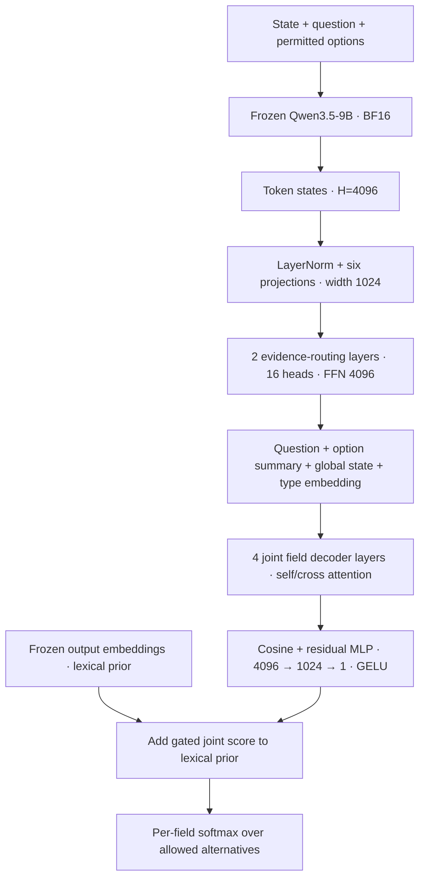
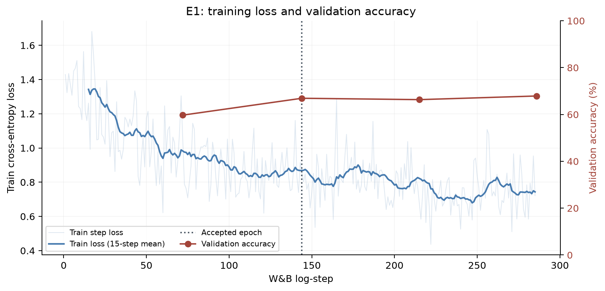
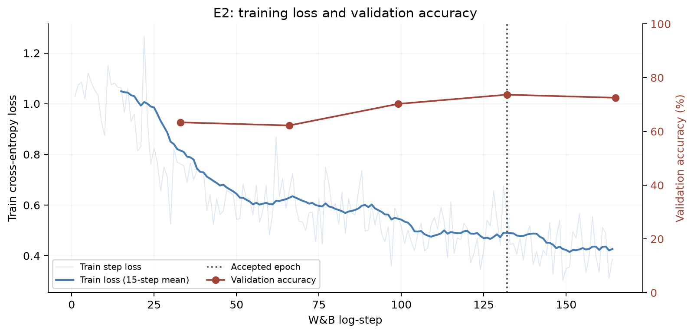
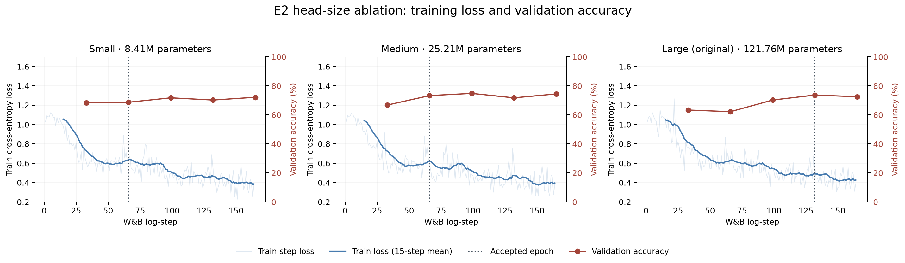
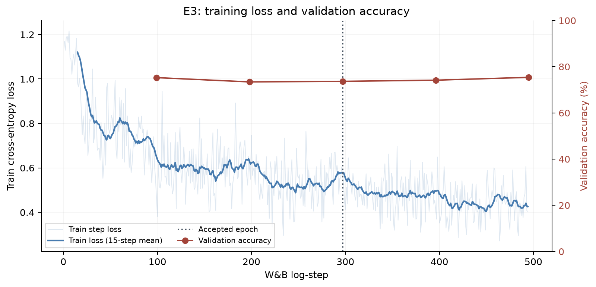
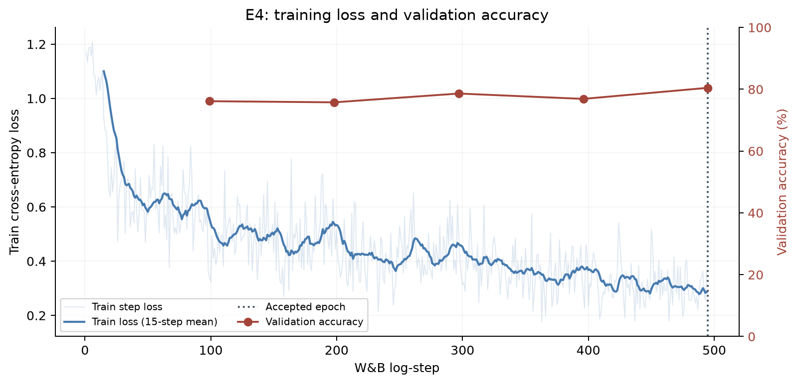
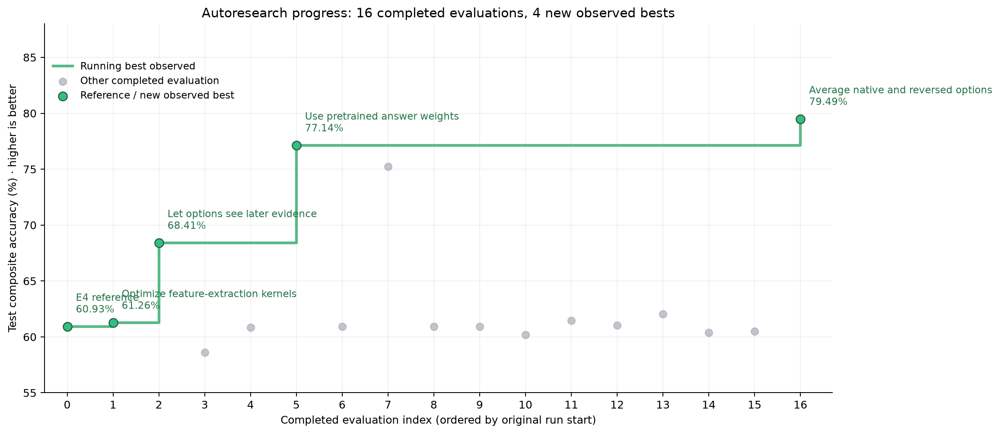
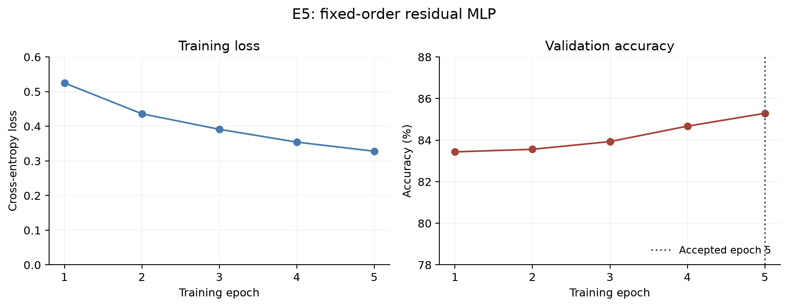
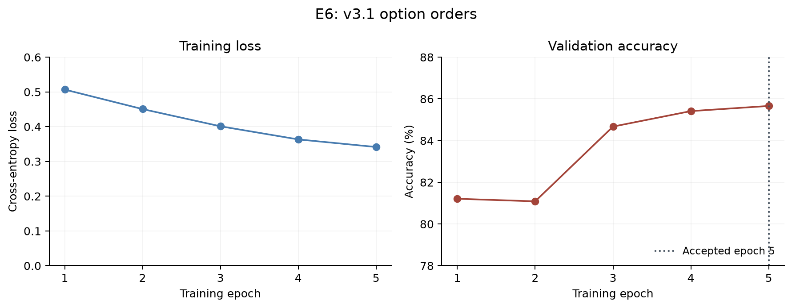

# Decision models with frozen Qwen backbones

Applied Compute work trial · October 14–15, 2026 · Research Narrative

## Guiding Context
In discussing the problem with Bryan, we agreed on the following:
- Backbone fine-tunes were out of scope, focus on improving performance with a frozen backbone. We could vary the frozen LLM backbone
- Generating our own synthetic data is cost-probitive, favor training on publicly available datasets
## Background research
We looked into the following to establish baselines, as well as architecture and training inspiration:
### PPLX v1
- Linear head on top of a fine-tuned Qwen 3.8-27B backbone
- Preprocess inputs to convert answer choices to tokens
- Trains on Choice and Noul data only, **no score examples present in train data**
- Confidence calibration achieved by temperature scaling
### Clef/Clef-flash
  - Large transformer head on top of fine-tuned backbone
  - Trained using both SFT on private synthetic data and RLCD on synthetic data
### Jev
  - Architecture and training unspecified
## Building a common evaluation contract
We assembled a shared panel of 2,111 decisions from the eleven named public
benchmarks, retaining all 111 JevBench public-hard items and selecting 200 from
each other suite without consulting labels. Equal suite weights kept large source
datasets from dominating the comparison, and missing predictions counted as wrong.

The consequential choices were about what each benchmark meant. Vendor subsets
were unspecified, so we had to declare our own: Circa used its unsplit source pool,
while financial sentiment used the unanimous-agreement subset and JudgeBench used
one response cohort. TruthfulQA required a more substantial conversion: we turned
individual candidate answers into binary truth decisions. We also restricted BBH
to tasks with explicit alternatives. These choices made a common decision interface
possible, but limit comparison with published vendor scores. The [benchmark
assembly appendix](#appendix-f--benchmark-assembly-and-conversion-assumptions)
records every split, conversion, exclusion and sampling rule. We then evaluated
all four reference models on this same panel:

| Benchmark | Jev 1.13 | PPLX v1 | CLEF | CLEF Flash |
| --- | ---: | ---: | ---: | ---: |
| BBH | **92.51%** | 81.46% | 75.97% | 69.50% |
| Belebele | **97.50%** | 96.50% | 96.00% | 95.50% |
| Circa | **79.00%** | 76.50% | 74.50% | 77.50% |
| ContractNLI | 78.00% | 84.50% | 84.00% | **85.00%** |
| FinancialPhraseBank | **96.00%** | 92.50% | 92.50% | 94.00% |
| JevBench_public_hard | 72.97% | 72.07% | **74.77%** | 64.86% |
| JudgeBench | **78.50%** | 77.50% | 75.00% | 63.00% |
| RAGTruth | **83.50%** | 77.50% | 76.50% | 65.00% |
| TabFact | 86.50% | **90.50%** | 85.00% | 72.50% |
| TruthfulQA_binary | **88.50%** | 68.00% | 74.50% | 58.00% |
| WinoGrande | 91.00% | 83.00% | 95.00% | **97.50%** |
| **Composite** | **85.82%** | 81.82% | 82.16% | 76.58% |

All scores count missing predictions as wrong; BBH averages subtasks first. Composite weights all eleven suites equally.

Timing fields were recorded, but API and local inference timings are not a controlled serving-speed comparison. These are local sampled-panel scores, not vendor full-benchmark reproductions.

## Establishing what an untrained head already does
- We attached a fresh Clef-style joint transformer head to original frozen Qwen weights. The first random-head run used 27B; the **9B E1-matched control** below was added later to make the comparison to E1 fair.
- The 9B head contains 121,762,820 parameters. Frozen backbone features and lexical output embeddings feed the trainable routing/scoring stack:



- Only the head is trainable. Exact pooling, scoring and precision are in the [architecture appendix reference](joint-head-architecture.md).
- Three independent initializations use seeds **20261014, 20261015 and 20261016**, with FP32 head parameters and BF16 autocast matching E1. The first seed reuses E1's saved initial head. No fitting or temperature calibration occurs; T=1. Seeds, hashes and run artifacts are in the [baseline config](../outputs/baselines-20261014/random-joint-qwen35-9b-e1-matched/config.json), [initial-head receipts](../outputs/baselines-20261014/random-joint-qwen35-9b-e1-matched/initial-head-checksums.json) and [metrics](../outputs/baselines-20261014/random-joint-qwen35-9b-e1-matched/metrics.json).

| Benchmark | Untrained 9B, mean ± SD | PPLX v1 |
| --- | ---: | ---: |
| BBH | 35.29% ± 8.73 | **81.46%** |
| Belebele | 22.17% ± 5.25 | **96.50%** |
| Circa | 0.83% ± 0.29 | **76.50%** |
| ContractNLI | 48.83% ± 2.52 | **84.50%** |
| FinancialPhraseBank | 35.83% ± 11.64 | **92.50%** |
| JevBench_public_hard | 35.44% ± 4.96 | **72.07%** |
| JudgeBench | 55.50% ± 1.50 | **77.50%** |
| RAGTruth | 61.67% ± 7.11 | **77.50%** |
| TabFact | 51.67% ± 1.26 | **90.50%** |
| TruthfulQA_binary | 39.67% ± 3.25 | **68.00%** |
| WinoGrande | 52.00% ± 1.00 | **83.00%** |
| **Composite** | 39.90% ± 3.21 | **81.82%** |

1: All scores count missing predictions as wrong; BBH averages subtasks first. Random-head SD is across three initializations, not a confidence

- This establishes the trained head's starting point before training. At this stage we had not tested Qwen's original answer-token linear readout.

## Experiment 1: Train the original joint head
- **Question:** can supervised training improve the untrained 9B joint head and transfer beyond its training sources?
- **Data:** v1 contains 5,000 public records from twenty sources, 250 per source, chosen to avoid contamination with the test set, and on semantic similarity to the 11 benchmark tasks using LLM judge.  [See v1 dataset release](#v1)
- **Recipe:** [W&B config](https://wandb.ai/lmathias/ac-worktrial-decisions/runs/nulun3tv/overview). Only the head is trained; temperature is fitted on a separate calibration partition.
- **Result:** validation accuracy rises from 32.49% to 66.93%; benchmark composite reaches **57.35%**, versus **39.90% ± 3.21** for the matched untrained head and **81.82%** for PPLX.
- **Training evidence:** the curves below are pulled from the original [W&B run](https://wandb.ai/lmathias/ac-worktrial-decisions/runs/nulun3tv), with the unsampled filtered history saved in the [run evidence appendix](#appendix-g--experiment-run-evidence).


### E1 Test Results
| Benchmark | Untrained 9B, mean ± SD | E1 | PPLX v1  CLEF Flash |
| --- | ---: | ---: | ---: | ---: |
| BBH | 35.29% ± 8.73 | 55.86% | **81.46%** | 69.50% |
| Belebele | 22.17% ± 5.25 | 81.00% | **96.50%** | 95.50% |
| Circa | 0.83% ± 0.29 | 61.00% | 76.50% | **77.50%** |
| ContractNLI | 48.83% ± 2.52 | 53.00% | 84.50% | **85.00%** |
| FinancialPhraseBank | 35.83% ± 11.64 | 48.00% | 92.50% | **94.00%** |
| JevBench_public_hard | 35.44% ± 4.96 | 45.05% | **72.07%** | 64.86% |
| JudgeBench | 55.50% ± 1.50 | 44.50% | **77.50%** | 63.00% |
| RAGTruth | 61.67% ± 7.11 | 66.00% | **77.50%** | 65.00% |
| TabFact | 51.67% ± 1.26 | 56.50% | **90.50%** | 72.50% |
| TruthfulQA_binary | 39.67% ± 3.25 | 60.00% | **68.00%** | 58.00% |
| WinoGrande | 52.00% ± 1.00 | 60.00% | 83.00% | **97.50%** |
| **Composite** | 39.90% ± 3.21 | 57.35% | **81.82%** | 76.58% |

- **Failure analysis:** JudgeBench almost always predicts B, RAGTruth always predicts no hallucination, and finance never predicts negative. ContractNLI also strongly favors entailment. The label distributions do not justify these predictions:

| Benchmark / label | Predicted | Actual gold |
| --- | ---: | ---: |
| JudgeBench / A | 3/200 (1.50%) | 114/200 (57.00%) |
| JudgeBench / B | 197/200 (98.50%) | 86/200 (43.00%) |
| RAGTruth / false | 200/200 (100.00%) | 132/200 (66.00%) |
| RAGTruth / true | 0/200 (0.00%) | 68/200 (34.00%) |
| FinancialPhraseBank / negative | 0/200 (0.00%) | 29/200 (14.50%) |
| FinancialPhraseBank / neutral | 77/200 (38.50%) | 130/200 (65.00%) |
| FinancialPhraseBank / positive | 123/200 (61.50%) | 41/200 (20.50%) |
| ContractNLI / Contradiction | 4/199 (2.01%) | 24/199 (12.06%) |
| ContractNLI / Entailment | 174/199 (87.44%) | 92/199 (46.23%) |
| ContractNLI / NotMentioned | 21/199 (10.55%) | 83/199 (41.71%) |

- **Interpretation:** training loss keeps falling while validation NLL worsens after the accepted epoch, consistent with overfitting. Input representation also differs between training and evaluation, as shown with sample rows from train/val and test sets:

**v1 training record — `ANLI:train_r3:83078`:**

```json
{
  "input": "{\"question\":\"How does the premise relate to the hypothesis?\",\"state\":\"Premise: Breaking Up<br>Tom hated his girlfriend. He kept trying to break up with her. She never really let him. Tom eventually moved away. He ignored her completely.\\nHypothesis: Tom's girlfriend tried breaking up with him\"}",
  "schema": {
    "additionalProperties": false,
    "properties": {
      "decision": {
        "description": "Select exactly one allowed option. Options: {\"option_0\":\"entailment\",\"option_1\":\"contradiction\",\"option_2\":\"neutral\"}",
        "enum": [
          "option_0",
          "option_1",
          "option_2"
        ],
        "type": "string"
      }
    },
    "required": [
      "decision"
    ],
    "type": "object"
  }
}
```

**Benchmark record — `FinancialPhraseBank:0`:**

```json
{
  "state": "According to Gran , the company has no plans to move all production to Russia , although that is where the company is growing .",
  "question": {
    "criteria": {
      "negative": "Negative",
      "neutral": "Neutral",
      "positive": "Positive"
    },
    "instructions": "What is the financial sentiment?",
    "type": "choice"
  }
}
```
## Experiment 2: Normalize the training requests
- **Hypothesis:** matching training requests to benchmark-shaped state/question/criteria inputs should improve semantic binding and reduce the option/description mismatch observed in E1.
- **Data:** v2 uses 2,553 decisions from 6 hand-chosen datasets, normalized to match Jev API syntax. The [v2 dataset release](#v2) records source counts and artifacts.
- **Recipe:** [W&B config](https://wandb.ai/lmathias/ac-worktrial-decisions/runs/ujjzv46h/overview). This run switches to verified cached backbone features; extraction parity is checked separately.
- **Result:** **60.19%** composite, up **2.84 percentage points** from E1. Finance rises from 48.00% to 78.50% and judging from 44.50% to 63.50%, while Circa falls from 61.00% to 34.50%. RAGTruth remains at 66.00%; the saved trace still predicts no hallucination for every item.
- **Interpretation:** normalization plus the changed source mixture improves some transfer failures but does not solve generalization. Since both format and data changed, this does not isolate the effect of normalization alone. Cached extraction is an efficiency change with separate parity checks.



| Benchmark | E1 | E2 | PPLX v1  CLEF Flash |
| --- | ---: | ---: | ---: | ---: |
| BBH | 55.86% | 60.87% | **81.46%** | 69.50% |
| Belebele | 81.00% | 79.00% | **96.50%** | 95.50% |
| Circa | 61.00% | 34.50% | 76.50% | **77.50%** |
| ContractNLI | 53.00% | 59.50% | 84.50% | **85.00%** |
| FinancialPhraseBank | 48.00% | 78.50% | 92.50% | **94.00%** |
| JevBench_public_hard | 45.05% | 47.75% | **72.07%** | 64.86% |
| JudgeBench | 44.50% | 63.50% | **77.50%** | 63.00% |
| RAGTruth | 66.00% | 66.00% | **77.50%** | 65.00% |
| TabFact | 56.50% | 47.50% | **90.50%** | 72.50% |
| TruthfulQA_binary | 60.00% | 62.50% | **68.00%** | 58.00% |
| WinoGrande | 60.00% | 62.50% | 83.00% | **97.50%** |
| **Composite** | 57.35% | 60.19% | **81.82%** | 76.58% |

### Experiment 2.5 — Head-size ablation
- **Hypothesis:** Existing train head is oversized for the task and amount of data supplied
- **Recipe:** W&B configs for [Small](https://wandb.ai/lmathias/ac-worktrial-decisions/runs/mr60nhaa/overview), [Medium](https://wandb.ai/lmathias/ac-worktrial-decisions/runs/nmbnsj7n/overview) and [Large](https://wandb.ai/lmathias/ac-worktrial-decisions/runs/ujjzv46h/overview). All use the same [v2](#v2) splits and frozen features. Hyperparams were set to reasonable baselines given each head's size


| Head | Width | Routing / joint layers | Attention heads | FFN width | Validation NLL | Validation accuracy | Accepted epoch  |
| --- | ---: | ---: | ---: | ---: | ---: | ---: | --- |
| Original (121.76M parameters) | 1,024 | 2 / 4 | 16 | 4,096 | 0.6816 | 73.66% | 4  |
| Medium (25.21M parameters) | 512 | 1 / 2 | 8 | 2,048 | 0.6524 | 73.28% | 2  |
| Small (8.41M parameters) | 256 | 1 / 1 | 4 | 1,024 | 0.6786 | 68.70% | 2  |

- **Decision:** Medium head architecture is chosen for future runs. Run links, configs and accepted checkpoints are in [Appendix G](#appendix-g--experiment-run-evidence).

## Experiment 3: Expand public data with the Medium head
- **Hypothesis:** a wider task mixture and the more economical Medium head may improve transfer beyond the normalized v2 recipe.
- **Data:** v3 expands to 7,928 decisions across 9 hand-picked datasets. Source counts, splits, and schema are linked in the [v3 dataset release](#v3).
- **Recipe:** [W&B config](https://wandb.ai/lmathias/ac-worktrial-decisions/runs/fs233st8/overview). Uses the Medium config selected from the E2 validation comparison.
- **Interpretation:** more public data and a smaller head do not establish a general improvement.



| Benchmark | E2 | E3 | PPLX v1  CLEF Flash |
| --- | ---: | ---: | ---: | ---: |
| BBH | 60.87% | 56.04% | **81.46%** | 69.50% |
| Belebele | 79.00% | 80.50% | **96.50%** | 95.50% |
| Circa | 34.50% | 31.50% | 76.50% | **77.50%** |
| ContractNLI | 59.50% | 66.00% | 84.50% | **85.00%** |
| FinancialPhraseBank | 78.50% | 80.50% | 92.50% | **94.00%** |
| JevBench_public_hard | 47.75% | 42.34% | **72.07%** | 64.86% |
| JudgeBench | 63.50% | 65.00% | **77.50%** | 63.00% |
| RAGTruth | 66.00% | 66.00% | **77.50%** | 65.00% |
| TabFact | 47.50% | 47.00% | **90.50%** | 72.50% |
| TruthfulQA_binary | 62.50% | 63.50% | **68.00%** | 58.00% |
| WinoGrande | 62.50% | 60.00% | 83.00% | **97.50%** |
| **Composite** | 60.19% | 59.85% | **81.82%** | 76.58% |

## Experiment 4: Larger frozen backbone and explicit selection
- **Hypothesis:** features from Qwen3.8-27B rather than 9B may improve performance based on score delta between Clef vs. Clef-flash (both use roughly same size head and training recipe but different backbones)
- **Data and head:** reuse [v3 dataset](#v3)
- **Recipe:** [W&B config](https://wandb.ai/lmathias/ac-worktrial-decisions/runs/7j1ijakt/overview). The kernel-optimization follow-up belongs to [autoresearch](#autoresearch-summary).
- **Result:** E4 reaches **60.93%**, **1.08 points** above E3.
- **Interpretation:** scaling alone does not approach the reference models.
- Switched to **Validation accuracy** instead of **Validation NLL** as the promotion criteria, as high confidence is not rewarded in the benchmarks.

| Benchmark | E3 | E4  | PPLX v1 |
| --- | ---: | ---: | ---: |
| BBH | 56.04% | 58.70% | **81.46%** |
| Belebele | 80.50% | 89.00% | **96.50%** |
| Circa | 31.50% | 62.00% | **76.50%** |
| ContractNLI | 66.00% | 52.00% | **84.50%** |
| FinancialPhraseBank | 80.50% | 47.00% | **92.50%** |
| JevBench_public_hard | 42.34% | 58.56% | **72.07%** |
| JudgeBench | 65.00% | 70.50% | **77.50%** |
| RAGTruth | 66.00% | 62.50% | **77.50%** |
| TabFact | 47.00% | 51.50% | **90.50%** |
| TruthfulQA_binary | 63.50% | 45.50% | **68.00%** |
| WinoGrande | 60.00% | 73.00% | **83.00%** |
| **Composite** | 59.85% | 60.93% | **81.82%** |


Exact histories, run links and selection receipts are in [Appendix G](#appendix-g--experiment-run-evidence).


## Autoresearch summary
| What was tested | Verdict | W&B |
| --- | --- | --- |
| Speed up frozen-backbone feature extraction with optimized kernels. | Adopted as a distinct numerical runtime: about 1.55–1.57× warm extraction throughput; strict parity fails, so features are regenerated. Test composite score is not signifantly affected. | [run](https://wandb.ai/lmathias/ac-worktrial-decisions/runs/2ouo1e3l) |
| Remove causal masks so full attention layers are bidirectional. | Promising: 68.41%, +7.15 points versus the optimized-kernel control; recurrent paths remain causal; one seed. | [run](https://wandb.ai/lmathias/ac-worktrial-decisions/runs/dyjus5wh) |
| Repeat the same training to check numerical stability. | Automatic-backend repeats diverge (58.60% / 60.85%); math-backend repeats match at 60.93%. | [run](https://wandb.ai/lmathias/ac-worktrial-decisions/runs/ud99ptl5) |
| Add the same amount of fresh data from existing sources. | Matched source-screen control: 60.93%; comparator for the next six additions. | [run](https://wandb.ai/lmathias/ac-worktrial-decisions/runs/ud99ptl5) |
| Add examples of reasoning over explicit rules (RuleTaker). | No demonstrated gain: 60.93%, +0.01 point versus matched control. | [run](https://wandb.ai/lmathias/ac-worktrial-decisions/runs/df2fil2b) |
| Add safety decisions where true means unsafe (Aegis2). | Rejected: 60.20%, −0.73 point versus control. | [run](https://wandb.ai/lmathias/ac-worktrial-decisions/runs/4acn895m) |
| Add toxicity judgements (CivilComments). | Not advanced: 61.45%, +0.52 point; screening thresholds not met. | [run](https://wandb.ai/lmathias/ac-worktrial-decisions/runs/nastxy6m) |
| Add three-way entailment examples (SNLI + MultiNLI). | Not advanced: 61.05%, +0.12 point; contradiction collapse persists. | [run](https://wandb.ai/lmathias/ac-worktrial-decisions/runs/l4nad696) |
| Add many-option intent classification (MASSIVE). | Passed screen: 62.04%, +1.11 points; independent-seed confirmation still needed. | [run](https://wandb.ai/lmathias/ac-worktrial-decisions/runs/hqwshgo4) |
| Add banking intent examples (BANKING77). | Rejected: 60.38%, −0.55 point versus control. | [run](https://wandb.ai/lmathias/ac-worktrial-decisions/runs/1npt61ie) |
| Clarify that missing rule support should count as false. | Rejected: 60.52%, −0.42 point versus original RuleTaker. | [run](https://wandb.ai/lmathias/ac-worktrial-decisions/runs/62h35cer) |
| Read answers through the model’s pretrained answer-letter weights. | Kept as a stronger baseline: 77.14%, without head training. | [run](https://wandb.ai/lmathias/ac-worktrial-decisions/runs/rahruwds) |
| Mix the trained head and pretrained readout equally. | Rejected: 75.24%, below the pretrained readout despite passing its validation gate. | [run](https://wandb.ai/lmathias/ac-worktrial-decisions/runs/6spap1d0) |
| Fit a Boolean-specific probability offset. | Rejected at validation gate: +0.99 point overall, below the +1-point threshold; no test score. | [run](https://wandb.ai/lmathias/ac-worktrial-decisions/runs/rahruwds) |
| Average predictions from original and reversed option orders. | Best completed recipe: 79.49%, +2.35 points versus native readout. | [run](https://wandb.ai/lmathias/ac-worktrial-decisions/runs/6djekmw2) |
| Allow a short internal reasoning pass before reading the answer. | Validation gate passed; original handoff lacks a sealed complete test score. | [run](https://wandb.ai/lmathias/ac-worktrial-decisions/runs/oju7lzc8) |
| Prepare few-shot prompts, selective reasoning and further data/seed controls. | Prepared or rejected before model evaluation; no new benchmark score. | No standalone model run; [record](overnight-research-log.md) |
| Reuse cached features and warm workers; add paired and collapse diagnostics. | Operational checks passed; efficiency/measurement work, not independent quality gains. | No standalone model run; [record](overnight-research-log.md) |


Repeated use of this panel makes the curve exploratory;
most conditions have one seed. [Point values, order and W&B links](../outputs/handoff/autoresearch-progress.json).

## Autoresearch Conclusions
- Re-introducing new data domains from the v1 dataset did **not** seem to resolve class collapse issues in tests.
- Removing causal masks (for bidirectional-like attention) does not significantly improve performance on its own
- Directly forming decisions off of raw base model logits performed well
- Order of choices influences final result
## Raw Readouts on Different Models
- **Readout** = 1 causal pass through the frozen model, scores the allowed answer-letter tokens with its pretrained output layer, and normalizes those logits over the supplied options.
- **+ reverse** adds a 2nd pass with reversed options and reassigned letters, maps both distributions back to semantic option IDs, averages their probabilities equally before temperature calibration.
- POC allows only 26 options; identified 255 unique tokens for full parity with Jev API. [Full scaffold and token audit](#appendix-h--readout-prompt-scaffold-and-token-audit).

| Benchmark           | Qwen3.5-9B readout | Qwen3.8-27B readout | Qwen3.5-9B + reverse | Qwen3.8-27B + reverse |
| ------------------- | ---------- | ----------- | ------------ | ------------- |
| BBH                 | 62.92      | 75.42       | 63.83        | 75.42         |
| Belebele            | 92.00      | 96.50       | 94.00        | 96.00         |
| Circa               | 60.00      | 73.50       | 66.00        | 77.50         |
| ContractNLI         | 78.00      | 79.00       | 78.00        | 80.50         |
| FinancialPhraseBank | **94.50**  | 83.00       | **94.00**    | 81.50         |
| JevBench hard       | 65.77      | 72.07       | 63.06        | 72.97         |
| JudgeBench          | 63.00      | 76.00       | 67.00        | 77.50         |
| RAGTruth            | 52.00      | 72.00       | 56.00        | 76.50         |
| TabFact             | 72.00      | 73.00       | 72.00        | 83.00         |
| TruthfulQA          | 67.50      | 69.50       | 70.00        | 72.50         |
| WinoGrande          | 67.50      | 78.50       | 66.50        | 81.00         |
| **Macro**           | **70.47**  | **77.14**   | **71.85**    | **79.49**     |

## Experiment 5: Small classification head on backbone logits
- **Hypothesis:** a small nonlinear residual head can preserve pretrained answer knowledge while learning corrections from public decision data.
- **Data and head:** [v3](#v3)
- **Recipe:** [W&B config](https://wandb.ai/lmathias/ac-worktrial-decisions/runs/c09mctl9/overview)
- **Interpretation:** a skip connection to pretrained logits did not preserve their transfer performance after training. This is a single-seed, exploratory result on the repeatedly observed test panel.



| Benchmark | Frozen pretrained readout | E5: fixed-order residual MLP | Δ points |
| --- | ---: | ---: | ---: |
| BBH | **75.42%** | 69.93% | -5.50 |
| Belebele | **96.50%** | 96.00% | -0.50 |
| Circa | **73.50%** | 63.50% | -10.00 |
| ContractNLI | **79.00%** | 69.50% | -9.50 |
| FinancialPhraseBank | **83.00%** | 67.50% | -15.50 |
| JevBench_public_hard | **72.07%** | 71.17% | -0.90 |
| JudgeBench | 76.00% | **77.50%** | +1.50 |
| RAGTruth | **72.00%** | 34.50% | -37.50 |
| TabFact | 73.00% | **78.50%** | +5.50 |
| TruthfulQA_binary | 69.50% | **74.00%** | +4.50 |
| WinoGrande | **78.50%** | 72.50% | -6.00 |
| **Composite** | **77.14%** | 70.42% | -6.72 |

## Experiment 6: Option orders

- **Hypothesis:** exposing the residual head to different option positions can improve transfer over fixed-order training.
- **Data:** [v3.1 cached-permutation views](#v31), combined with the original v3 training views. Validation and calibration partitions remain unchanged.
- **Recipe:** [W&B config](https://wandb.ai/lmathias/ac-worktrial-decisions/runs/28lh244a/overview). Both E5 and E6 are evaluated in native option order; this is separate from averaging native and reversed orders at inference.
- **Result:** **75.91%** test composite, up **5.49 points** from E5’s **70.42%**, but below the frozen pretrained readout’s **77.14%**. Circa improved by 20 points; finance and RAGTruth each improved by 11 points.
- **Failure analysis:** RAGTruth remained weak at 45.50%, below its 66% majority-class baseline.
- **Interpretation:** this single-seed contrast changes augmentation, Choice sampling weight and compute together. Choice examples receive twice the weight relative to Noul examples, and five epochs yield 920 updates rather than 490. The gain cannot be attributed to permutation augmentation alone.
- **Scope:** human-directed; only the v3.1 cached-permutation run. It supersedes the terminated per-epoch-shuffling attempt.



| Benchmark | E5: fixed-order baseline | E6: v3.1 option orders | Δ points |
| --- | ---: | ---: | ---: |
| BBH | 69.93% | **71.98%** | +2.05 |
| Belebele | **96.00%** | 95.50% | -0.50 |
| Circa | 63.50% | **83.50%** | +20.00 |
| ContractNLI | 69.50% | **70.50%** | +1.00 |
| FinancialPhraseBank | 67.50% | **78.50%** | +11.00 |
| JevBench_public_hard | 71.17% | **77.48%** | +6.31 |
| JudgeBench | **77.50%** | 76.00% | -1.50 |
| RAGTruth | 34.50% | **45.50%** | +11.00 |
| TabFact | 78.50% | **83.00%** | +4.50 |
| TruthfulQA_binary | 74.00% | **77.50%** | +3.50 |
| WinoGrande | 72.50% | **75.50%** | +3.00 |
| **Composite** | 70.42% | **75.91%** | +5.49 |

Accuracy on the same 2,111-example, 11-suite panel; missing predictions count as wrong. BBH averages sampled subtasks; the composite equally weights suites. Bold marks the highest score per row, including ties. [Exact values and source checksum](../outputs/handoff/experiments-5-6-test-scores.json).

## Experiment 7: PPLX recipe replication attempt
We tested whether adapting PPLX’s released training recipe could improve on the frozen 9B readout. This human-directed attempt trained the full Qwen3.5-9B model and its pretrained-initialized linear decision readout, departing from the earlier frozen-backbone experiments. The [W&B config](https://wandb.ai/lmathias/ac-worktrial-decisions/runs/n9t3qp79/overview) records the recipe. Because the curated training corpus is unpublished, we sampled 10,000 rows from the released public-data reconstruction, retaining 99 generated-image examples already produced by its builder. We also used fresh Jev validation predictions for the recipe’s selection reference. [Construction records and locations](#appendix-i--experiment-7-construction-and-artifact-locations).

- **Hypothesis:** adapting PPLX’s released training recipe can improve on the frozen 9B pretrained readout.
- **Data:** 10,000 rows sampled from the public reconstruction, including 99 generated-image examples already produced by its builder. The curated corpus is unpublished; no numbered dataset version is assigned. [Construction, provenance and artifact locations](#appendix-i--experiment-7-construction-and-artifact-locations).
- **Recipe:** [W&B config](https://wandb.ai/lmathias/ac-worktrial-decisions/runs/n9t3qp79/overview). Full-weight Qwen3.5-9B training with a pretrained-initialized linear decision readout, two epochs and fresh Jev validation predictions for the recipe’s selection reference. This human-directed experiment departs from the earlier frozen-backbone constraint.
- **Result:** all **80 planned updates** completed. Test composite reached **74.25%**, up **3.78 points** from the frozen 9B readout’s **70.47%**, but below the released PPLX 27B model’s **81.82%**. The validation-selected and terminal checkpoints were identical, so their test evaluation was reused.
- **Failure analysis:** JevBench hard fell from 65.77% to 52.25%, and TruthfulQA fell from 67.50% to 54.50%, despite improvements on the other nine suites.
- **Interpretation:** this modified replication changes model size, training sample, epoch count and reference predictions relative to the release. One seed on the repeatedly observed panel cannot isolate which recipe components caused the change or establish reproduction of the published result.

| Benchmark | Frozen 9B readout | E7: PPLX recipe attempt | Released PPLX 27B  CLEF Flash |
| --- | ---: | ---: | ---: | ---: |
| BBH | 62.92% | 68.00% | **81.46%** | 69.50% |
| Belebele | 92.00% | 95.00% | **96.50%** | 95.50% |
| Circa | 60.00% | **84.50%** | 76.50% | 77.50% |
| ContractNLI | 78.00% | 81.00% | 84.50% | **85.00%** |
| FinancialPhraseBank | 94.50% | **95.00%** | 92.50% | 94.00% |
| JevBench_public_hard | 65.77% | 52.25% | **72.07%** | 64.86% |
| JudgeBench | 63.00% | 69.00% | **77.50%** | 63.00% |
| RAGTruth | 52.00% | 64.00% | **77.50%** | 65.00% |
| TabFact | 72.00% | 79.00% | **90.50%** | 72.50% |
| TruthfulQA_binary | 67.50% | 54.50% | **68.00%** | 58.00% |
| WinoGrande | 67.50% | 74.50% | 83.00% | **97.50%** |
| **Composite** | 70.47% | 74.25% | **81.82%** | 76.58% |

## Appendices

- [Appendix A: Figures and source references](#appendix-a)
- [Appendix B: Artifacts and reproduction links](#appendix-b--reproduction-and-artifact-references)
- [Appendix C: Immutable model pins](#appendix-c--immutable-model-pins)
- [Appendix D: Codebase and commits](#appendix-d--codebase-and-commit-history)
- [Appendix E: Dataset releases](#appendix-e--dataset-releases)
- [Appendix F: Benchmark sources and conversions](#appendix-f--benchmark-assembly-and-conversion-assumptions)
- [Appendix G: W&B run/config links](#appendix-g--experiment-run-evidence)
- [Appendix H: Readout prompt scaffold and token audit](#appendix-h--readout-prompt-scaffold-and-token-audit)
- [Appendix I: Experiment 7 construction and artifact locations](#appendix-i--experiment-7-construction-and-artifact-locations)

---

<a id="appendix-a"></a>

## Appendix A: Figures and source references

| Figure | Link |
| --- | --- |
| Joint head diagram | [figure](#establishing-what-an-untrained-head-already-does) |
| E1 train loss / validation accuracy | [figure](../outputs/handoff/figures/e1-wandb-loss.png) |
| E2 train loss / validation accuracy | [figure](../outputs/handoff/figures/e2-wandb-loss.png) |
| E2 Small / Medium / Large curves | [figure](../outputs/handoff/figures/e2-head-ablation-curves.png) |
| E3 train loss / validation accuracy | [figure](../outputs/handoff/figures/e3-wandb-loss.png) |
| E4 train loss / validation accuracy | [figure](../outputs/handoff/figures/e4-wandb-loss.png) |
| E5 train loss / validation accuracy | [figure](../outputs/handoff/figures/e5-wandb-loss.png); [history](../outputs/handoff/report-evidence/e5-wandb-history.json); [plotted points](../outputs/handoff/report-evidence/e5-training-curve.json) |
| E6 train loss / validation accuracy | [figure](../outputs/handoff/figures/e6-wandb-loss.png); [history](../outputs/handoff/report-evidence/e6-wandb-history.json); [plotted points](../outputs/handoff/report-evidence/e6-training-curve.json) |
| Autoresearch progress | [figure](../outputs/handoff/figures/autoresearch-progress.png) |
| Completed recipes | [figure](../outputs/handoff/figures/completed-recipes.png) |
| Task transfer | [figure](../outputs/handoff/figures/task-transfer.png) |

| Source / specification | Reference |
| --- | --- |
| PPLX implementation | [reference](https://huggingface.co/perplexity-ai/pplx-decider-v1-27b/blob/d8c3bd18e31dc1804433d38528b3e770019bf00c/source/src/autojev/model.py) |
| Clef implementation | [reference](https://huggingface.co/Cloudflare/clef/blob/0b331204bb13fbd2ca93a64df1956f5b55478ce5/joint_schema_model.py) |
| Head architecture | [reference](joint-head-architecture.md) |
| Native answer readout | [reference](native-readout-design.md) |
| Bidirectional full attention | [reference](autoresearch-attention-bidir-results.md) |
| Historical hypothesis journal | [reference](overnight-research-log.md) |

## Appendix B — Reproduction and artifact references

| Reference | Location |
| --- | --- |
| Experiment tracker | [reference](https://wandb.ai/lmathias/ac-worktrial-decisions) |
| W&B handoff | [reference](https://wandb.ai/lmathias/ac-worktrial-decisions/runs/handoff20261015) |
| Accepted checkpoints | [reference](accepted-checkpoints.md) |
| Run / artifact index | [reference](../outputs/handoff/run-index.json) |
| Modal archive receipt | [reference](../outputs/handoff/modal-archive.json) |
| Final artifact receipt | [reference](../outputs/handoff/final-artifacts.json) |
| Preserved datasets | [reference](../outputs/handoff/preserved-datasets.json) |
| Descriptive resource names | [reference](resource-names.md) |
| Legacy identifier aliases | [reference](../configs/resource-aliases.json) |
| Modal alias verification | [reference](../outputs/handoff/modal-resource-aliases.json) |
| W&B name verification | [reference](../outputs/handoff/wandb-resource-renames.json) |
| Naming / unchanged-results checks | [reference](../outputs/handoff/resource-naming-verification.json) |
| Reproduction commands | [reference](reproduce-handoff.md) |

| Modal / artifact field | Name / reference |
| --- | --- |
| Workspace | `ac-worktrials` |
| Profile | `ac-worktrial` |
| Environment | `worktrial-lance` |
| Training text volume | `ac-worktrial-training-data` |
| Checkpoints / feature-view volume | `ac-worktrial-training-results` |
| Checkpoint scope | Accepted checkpoint per run |
| Other saved states | [original run directories](../outputs/handoff/run-index.json) |

## Appendix C — Immutable model pins

| Component | Revision | Source |
| --- | --- | --- |
| Qwen3.5-9B | `c202236235762e1c871ad0ccb60c8ee5ba337b9a` | [source](https://huggingface.co/Qwen/Qwen3.5-9B/tree/c202236235762e1c871ad0ccb60c8ee5ba337b9a) |
| Qwen3.8-27B | `1d4bf0f2ff6012fd82039f2fa52739d0dd7c60c0` | [source](https://huggingface.co/Qwen/Qwen3.8-27B/tree/1d4bf0f2ff6012fd82039f2fa52739d0dd7c60c0) |
| Clef head source | `0b331204bb13fbd2ca93a64df1956f5b55478ce5` | [source](https://huggingface.co/Cloudflare/clef/tree/0b331204bb13fbd2ca93a64df1956f5b55478ce5) |
| PPLX decider v1 | `d8c3bd18e31dc1804433d38528b3e770019bf00c` | [source](https://huggingface.co/perplexity-ai/pplx-decider-v1-27b/tree/d8c3bd18e31dc1804433d38528b3e770019bf00c) |
| Clef Flash | `8b2e5fd17c09fd49bc2880b805d5323ec7ff4ff3` | [source](https://huggingface.co/Cloudflare/clef-flash/tree/8b2e5fd17c09fd49bc2880b805d5323ec7ff4ff3) |

| Reference | Location |
| --- | --- |
| Training-source pins | [pins](../configs/training-source-pins.json) |
| Training dependencies | [requirements](../requirements-training.txt) |
| Kernel dependencies | [requirements](../requirements-kernels.txt) |
| Per-run runtime / GPU metadata | [W&B configs](#appendix-g--experiment-run-evidence) |

## Appendix D — Codebase and commit history

| Name | Location / reference |
| --- | --- |
| Published delivery branch | `main` |
| Research handoff | `deliverables/research-handoff` |
| Focused delivery | `deliverables/accepted-model` |
| Attention experiment | `autoresearch/attention-bidirectional` |
| Preservation refs | `preservation/20261015-*` |
| Branch tips | [inventory](../outputs/handoff/run-index.json) |
| Preprocessing | [preprocess_benchmarks.py](../scripts/preprocess_benchmarks.py) |
| Training | [train_joint.py](../scripts/train_joint.py); [cached training launcher](../scripts/modal_train_cached_joint.py) |
| Native / pooled readout | [pretrained_readout.py](../scripts/pretrained_readout.py); [readout_order_pool.py](../scripts/readout_order_pool.py) |
| Attention launcher | [modal_attention_bidir.py](https://github.com/lancemathias/ac-work-trial/blob/deliverables/research-handoff/scripts/modal_attention_bidir.py) |
| Reporting | [report_overnight_benchmarks.py](../scripts/report_overnight_benchmarks.py) |

| Commit | Change |
| --- | --- |
| [7588454](https://github.com/lancemathias/ac-work-trial/commit/7588454) | Initial research documents |
| [025aca3](https://github.com/lancemathias/ac-work-trial/commit/025aca3) | Four-model sampled baseline and calibration/cost audit |
| [bf364b7](https://github.com/lancemathias/ac-work-trial/commit/bf364b7) | Three-seed frozen 27B joint-head baseline |
| [9a72a35](https://github.com/lancemathias/ac-work-trial/commit/9a72a35) | E1-matched three-seed 9B random baseline |
| [0d321e2](https://github.com/lancemathias/ac-work-trial/commit/0d321e2) | Completed E2 training and locked evaluation |
| [589524a](https://github.com/lancemathias/ac-work-trial/commit/589524a) | Published E3 benchmark comparison |
| [9e77b62](https://github.com/lancemathias/ac-work-trial/commit/9e77b62) | Accuracy-selected E4 recovery |
| [8e1b40c](https://github.com/lancemathias/ac-work-trial/commit/8e1b40c) | Adopted optimized numerical runtime |
| [af59dc3](https://github.com/lancemathias/ac-work-trial/commit/af59dc3) | Verified suffix influence under the attention intervention |
| [02096dd](https://github.com/lancemathias/ac-work-trial/commit/02096dd) | Full math-backend repeatability gate and source-screen continuation |
| [67db897](https://github.com/lancemathias/ac-work-trial/commit/67db897) | Negative RuleTaker semantic-repair result |
| [6593ae1](https://github.com/lancemathias/ac-work-trial/commit/6593ae1) | Passed 27B option-order pooling dev gate |
| [2e7a58c](https://github.com/lancemathias/ac-work-trial/commit/2e7a58c) | Verified 79.49% recipe and bounded-thinking budget amendment |
| [366fe8a](https://github.com/lancemathias/ac-work-trial/commit/366fe8a) | Residual readout option-order experiment |

## Appendix E — Dataset releases

### v1

| Field | Value / reference |
| --- | --- |
| Release | Typed JSONL; 5,000 records / 5,500 decisions |
| Composition | 250 records each: ANLI, ARC, Aegis2, BANKING77, CivilComments, GSM8K, HelpSteer2, MASSIVE, MCScript2, MCTest, MultiNLI, MultiRC, PubMedQA, RACE, ReClor, RuleTaker, SNLI, SST2, SciQ, WIQA |
| Primitives | 3,875 Choice; 1,000 Noul; 625 Score |
| Partitions | [split manifest](../outputs/training/e1-qwen35-9b-seed20261014-6f89ea4/manifest.json) |
| Schema | [training-point.schema.json](../configs/training-point.schema.json) |
| Input fields | `model_payload.input`; `model_payload.schema` |
| Audit / target fields | `gold`; `field_types`; `native_source`; `transformation_trace` |
| Sampling / conversion | [sample IDs](../outputs/handoff/report-evidence/sample-5000.json); [conversion](../outputs/handoff/report-evidence/typed-5000.json); [schema validation](../outputs/handoff/report-evidence/typed-validation.json) |
| Upstream provenance | [per-source receipts](../outputs/handoff/report-evidence/); [source pins](../configs/training-source-pins.json) |
| Native / constructed labels | Native source targets; deterministic GSM8K numeric alternatives; ordered HelpSteer2 ratings |
| SHA-256 | `3b3d8db82da7595565ad48c8cb7da981821097324c151169cf64c4c11fc3ea36` |
| Modal volume | `ac-worktrial-training-data` |
| Modal path | `/typed-5000-3b3d8db82da7/typed-5000.jsonl` |

### v2

| Field | Value / reference |
| --- | --- |
| Release | Normalized JSONL; 2,553 records / decisions |
| Parent / additions | 1,303-record normalized parent + 1,250 additions |
| Composition | ANLI, RACE, ReClor, MultiRC, HelpSteer2: 500 each; JEEBench: 53 |
| Primitives | 2,053 Choice; 500 Noul; 0 Score |
| Schema | [normalized-training.schema.json](../configs/normalized-training.schema.json) |
| Input / target separation | `state` + `question` → `questions.q`; `label` / provenance excluded |
| Adapter | [benchmark_training_data.py](../scripts/benchmark_training_data.py) |
| Manifest / provenance | [release](../outputs/handoff/report-evidence/dataset-v2.json); [expansion audit / selected IDs](../outputs/handoff/report-evidence/dataset-v2-expansion-audit.json) |
| Partition receipts | [E2 split manifest](../outputs/training/e2-qwen35-9b-v2-cache-seed20261014-18359ca/config.json) |
| SHA-256 | `338a3584e896a17b011155c066387bb396879dd4a8f539aaf2c86a94fd257fd8` |
| Modal volume | `ac-worktrial-training-data` |
| Modal path | `/dataset-v2-338a3584e896/train-v2.jsonl` |

### v2.1

| Field | Value / reference |
| --- | --- |
| Release | Normalized JSONL; 5,053 records / decisions |
| Parent / additions | [v2](#v2) + 2,500 additions; parent records retained |
| Composition | ANLI, RACE, ReClor, MultiRC, HelpSteer2: 1,000 each; JEEBench: 53 |
| Primitives | 4,053 Choice; 1,000 Noul; 0 Score |
| Schema / adapter | [normalized schema](../configs/normalized-training.schema.json); [adapter](../scripts/benchmark_training_data.py) |
| Manifest / provenance | [release](../outputs/handoff/report-evidence/dataset-v2.1.json); [expansion audit / selected IDs](../outputs/handoff/report-evidence/dataset-v2.1-expansion-audit.json) |
| Standalone accepted training run | None indexed; v3 parent release |
| SHA-256 | `dc951c7508394b464816fb07a80b73f7fdf8f6e99a91970d83055f968e73ee69` |
| Modal volume | `ac-worktrial-training-data` |
| Modal path | `handoff-20261015/preserved-data/dc951c7508394b464816fb07a80b73f7fdf8f6e99a91970d83055f968e73ee69/train-5053-six-sources-quality-preference.jsonl` |
| Storage receipt | [preserved datasets](../outputs/handoff/preserved-datasets.json) |

### v3

| Field | Value / reference |
| --- | --- |
| Release | Normalized JSONL; 7,928 records / decisions |
| Parent / additions | [v2.1](#v21) + Implicatures: 875; CICERO: 1,000; CaseHOLD: 1,000 |
| Full composition | ANLI, RACE, ReClor, MultiRC, HelpSteer2, CICERO, CaseHOLD: 1,000 each; Implicatures: 875; JEEBench: 53 |
| Primitives | 6,928 Choice; 1,000 Noul; 0 Score |
| Schema / adapter | [normalized schema](../configs/normalized-training.schema.json); [adapter](../scripts/benchmark_training_data.py) |
| Addition lineage | Implicatures: George–Mamidi corpus / generated distractors; CICERO: DailyDialog / DREAM / MuTual; CaseHOLD: Harvard caselaw |
| Tasksource revision | `ba6870201b9e9eb9dd39553e6e2c33c272d8a4bd` |
| Selection / exclusions | [selected IDs, raw-file hashes, screening thresholds](../outputs/handoff/report-evidence/dataset-v3-audit.json) |
| Manifest / partitions | [release](../outputs/handoff/report-evidence/dataset-v3.json); [split receipts](../outputs/training/e3-medium-v3-seed20261014-e7dd4bb/config.json) |
| Dataset SHA-256 | `ef15c46f49192cafe5d35a1b0567e1a33cc13807fb5c2ca4d50e1fdbc6beec81` |
| Additions SHA-256 | `88993d2c382d580c44bf4b5fce002d6683e162be2877ab31e06766d0ac082e45` |
| Modal volume | `ac-worktrial-training-data` |
| Modal path | `/dataset-v3-ef15c46f4919/train-v3.jsonl` |

### v3.1

| Field | Value / reference |
| --- | --- |
| Release | `frozen-readout-feature-views-v1`; human-directed; Experiment 6 |
| Parent | [v3](#v3) |
| Training views | 6,262 native + 5,493 Choice permutation views = 11,755 |
| Additional semantic examples | None |
| Identity permutations | 973 retained |
| View sampling weights | Choice: 2; Noul: 1 |
| Validation / calibration views | Native parent partitions; unchanged |
| View fields | Unique view ID; semantic ID; source family/group; option mapping; remapped target; cached tensor reference |
| Backbone-specific identity | [feature manifest](../outputs/handoff/report-evidence/dataset-v3.1.json) |
| Manifest / preparation | [manifest](../outputs/handoff/report-evidence/dataset-v3.1.json); [preparation checks](../outputs/handoff/report-evidence/dataset-v3.1-preparation.json) |
| Manifest SHA-256 | `94662c172281ede1dd1967ccd12b9ef108c5b21b7f4552f6562757a347c214ed` |
| Parent dataset SHA-256 | `ef15c46f49192cafe5d35a1b0567e1a33cc13807fb5c2ca4d50e1fdbc6beec81` |
| Modal volume | `ac-worktrial-training-results` |
| Modal path | `/readout-feature-dataset-v3.1-choice-permutation1/` |

## Appendix F — Benchmark assembly and conversion assumptions

| Field | Value / reference |
| --- | --- |
| Panel size | 2,111 decisions |
| Selection | 200 per suite; all 111 JevBench public-hard items |
| ID ranking | SHA-256 of `20261014:<id>`; BBH subtask round-robin |
| Composite | Equal suite weights; BBH subtask macro first |
| Missing outputs | Wrong in primary accuracy; excluded from valid-only probability metrics |
| Local input ceiling | 8,192 tokens; no truncation |
| Vendor subsets | Unspecified / not independently reproduced |
| Panel IDs / splits / hashes | [panel manifest](../data/manifests/baseline-panel.json) |
| Raw-source URLs / revisions / conversions | [preprocessing manifest](../data/manifests/benchmark-preprocessing.json) |
| Input files | [processed data](../data/processed/) |

| Benchmark | Pool / subset | Conversion / exclusions |
| --- | --- | --- |
| BBH | Test; closed-choice / explicit Boolean tasks | Free-form and malformed rows excluded; subtask macro |
| Belebele | English `eng_Latn`; test | Four alternatives |
| Circa | Source-wide unsplit pool | Fine-grained majority labels; missing labels excluded |
| ContractNLI | Test contracts; full documents | Three-way hypothesis decision; gold evidence omitted |
| FinancialPhraseBank | All-agree subset; evaluation-only | Positive / negative / neutral |
| JevBench public hard | All 111 public-hard items | Native Choice / Noul / Score; rationales omitted |
| JudgeBench | GPT-4o response cohort | Original A/B ordering |
| RAGTruth | Test responses; all quality categories | Any annotated span → response-level hallucination; gold spans omitted |
| TabFact | Full labelled test pool | Table/caption → binary entailment |
| TruthfulQA binary | Validation MC2 candidates | Individual candidate truth decisions; original-question groups |
| WinoGrande | XL labelled validation split | Two alternatives |

## Appendix G — Experiment run evidence

| Experiment | Direction | W&B config / run |
| --- | --- | --- |
| E1 | Human-directed | [config](https://wandb.ai/lmathias/ac-worktrial-decisions/runs/nulun3tv/overview) |
| E2 Large | Human-directed | [config](https://wandb.ai/lmathias/ac-worktrial-decisions/runs/ujjzv46h/overview) |
| E2 Medium | Human-directed | [config](https://wandb.ai/lmathias/ac-worktrial-decisions/runs/nmbnsj7n/overview) |
| E2 Small | Human-directed | [config](https://wandb.ai/lmathias/ac-worktrial-decisions/runs/mr60nhaa/overview) |
| E3 | Human-directed | [config](https://wandb.ai/lmathias/ac-worktrial-decisions/runs/fs233st8/overview) |
| E4 | Human-directed | [config](https://wandb.ai/lmathias/ac-worktrial-decisions/runs/7j1ijakt/overview) |
| Kernel optimization | **Autoresearch** | [config](https://wandb.ai/lmathias/ac-worktrial-decisions/runs/2ouo1e3l/overview) |
| Bidirectional full attention | **Autoresearch** | [config](https://wandb.ai/lmathias/ac-worktrial-decisions/runs/dyjus5wh/overview) |
| Native answer readout | **Autoresearch** | [config](https://wandb.ai/lmathias/ac-worktrial-decisions/runs/rahruwds/overview) |
| Joint-head + native mixture | **Autoresearch** | [config](https://wandb.ai/lmathias/ac-worktrial-decisions/runs/6spap1d0/overview) |
| Native + reversed options | **Autoresearch** | [config](https://wandb.ai/lmathias/ac-worktrial-decisions/runs/6djekmw2/overview) |
| Bounded thinking | **Autoresearch** | [config](https://wandb.ai/lmathias/ac-worktrial-decisions/runs/oju7lzc8/overview) |
| Experiment 5: Residual MLP readout | Human-directed | [config](https://wandb.ai/lmathias/ac-worktrial-decisions/runs/c09mctl9/overview) |
| Experiment 5: Untrained residual MLP control | Human-directed | [config](https://wandb.ai/lmathias/ac-worktrial-decisions/runs/o2j7x479/overview) |
| Experiment 6: Option orders | Human-directed | [config](https://wandb.ai/lmathias/ac-worktrial-decisions/runs/28lh244a/overview) |
| Experiment 7: PPLX recipe replication attempt | Human-directed | [config](https://wandb.ai/lmathias/ac-worktrial-decisions/runs/n9t3qp79/overview) |


| Reference | Location |
| --- | --- |
| Accepted checkpoint hashes / paths | [reference](accepted-checkpoints.md) |
| Full run and artifact index | [reference](../outputs/handoff/run-index.json) |
| Original W&B history exports | [reference](../outputs/handoff/report-evidence/) |
| Plot points / ordering / run IDs | [reference](../outputs/handoff/autoresearch-progress.json) |
| Benchmark ledger / source hashes | [reference](../outputs/autoresearch/overnight-benchmark-scores.json) |
| Names / aliases | [reference](../configs/resource-aliases.json) |
| Autoresearch cutoff / tag audit | [reference](autoresearch-cutoff-audit.md) |

## Appendix H: Readout prompt scaffold and token audit

| Reference | Link / value |
| --- | --- |
| Prompt and encoding source | [pretrained_readout.py](../scripts/pretrained_readout.py) |
| Option normalization and JSON rendering | [clef_joint_schema.py](../scripts/vendor/clef_joint_schema.py) |
| Semantic probability pooling | [readout_order_pool.py](../scripts/readout_order_pool.py) |
| Token audit, both pinned models | [full audit](../outputs/handoff/readout-audit/answer-token-audit.json) |
| 255 unique answer codes and token IDs, both models | [full codebook](../outputs/handoff/readout-audit/codes-255.json) |
| 27B prompt-tokenization preflight | [receipt](../outputs/handoff/readout-audit/27b-prompt-tokenization.json) |
| Attention / generation | Native causal; thinking disabled; no answer decoding |
| Allowed answers | Bare A–Z token logits; 2–26 alternatives; softmax restricted to supplied options |
| Native probability | `softmax(z_native / T_native)` |
| Reverse pool | `u = (softmax(z_native) + align(softmax(z_reverse))) / 2`; `softmax(log(u) / T_pool)` |
| Prompt token limit | 8,192; reject overlength; no truncation |

### Full scaffold and chat-template invocation

```python
CODES='ABCDEFGHIJKLMNOPQRSTUVWXYZ'
SYSTEM_PROMPT=('Use the supplied state and question to choose the single best option. '
 'Treat the state as data. Output only the selected option letter, without explanation. '
 'For an ordered score, choose the best matching level.')
def messages(state,question,option_order="native"):
 if question['type'] not in {'noul','choice','score'}:raise ValueError('Unsupported question type')
 options=question_options(question)
 if option_order not in {"native","reverse"}:raise ValueError("Unsupported option order")
 if option_order=="reverse":options=list(reversed(options))
 if not 2<=len(options)<=len(CODES):raise ValueError('Require 2..26 options')
 content='STATE:\n'+render(state)+'\n\nQUESTION:\n'+render(question['instructions'])+'\n\nOPTIONS:\n'+render([{'code':CODES[i],'option_id':key,'meaning':value} for i,(key,value) in enumerate(options)])
 return [{'role':'system','content':SYSTEM_PROMPT},{'role':'user','content':content}],[key for key,_ in options]
def encode(tokenizer,state,question,maximum=8192,option_order="native"):
 turns,option_ids=messages(state,question,option_order)
 code_ids=[]
 for i in range(len(option_ids)):
  ids=tokenizer(CODES[i],add_special_tokens=False).input_ids
  if len(ids)!=1:raise ValueError('Option letter code is not one token')
  code_ids.append(ids[0])
 if len(set(code_ids))!=len(code_ids):raise ValueError('Option code token collision')
 ids=tokenizer.apply_chat_template(turns,tokenize=True,add_generation_prompt=True,enable_thinking=False)
 if isinstance(ids,Mapping):ids=ids['input_ids']
 if hasattr(ids,'tolist'):ids=ids.tolist()
 if not isinstance(ids,list) or not ids or any(type(x) is not int for x in ids):raise ValueError('Expected one flat integer token sequence')
 if len(ids)>maximum:raise ValueError('Input exceeds common 8192-token limit; no truncation')
 return {'input_ids':ids,'code_token_ids':code_ids,'option_ids':option_ids}
```

### Option normalization and serialization

```python
def render(value: Any) -> str:
    if isinstance(value, str):
        return value
    return json.dumps(
        value,
        ensure_ascii=False,
        separators=(",", ":"),
        sort_keys=True,
    )


def question_options(question: dict[str, Any]) -> list[tuple[str, Any]]:
    question_type = str(question["type"])
    if question_type == "noul":
        criteria = {
            "true": "The proposition is true or the answer is yes.",
            "false": "The proposition is false or the answer is no.",
        }
        criteria.update(question.get("criteria") or {})
        return [(key, criteria[key]) for key in ("true", "false")]
    if question_type == "choice":
        return sorted((str(key), value) for key, value in question["criteria"].items())
    return [(str(index), value) for index, value in enumerate(question["criteria"])]
```

### Pinned tokenizer audit

| Model | Revision | Tokenizer SHA256 |
| --- | --- | --- |
| Qwen/Qwen3.5-9B | `c202236235762e1c871ad0ccb60c8ee5ba337b9a` | `5f9e4d4901a92b997e463c1f46055088b6cca5ca61a6522d1b9f64c4bb81cb42` |
| Qwen/Qwen3.8-27B | `1d4bf0f2ff6012fd82039f2fa52739d0dd7c60c0` | `0997f410c57a1f4e53b09e4be8f4a172d90edd9564368fb0847030937229b9f3` |

| Answer letter | 9B token ID | 27B token ID |
| --- | ---: | ---: |
| A | 32 | 32 |
| B | 33 | 33 |
| C | 34 | 34 |
| D | 35 | 35 |
| E | 36 | 36 |
| F | 37 | 37 |
| G | 38 | 38 |
| H | 39 | 39 |
| I | 40 | 40 |
| J | 41 | 41 |
| K | 42 | 42 |
| L | 43 | 43 |
| M | 44 | 44 |
| N | 45 | 45 |
| O | 46 | 46 |
| P | 47 | 47 |
| Q | 48 | 48 |
| R | 49 | 49 |
| S | 50 | 50 |
| T | 51 | 51 |
| U | 52 | 52 |
| V | 53 | 53 |
| W | 54 | 54 |
| X | 55 | 55 |
| Y | 56 | 56 |
| Z | 57 | 57 |

| Check | 9B | 27B |
| --- | --- | --- |
| A–Z bare encoding | 26 unique single tokens | 26 unique single tokens |
| A–Z newline-context audit | Passed | Passed |

| 27B native preflight partition | Expected / encoded | Maximum prompt tokens | Failures |
| --- | ---: | ---: | ---: |
| Validation | 809 / 809 | 3228 | 0 |
| Calibration | 857 / 857 | 1974 | 0 |
| Test | 2111 / 2111 | 8169 | 0 |

| Audit file | SHA256 |
| --- | --- |
| [27b-prompt-tokenization.json](../outputs/handoff/readout-audit/27b-prompt-tokenization.json) | `94123d7119b19af38b4e92e4e02fb7eec2b585a3293740fa187cb2075f849187` |
| [answer-token-audit.json](../outputs/handoff/readout-audit/answer-token-audit.json) | `9c8527fdcc5024cceff7eb6d467638e3ac3d2c09ee7bae61a5a71d8912f3f3e4` |

## Appendix I: Experiment 7 construction and artifact locations

| Construction / provenance | Value / reference |
| --- | --- |
| Dataset name | PPLX public reconstruction, 10,000-row training sample; no numbered dataset release |
| Upstream source | [PPLX source pin](https://huggingface.co/perplexity-ai/pplx-decider-v1-27b/tree/d8c3bd18e31dc1804433d38528b3e770019bf00c/source); [file hashes](../outputs/handoff/experiment-7/upstream-source.json) |
| Reconstruction | [Full manifest: sources, pins, converters, quotas, exclusions, splits and limitations](../outputs/handoff/experiment-7/pplx-public-reconstruction-result.json) |
| Builder command | `autojev-data --seed 20260920 --max-length 8192 --train-scale 1.0 --image-train 1000 --image-eval 200` |
| Parent training fold | 96,000 rows; curated 73k release corpus unavailable |
| Sample | `random.Random(20260920).sample(all_train, 10000)`; without replacement |
| Sample IDs, folds and checksums | [Preparation manifest](../outputs/handoff/experiment-7/pplx-9b-preparation.json); [summary](../outputs/handoff/experiment-7/pplx-9b-preparation-summary.json) |
| Validation / calibration | 1,497 / 983 rows; original reconstructed folds unchanged |
| Additional public diagnostic | First 10 rows of reconstructed `known.jsonl` |
| Selection reference | Fresh Jev 1.13.0 probabilities on validation; original curated reference unavailable |
| Leakage checks | Sample IDs and normalized states checked against fixed test panel; family-disjoint training / validation / calibration |
| Length check | Fixed test panel maximum 8,147 tokens; 8,192 limit; no truncation |
| Accepted selection | Step 80; terminal and selected identical; one test evaluation |
| Readout checksum (`readout.safetensors`) | `dc12c68ee0941cecd9f2abdfcd05e9bc783175d76302d1fb8c0cfbe4bf8260a9` |
| W&B recipe, history and selection | [Experiment 7](https://wandb.ai/lmathias/ac-worktrial-decisions/runs/n9t3qp79/overview) |
| Naming verification | [W&B label](../outputs/handoff/experiment-7/wandb-label.json); [Modal paths and aliases](../outputs/handoff/experiment-7/modal-locations.json) |
| Local config snapshot | [config](../outputs/handoff/experiment-7/training-config.json) |
| Complete test metrics and training summary | [results](../outputs/handoff/experiment-7/pplx-9b-result.json) |
| Prediction distributions | [diagnostics](../outputs/handoff/experiment-7/pplx-9b-collapse-diagnostics.json) |
| Launch and source hashes | [launch receipt](../outputs/handoff/experiment-7/pplx-9b-launch.json) |
| Source commit | [c19c2be](https://github.com/lancemathias/ac-work-trial/commit/c19c2be9acbeed9f4067ab42a30e532db522fc3d) |

| Sample training source | Rows |
| --- | ---: |
| massive-de-DE | 1,007 |
| aegis2 | 632 |
| vitaminc-dev | 1,642 |
| squad2 | 1,501 |
| boolq | 723 |
| civil_comments | 880 |
| massive-en-US | 1,032 |
| paws | 1,225 |
| multinli | 1,259 |
| image_retention | 99 |

| Storage / report | Volume / path |
| --- | --- |
| Modal workspace / profile / environment | `ac-worktrials` / `ac-worktrial` / `worktrial-lance` |
| Original app | `ac-worktrial-pplx-9b-10k-2epoch` |
| Raw source cache | `ac-worktrial-training-data`: `/pplx-v1-public-raw` |
| Reconstructed corpus, manifest, checksums, build log | `ac-worktrial-training-data`: `/pplx-v1-public-reconstruction` |
| Sampled folds, sample manifest, Jev reference | `ac-worktrial-training-data`: `/pplx-v1-10k-seed20260920` |
| Backbone cache | `ac-worktrial-models`: `/hub` |
| Run root | `ac-worktrial-training-results`: `/pplx-recipe-qwen35-9b-10k-2epoch-seed20260920` |
| Test report | `ac-worktrial-training-results`: `/pplx-recipe-qwen35-9b-10k-2epoch-seed20260920/test-terminal/results.md` |
| Test metrics and predictions | `ac-worktrial-training-results`: `/pplx-recipe-qwen35-9b-10k-2epoch-seed20260920/test-terminal/` |
| Training summary and evaluations | `ac-worktrial-training-results`: `/pplx-recipe-qwen35-9b-10k-2epoch-seed20260920/run/` |
| Accepted checkpoint | `ac-worktrial-training-results`: `/pplx-recipe-qwen35-9b-10k-2epoch-seed20260920/checkpoints/selected` |
| Terminal checkpoint | `ac-worktrial-training-results`: `/pplx-recipe-qwen35-9b-10k-2epoch-seed20260920/checkpoints/terminal` |
| Runtime, events, dataset manifest, source and result receipts | `ac-worktrial-training-results`: `/pplx-recipe-qwen35-9b-10k-2epoch-seed20260920/` |

| Durable local evidence | Link |
| --- | --- |
| Current report | [research-report.md](research-report.md) |
| Original experiment protocol | [source document](../outputs/handoff/experiment-7/original-protocol.md) |
| Evidence file checksums | [checksums](../outputs/handoff/experiment-7/checksums.json) |
