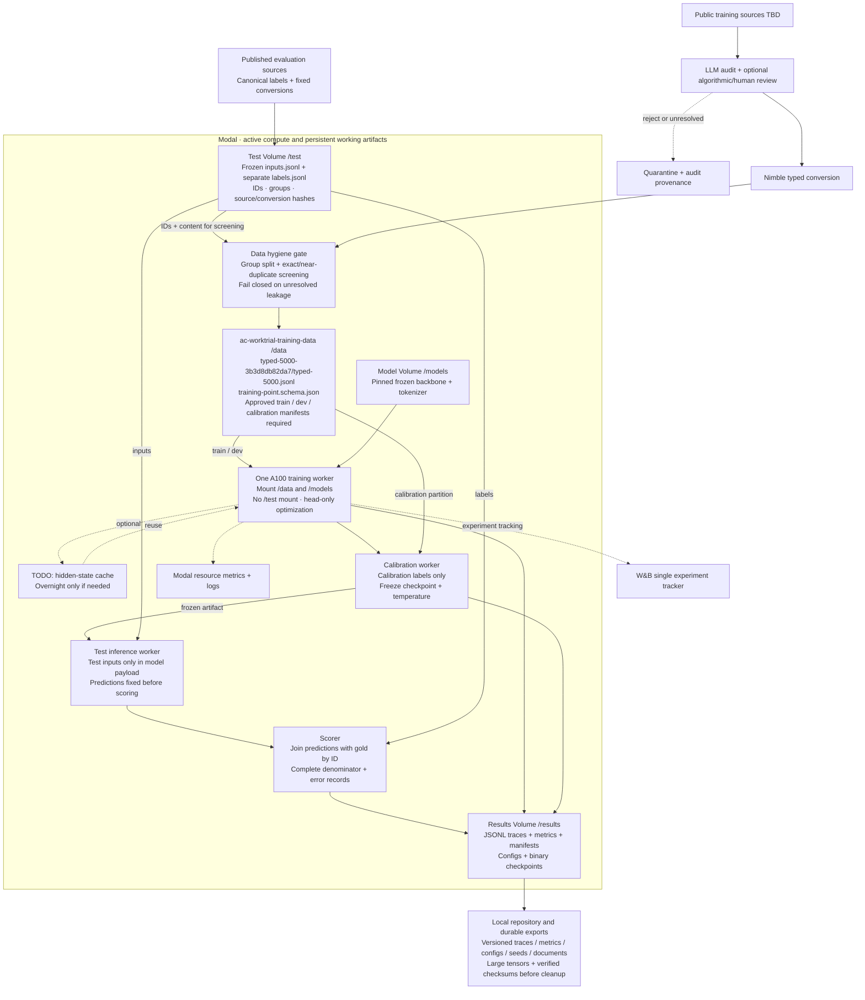

# Decision model training system

Proposed design. The initial typed dataset is pinned below; approval and split
preparation are still required. Interpret “numble” as
Bespoke Nimble, the typed-decision converter discussed in the research review.
No training, judge calls or overnight feature-extraction job is launched by this
design. Future Modal operations use workspace `ac-worktrials`, profile
`ac-worktrial`, and environment `worktrial-lance`. Never substitute the profile
name for the environment name.

[Editable Excalidraw diagram](../outputs/design/training-system.excalidraw).

## Data preparation

Snapshot public datasets with their revisions and usage terms. Audit existing
labels and task definitions with an LLM judge; store judge identity, prompt,
verdicts and cost. Optional algorithmic checks or human review resolve flagged
records. Keep exclusions and unresolved items visible. The judge audits existing
data; this is not synthetic-example generation. Do not silently replace original
labels with judge predictions. Any accepted correction needs explicit provenance.

Use pinned Nimble converters where available; extend deterministic conversions
for selected datasets without a converter. Preserve task semantics, label
mapping, option order and ordered Score rubrics. Save typed input schemas **and
their labels**, source IDs, grouping keys and manifests in /data. Validate schemas
and screen training/development/calibration records against protected evaluation
data before publishing approved partitions. Judge rationale and gold labels never enter inference inputs.

## Test storage and data hygiene

Use a dedicated Modal test Volume mounted at `/test` only by preparation/screening,
benchmark inference and scoring workers. Each versioned benchmark namespace stores
`inputs.jsonl`, `labels.jsonl`, source snapshots and a manifest containing source
revisions, conversions, IDs, groups, content hashes and exclusion policy. Freeze
this manifest before comparisons. Hash-check it on every evaluation; reject an
unrecorded change. Test inputs and gold labels are separate files so the model
request builder can whitelist state/question fields without ever reading gold.

Training workers mount only approved training/development/calibration namespaces
in `/data`, the model Volume and `/results`; **they do not mount the test Volume**.
Do not publish raw test corpora or merged gold-labelled evaluation traces into
training namespaces. Results traces include gold only after scoring and are never
accepted as training inputs. Select experiments on development data and fit
calibration only on its distinct partition. Log any exploratory benchmark access
or benchmark-guided choice; do not imply an untouched final test if it was used
for selection. No benchmark examples, paraphrases or judge-generated variants are
added to training.

Before approving data, the preparation worker must:

1. Assign roles by pinned source/split and explicit dataset allowlist, never by a
   random row split across related documents. Keep source documents, question
   siblings and translations in the same group. Keep whole benchmark datasets
   out of training when this project's source policy requires it.
2. Reject overlapping upstream IDs, group IDs or normalized exact content across
   train, development, calibration and protected test partitions. Check content
   independently of labels and option order.
3. Screen near duplicates and substantial source-text containment against test
   data. Fix and record similarity thresholds before screening; record candidates,
   adjudication and removals. Unresolved matches block publication. Screening
   reduces known leakage; it does not prove absence of every semantic duplicate.
4. Validate task semantics, option membership, Boolean/Score targets, unique IDs,
   label mappings and provenance. Reject missing/malformed records explicitly;
   no gold rationale, audit verdict or answer-bearing metadata enters model input.
5. Emit a hygiene report with partition counts, hashes, overlap findings and pass/
   fail status. Training loaders require an approved role-specific manifest and
   reject `evaluation_only` examples, unauthorized sources and hash mismatches.

These controls enforce separation through both **storage/mount boundaries** and
**fail-closed loaders/manifests**, rather than relying on a filename or researcher
memory. The LLM judge is a quality check, not the leakage barrier. Keep benchmark
labels canonical; audit issues are reported rather than corrected to favor a model.
Unknown pretrained-backbone contamination remains a limitation outside these checks.

**Implementation status:** these mount boundaries, training-loader checks and
cross-partition duplicate gate are required design controls, not yet verified
end-to-end. Existing preprocessing writes `evaluation_only` flags and hashes,
validates IDs/targets, excludes annotation fields from inputs, and has artifact
checks. Those checks do not yet enforce train/test isolation in a training loop.
Implement and test rejection of leaked groups, evaluation rows and altered
manifests before the first training run.

## Training and evaluation

Load pinned frozen backbones from /models and optimize head parameters only.
The joint schema head needs token hidden states and question/option span metadata.
Full hidden-state caching remains a TODO: measure one representative shard before
deciding whether repeated experiments warrant overnight extraction. Cache identity
includes checkpoint, tokenizer, layout, attention mode, precision and data hashes.

Select routine experiments on independent development data. Fit temperature only
on calibration labels, then save a fixed checkpoint and temperature. Test inference
uses the separate `/test` input file and emits predictions keyed by ID. The scorer
joins these with `/test` gold labels only after inference, checks complete coverage,
and records unsupported/errored cases as specified by the fixed protocol. Preserve complete predictions and failures rather than silently reducing
the evaluation denominator. Separate extraction, training and end-to-end serving
time. Use one serialized A100 execution path.

## Persistence and observability

Modal Volumes hold working data, manifests, audit reports, traces, metrics,
configs and binary checkpoints during runs. Flush records and commit Volume writes periodically
and on completed phases; mark completed artifacts explicitly. Checkpoint saving
and trace persistence do not depend on W&B upload success.

Keep code and durable results outside Modal as required by the work-trial
instructions. Version control code, configs, seeds, traces, metrics and documents.
Export large tensor artifacts locally with a manifest of checksums and verify the
exports before cleaning Modal resources. Never revert research code or results
as part of cleanup. Dataset redistribution still follows source usage terms.

W&B is the single experiment tracker for configuration, metrics and artifact
references. Modal monitors resources and execution health. Evaluation JSONL includes run ID,
checkpoint ID, example ID, actual timestamps, source/prompt identity, prediction,
probability distribution, target and errors. Phoenix is out of scope.
Use Modal Secrets for the judge and W&B credentials;
never save secrets with run artifacts.
