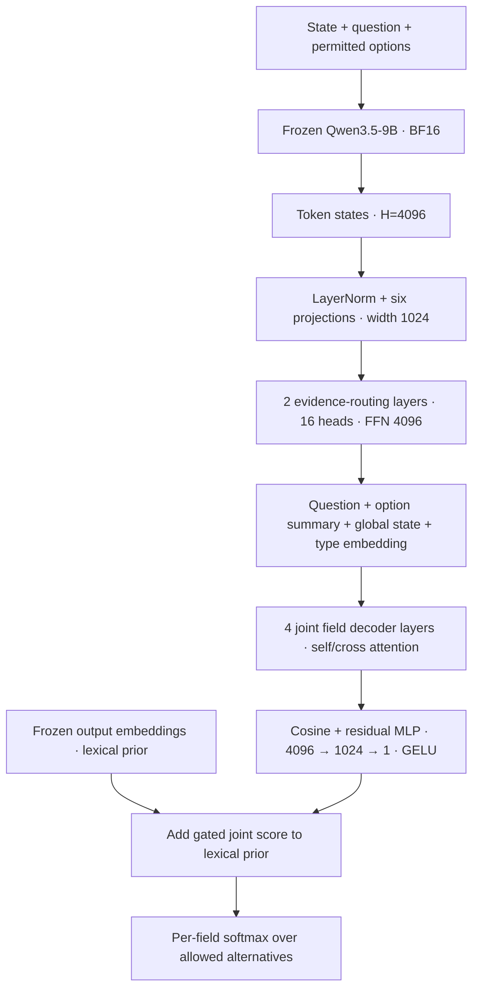
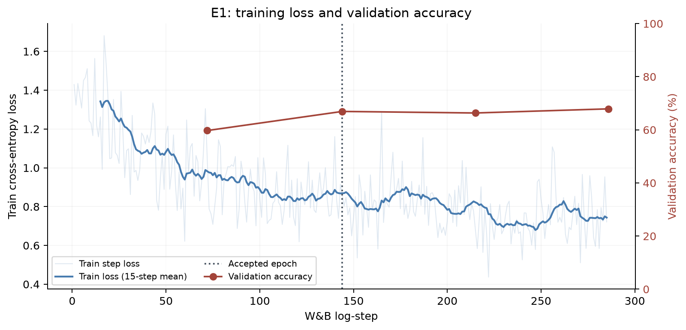
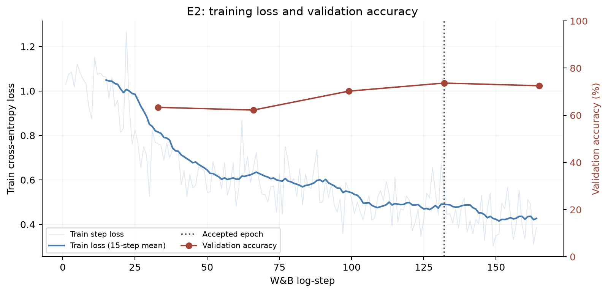
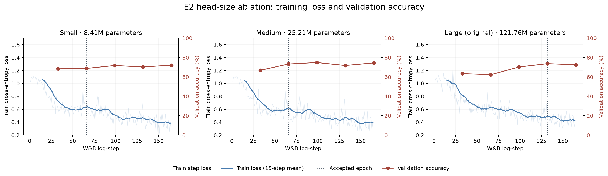
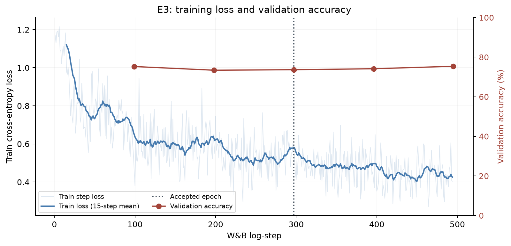
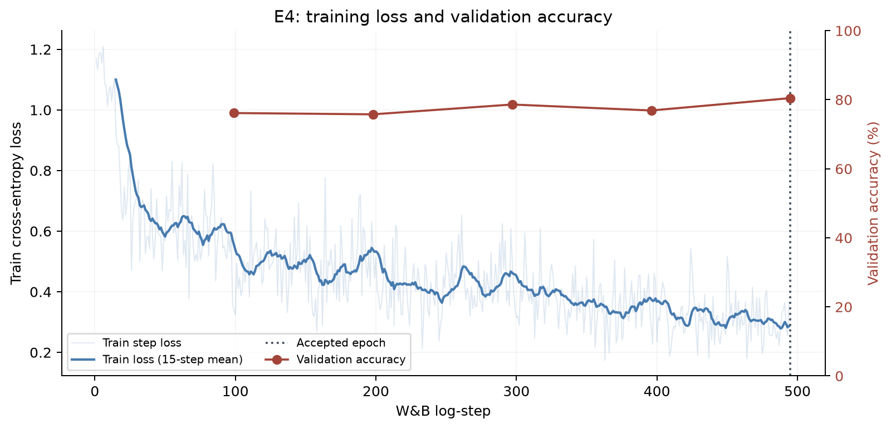
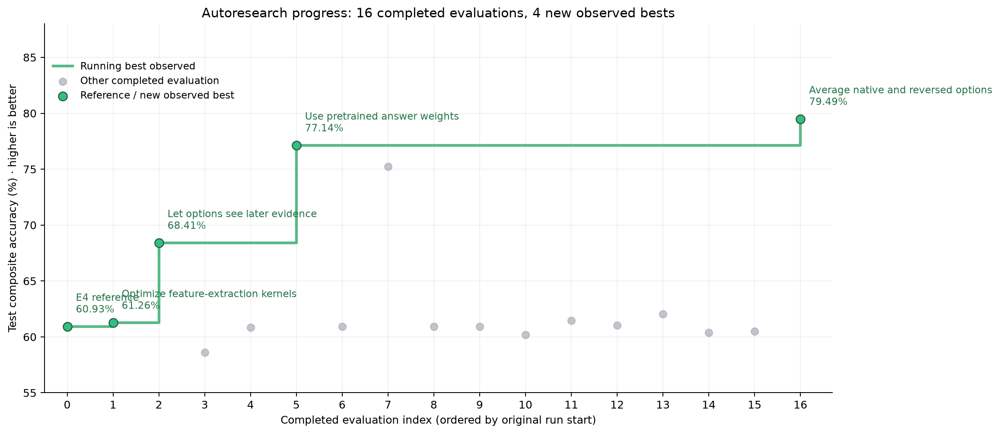

# Decision models with frozen Qwen backbones

Applied Compute work trial · October 14–15, 2026 · Research Narrative

## Guiding Context
In discussing the problem with Bryan, we agreed on the following:
- Backbone fine-tunes were out of scope, focus on improving performance with a frozen backbone. We could vary the frozen LLM backbone
- Generating our own synthetic data is cost-probitive, favor training on publicly available datasets
## Background research
We looked into the following to establish baselines, as well as architecture and training inspiration:
### PPLX v1
- Linear head on top of a fine-tuned Qwen 3.8-27B backbone
- Preprocess inputs to convert answer choices to tokens
- Trains on Choice and Noul data only, **no score examples present in train data**
- Confidence calibration achieved by temperature scaling
### Clef/Clef-flash
  - Large transformer head on top of fine-tuned backbone
  - Trained using both SFT on private synthetic data and RLCD on synthetic data
### Jev
  - Architecture and training unspecified
## Building a common evaluation contract
We assembled a shared panel of 2,111 decisions from the eleven named public
benchmarks, retaining all 111 JevBench public-hard items and selecting 200 from
each other suite without consulting labels. Equal suite weights kept large source
datasets from dominating the comparison, and missing predictions counted as wrong.

The consequential choices were about what each benchmark meant. Vendor subsets
were unspecified, so we had to declare our own: Circa used its unsplit source pool,
while financial sentiment used the unanimous-agreement subset and JudgeBench used
one response cohort. TruthfulQA required a more substantial conversion: we turned
individual candidate answers into binary truth decisions. We also restricted BBH
to tasks with explicit alternatives. These choices made a common decision interface
possible, but limit comparison with published vendor scores. The [benchmark
assembly appendix](#appendix-f--benchmark-assembly-and-conversion-assumptions)
records every split, conversion, exclusion and sampling rule. We then evaluated
all four reference models on this same panel:

| Benchmark | Jev 1.13 | PPLX v1 | CLEF | CLEF Flash |
| --- | ---: | ---: | ---: | ---: |
| BBH | **92.51%** | 81.46% | 75.97% | 69.50% |
| Belebele | **97.50%** | 96.50% | 96.00% | 95.50% |
| Circa | **79.00%** | 76.50% | 74.50% | 77.50% |
| ContractNLI | 78.00% | 84.50% | 84.00% | **85.00%** |
| FinancialPhraseBank | **96.00%** | 92.50% | 92.50% | 94.00% |
| JevBench_public_hard | 72.97% | 72.07% | **74.77%** | 64.86% |
| JudgeBench | **78.50%** | 77.50% | 75.00% | 63.00% |
| RAGTruth | **83.50%** | 77.50% | 76.50% | 65.00% |
| TabFact | 86.50% | **90.50%** | 85.00% | 72.50% |
| TruthfulQA_binary | **88.50%** | 68.00% | 74.50% | 58.00% |
| WinoGrande | 91.00% | 83.00% | 95.00% | **97.50%** |
| **Composite** | **85.82%** | 81.82% | 82.16% | 76.58% |

All scores count missing predictions as wrong; BBH averages subtasks first. Composite weights all eleven suites equally.

Timing fields were recorded, but API and local inference timings are not a controlled serving-speed comparison. These are local sampled-panel scores, not vendor full-benchmark reproductions.

## Establishing what an untrained head already does
- We attached a fresh Clef-style joint transformer head to original frozen Qwen weights. The first random-head run used 27B; the **9B E1-matched control** below was added later to make the comparison to E1 fair.
- The 9B head contains 121,762,820 parameters. Frozen backbone features and lexical output embeddings feed the trainable routing/scoring stack:



- Only the head is trainable. Exact pooling, scoring and precision are in the [architecture appendix reference](../../docs/joint-head-architecture.md).
- Three independent initializations use seeds **20261014, 20261015 and 20261016**, with FP32 head parameters and BF16 autocast matching E1. The first seed reuses E1's saved initial head. No fitting or temperature calibration occurs; T=1. Seeds, hashes and run artifacts are in the [baseline config](../baselines-20261014/random-joint-qwen35-9b-e1-matched/config.json), [initial-head receipts](../baselines-20261014/random-joint-qwen35-9b-e1-matched/initial-head-checksums.json) and [metrics](../baselines-20261014/random-joint-qwen35-9b-e1-matched/metrics.json).

| Benchmark | Untrained 9B, mean ± SD | PPLX v1 |
| --- | ---: | ---: |
| BBH | 35.29% ± 8.73 | **81.46%** |
| Belebele | 22.17% ± 5.25 | **96.50%** |
| Circa | 0.83% ± 0.29 | **76.50%** |
| ContractNLI | 48.83% ± 2.52 | **84.50%** |
| FinancialPhraseBank | 35.83% ± 11.64 | **92.50%** |
| JevBench_public_hard | 35.44% ± 4.96 | **72.07%** |
| JudgeBench | 55.50% ± 1.50 | **77.50%** |
| RAGTruth | 61.67% ± 7.11 | **77.50%** |
| TabFact | 51.67% ± 1.26 | **90.50%** |
| TruthfulQA_binary | 39.67% ± 3.25 | **68.00%** |
| WinoGrande | 52.00% ± 1.00 | **83.00%** |
| **Composite** | 39.90% ± 3.21 | **81.82%** |

1: All scores count missing predictions as wrong; BBH averages subtasks first. Random-head SD is across three initializations, not a confidence

- This establishes the trained head's starting point before training. At this stage we had not tested Qwen's original answer-token linear readout.

## Experiment 1: Train the original joint head
- **Question:** can supervised training improve the untrained 9B joint head and transfer beyond its training sources?
- **Data:** v1 contains 5,000 public records from twenty sources, 250 per source, chosen to avoid contamination with the test set, and on semantic similarity to the 11 benchmark tasks using LLM judge.  [See v1 dataset release](#v1)
- **Recipe:** [W&B config](https://wandb.ai/lmathias/ac-worktrial-decisions/runs/nulun3tv/overview). Only the head is trained; temperature is fitted on a separate calibration partition.
- **Result:** validation accuracy rises from 32.49% to 66.93%; benchmark composite reaches **57.35%**, versus **39.90% ± 3.21** for the matched untrained head and **81.82%** for PPLX.
- **Training evidence:** the curves below are pulled from the original [W&B run](https://wandb.ai/lmathias/ac-worktrial-decisions/runs/nulun3tv), with the unsampled filtered history saved in the [run evidence appendix](#appendix-g--experiment-run-evidence).


### E1 Test Results
| Benchmark | Untrained 9B, mean ± SD | E1 | PPLX v1 |
| --- | ---: | ---: | ---: |
| BBH | 35.29% ± 8.73 | 55.86% | **81.46%** |
| Belebele | 22.17% ± 5.25 | 81.00% | **96.50%** |
| Circa | 0.83% ± 0.29 | 61.00% | **76.50%** |
| ContractNLI | 48.83% ± 2.52 | 53.00% | **84.50%** |
| FinancialPhraseBank | 35.83% ± 11.64 | 48.00% | **92.50%** |
| JevBench_public_hard | 35.44% ± 4.96 | 45.05% | **72.07%** |
| JudgeBench | 55.50% ± 1.50 | 44.50% | **77.50%** |
| RAGTruth | 61.67% ± 7.11 | 66.00% | **77.50%** |
| TabFact | 51.67% ± 1.26 | 56.50% | **90.50%** |
| TruthfulQA_binary | 39.67% ± 3.25 | 60.00% | **68.00%** |
| WinoGrande | 52.00% ± 1.00 | 60.00% | **83.00%** |
| **Composite** | 39.90% ± 3.21 | 57.35% | **81.82%** |

- **Failure analysis:** JudgeBench almost always predicts B, RAGTruth always predicts no hallucination, and finance never predicts negative. ContractNLI also strongly favors entailment. The label distributions do not justify these predictions:

| Benchmark / label | Predicted | Actual gold |
| --- | ---: | ---: |
| JudgeBench / A | 3/200 (1.50%) | 114/200 (57.00%) |
| JudgeBench / B | 197/200 (98.50%) | 86/200 (43.00%) |
| RAGTruth / false | 200/200 (100.00%) | 132/200 (66.00%) |
| RAGTruth / true | 0/200 (0.00%) | 68/200 (34.00%) |
| FinancialPhraseBank / negative | 0/200 (0.00%) | 29/200 (14.50%) |
| FinancialPhraseBank / neutral | 77/200 (38.50%) | 130/200 (65.00%) |
| FinancialPhraseBank / positive | 123/200 (61.50%) | 41/200 (20.50%) |
| ContractNLI / Contradiction | 4/199 (2.01%) | 24/199 (12.06%) |
| ContractNLI / Entailment | 174/199 (87.44%) | 92/199 (46.23%) |
| ContractNLI / NotMentioned | 21/199 (10.55%) | 83/199 (41.71%) |

- **Interpretation:** training loss keeps falling while validation NLL worsens after the accepted epoch, consistent with overfitting. Input representation also differs between training and evaluation, as shown with sample rows from train/val and test sets:

**v1 training record — `ANLI:train_r3:83078`:**

```json
{
  "input": "{\"question\":\"How does the premise relate to the hypothesis?\",\"state\":\"Premise: Breaking Up<br>Tom hated his girlfriend. He kept trying to break up with her. She never really let him. Tom eventually moved away. He ignored her completely.\\nHypothesis: Tom's girlfriend tried breaking up with him\"}",
  "schema": {
    "additionalProperties": false,
    "properties": {
      "decision": {
        "description": "Select exactly one allowed option. Options: {\"option_0\":\"entailment\",\"option_1\":\"contradiction\",\"option_2\":\"neutral\"}",
        "enum": [
          "option_0",
          "option_1",
          "option_2"
        ],
        "type": "string"
      }
    },
    "required": [
      "decision"
    ],
    "type": "object"
  }
}
```

**Benchmark record — `FinancialPhraseBank:0`:**

```json
{
  "state": "According to Gran , the company has no plans to move all production to Russia , although that is where the company is growing .",
  "question": {
    "criteria": {
      "negative": "Negative",
      "neutral": "Neutral",
      "positive": "Positive"
    },
    "instructions": "What is the financial sentiment?",
    "type": "choice"
  }
}
```
## Experiment 2: Normalize the training requests
- **Hypothesis:** matching training requests to benchmark-shaped state/question/criteria inputs should improve semantic binding and reduce the option/description mismatch observed in E1.
- **Data:** v2 uses 2,553 decisions from 6 hand-chosen datasets, normalized to match Jev API syntax. The [v2 dataset release](#v2) records source counts and artifacts.
- **Recipe:** [W&B config](https://wandb.ai/lmathias/ac-worktrial-decisions/runs/ujjzv46h/overview). This run switches to verified cached backbone features; extraction parity is checked separately.
- **Result:** **60.19%** composite, up **2.84 percentage points** from E1. Finance rises from 48.00% to 78.50% and judging from 44.50% to 63.50%, while Circa falls from 61.00% to 34.50%. RAGTruth remains at 66.00%; the saved trace still predicts no hallucination for every item.
- **Interpretation:** normalization plus the changed source mixture improves some transfer failures but does not solve generalization. Since both format and data changed, this does not isolate the effect of normalization alone. Cached extraction is an efficiency change with separate parity checks.



| Benchmark | E1 | E2 | PPLX v1 |
| --- | ---: | ---: | ---: |
| BBH | 55.86% | 60.87% | **81.46%** |
| Belebele | 81.00% | 79.00% | **96.50%** |
| Circa | 61.00% | 34.50% | **76.50%** |
| ContractNLI | 53.00% | 59.50% | **84.50%** |
| FinancialPhraseBank | 48.00% | 78.50% | **92.50%** |
| JevBench_public_hard | 45.05% | 47.75% | **72.07%** |
| JudgeBench | 44.50% | 63.50% | **77.50%** |
| RAGTruth | 66.00% | 66.00% | **77.50%** |
| TabFact | 56.50% | 47.50% | **90.50%** |
| TruthfulQA_binary | 60.00% | 62.50% | **68.00%** |
| WinoGrande | 60.00% | 62.50% | **83.00%** |
| **Composite** | 57.35% | 60.19% | **81.82%** |

### Experiment 2.5 — Head-size ablation
- **Hypothesis:** Existing train head is oversized for the task and amount of data supplied
- **Recipe:** W&B configs for [Small](https://wandb.ai/lmathias/ac-worktrial-decisions/runs/mr60nhaa/overview), [Medium](https://wandb.ai/lmathias/ac-worktrial-decisions/runs/nmbnsj7n/overview) and [Large](https://wandb.ai/lmathias/ac-worktrial-decisions/runs/ujjzv46h/overview). All use the same [v2](#v2) splits and frozen features. Hyperparams were set to reasonable baselines given each head's size


| Head | Width | Routing / joint layers | Attention heads | FFN width | Validation NLL | Validation accuracy | Accepted epoch  |
| --- | ---: | ---: | ---: | ---: | ---: | ---: | --- |
| Original (121.76M parameters) | 1,024 | 2 / 4 | 16 | 4,096 | 0.6816 | 73.66% | 4  |
| Medium (25.21M parameters) | 512 | 1 / 2 | 8 | 2,048 | 0.6524 | 73.28% | 2  |
| Small (8.41M parameters) | 256 | 1 / 1 | 4 | 1,024 | 0.6786 | 68.70% | 2  |

- **Decision:** Medium head architecture is chosen for future runs. Run links, configs and accepted checkpoints are in [Appendix G](#appendix-g--experiment-run-evidence).

## Experiment 3: Expand public data with the Medium head
- **Hypothesis:** a wider task mixture and the more economical Medium head may improve transfer beyond the normalized v2 recipe.
- **Data:** v3 expands to 7,928 decisions across 9 hand-picked datasets. Source counts, splits, and schema are linked in the [v3 dataset release](#v3).
- **Recipe:** [W&B config](https://wandb.ai/lmathias/ac-worktrial-decisions/runs/fs233st8/overview). Uses the Medium config selected from the E2 validation comparison.
- **Interpretation:** more public data and a smaller head do not establish a general improvement.



| Benchmark | E2 | E3 | PPLX v1 |
| --- | ---: | ---: | ---: |
| BBH | 60.87% | 56.04% | **81.46%** |
| Belebele | 79.00% | 80.50% | **96.50%** |
| Circa | 34.50% | 31.50% | **76.50%** |
| ContractNLI | 59.50% | 66.00% | **84.50%** |
| FinancialPhraseBank | 78.50% | 80.50% | **92.50%** |
| JevBench_public_hard | 47.75% | 42.34% | **72.07%** |
| JudgeBench | 63.50% | 65.00% | **77.50%** |
| RAGTruth | 66.00% | 66.00% | **77.50%** |
| TabFact | 47.50% | 47.00% | **90.50%** |
| TruthfulQA_binary | 62.50% | 63.50% | **68.00%** |
| WinoGrande | 62.50% | 60.00% | **83.00%** |
| **Composite** | 60.19% | 59.85% | **81.82%** |

## Experiment 4: Larger frozen backbone and explicit selection
- **Hypothesis:** features from Qwen3.8-27B rather than 9B may improve performance based on score delta between Clef vs. Clef-flash (both use roughly same size head and training recipe but different backbones)
- **Data and head:** reuse [v3 dataset](#v3)
- **Recipe:** [W&B config](https://wandb.ai/lmathias/ac-worktrial-decisions/runs/7j1ijakt/overview). The kernel-optimization follow-up belongs to [autoresearch](#autoresearch-summary).
- **Result:** the accepted fallback condition reaches **60.93%**, **1.08 points** above E3.
- **Interpretation:** scaling alone does not approach the reference models.
- Switched to **Validation accuracy** instead of **Validation NLL** as the promotion criteria, as high confidence is not rewarded in the benchmarks.

| Benchmark | E3 | E4  | PPLX v1 |
| --- | ---: | ---: | ---: |
| BBH | 56.04% | 58.70% | **81.46%** |
| Belebele | 80.50% | 89.00% | **96.50%** |
| Circa | 31.50% | 62.00% | **76.50%** |
| ContractNLI | 66.00% | 52.00% | **84.50%** |
| FinancialPhraseBank | 80.50% | 47.00% | **92.50%** |
| JevBench_public_hard | 42.34% | 58.56% | **72.07%** |
| JudgeBench | 65.00% | 70.50% | **77.50%** |
| RAGTruth | 66.00% | 62.50% | **77.50%** |
| TabFact | 47.00% | 51.50% | **90.50%** |
| TruthfulQA_binary | 63.50% | 45.50% | **68.00%** |
| WinoGrande | 60.00% | 73.00% | **83.00%** |
| **Composite** | 59.85% | 60.93% | **81.82%** |


Exact histories, run links and selection receipts are in [Appendix G](#appendix-g--experiment-run-evidence).


## Autoresearch summary
| What was tested | Verdict | W&B |
| --- | --- | --- |
| Speed up frozen-backbone feature extraction with optimized kernels. | Adopted as a distinct numerical runtime: about 1.55–1.57× warm extraction throughput; strict parity fails, so features are regenerated. Test composite score is not signifantly affected. | [run](https://wandb.ai/lmathias/ac-worktrial-decisions/runs/2ouo1e3l) |
| Remove causal masks so full attention layers are bidirectional. | Promising: 68.41%, +7.15 points versus the optimized-kernel control; recurrent paths remain causal; one seed. | [run](https://wandb.ai/lmathias/ac-worktrial-decisions/runs/dyjus5wh) |
| Repeat the same training to check numerical stability. | Automatic-backend repeats diverge (58.60% / 60.85%); math-backend repeats match at 60.93%. | [run](https://wandb.ai/lmathias/ac-worktrial-decisions/runs/ud99ptl5) |
| Add the same amount of fresh data from existing sources. | Matched source-screen control: 60.93%; comparator for the next six additions. | [run](https://wandb.ai/lmathias/ac-worktrial-decisions/runs/ud99ptl5) |
| Add examples of reasoning over explicit rules (RuleTaker). | No demonstrated gain: 60.93%, +0.01 point versus matched control. | [run](https://wandb.ai/lmathias/ac-worktrial-decisions/runs/df2fil2b) |
| Add safety decisions where true means unsafe (Aegis2). | Rejected: 60.20%, −0.73 point versus control. | [run](https://wandb.ai/lmathias/ac-worktrial-decisions/runs/4acn895m) |
| Add toxicity judgements (CivilComments). | Not advanced: 61.45%, +0.52 point; screening thresholds not met. | [run](https://wandb.ai/lmathias/ac-worktrial-decisions/runs/nastxy6m) |
| Add three-way entailment examples (SNLI + MultiNLI). | Not advanced: 61.05%, +0.12 point; contradiction collapse persists. | [run](https://wandb.ai/lmathias/ac-worktrial-decisions/runs/l4nad696) |
| Add many-option intent classification (MASSIVE). | Passed screen: 62.04%, +1.11 points; independent-seed confirmation still needed. | [run](https://wandb.ai/lmathias/ac-worktrial-decisions/runs/hqwshgo4) |
| Add banking intent examples (BANKING77). | Rejected: 60.38%, −0.55 point versus control. | [run](https://wandb.ai/lmathias/ac-worktrial-decisions/runs/1npt61ie) |
| Clarify that missing rule support should count as false. | Rejected: 60.52%, −0.42 point versus original RuleTaker. | [run](https://wandb.ai/lmathias/ac-worktrial-decisions/runs/62h35cer) |
| Read answers through the model’s pretrained answer-letter weights. | Kept as a stronger baseline: 77.14%, without head training. | [run](https://wandb.ai/lmathias/ac-worktrial-decisions/runs/rahruwds) |
| Mix the trained head and pretrained readout equally. | Rejected: 75.24%, below the pretrained readout despite passing its validation gate. | [run](https://wandb.ai/lmathias/ac-worktrial-decisions/runs/6spap1d0) |
| Fit a Boolean-specific probability offset. | Rejected at validation gate: +0.99 point overall, below the +1-point threshold; no test score. | [run](https://wandb.ai/lmathias/ac-worktrial-decisions/runs/rahruwds) |
| Average predictions from original and reversed option orders. | Best completed recipe: 79.49%, +2.35 points versus native readout. | [run](https://wandb.ai/lmathias/ac-worktrial-decisions/runs/6djekmw2) |
| Allow a short internal reasoning pass before reading the answer. | Validation gate passed; original handoff lacks a sealed complete test score. | [run](https://wandb.ai/lmathias/ac-worktrial-decisions/runs/oju7lzc8) |
| Prepare few-shot prompts, selective reasoning and further data/seed controls. | Prepared or rejected before model evaluation; no new benchmark score. | No standalone model run; [record](../../docs/overnight-research-log.md) |
| Reuse cached features and warm workers; add paired and collapse diagnostics. | Operational checks passed; efficiency/measurement work, not independent quality gains. | No standalone model run; [record](../../docs/overnight-research-log.md) |


Repeated use of this panel makes the curve exploratory;
most conditions have one seed. [Point values, order and W&B links](autoresearch-progress.json).

## Autoresearch Conclusions
Re-introducing new data domains from the v1 dataset did **not** seem to resolve class collapse issues in tests.
Directly forming decisions off of raw base model logits performed well, [TODO: one sentence about option order dependence]

## What remained unfinished at the handoff
This section describes the original handoff snapshot. The subsequent user-directed cached augmentation uses [v3.1](#v31); it is separate from the overnight autoresearch phase.

Two continuations remained outside the completed results. A bounded-thinking
protocol passed its validation gate, but the audited ledger did not contain a
sealed complete benchmark evaluation. A finished dashboard status and partial
outputs were insufficient grounds to promote it. Separately, a user-directed
residual readout experiment was still active at the handoff snapshot. It uses the [v3 dataset](#v3) and trains
a small MLP correction on top of frozen pretrained logits and compared fixed
option order with per-epoch shuffling.

## Conclusions and limits

The investigation showed that frozen-backbone decision heads can learn, but that
learning on public typed decisions does not guarantee transfer to a broad benchmark
panel. Representation choices, attention layout and numerical repeatability all
mattered. The strongest completed inference recipe reused pretrained answer
semantics and averaged option orders; the strongest trained head used the partial
attention intervention. Calibration remained a separate fitting step, not evidence
that all resulting confidence estimates were reliable under distribution shift.

The panel was observed repeatedly during this work, so these are exploratory
results rather than an untouched final test. Most trained conditions used one seed,
and the public-source conversions do not establish reproduction of vendor subsets.
The next useful work would preserve independent validation selection, confirm
promising interventions across seeds and test semantic binding directly. The
appendices below retain the detailed protocols, accepted-checkpoint references and
implementation evidence needed to audit or reproduce the investigation.

## Appendices
- [Appendix A — Detailed experiment record](#appendix-a): dates, architectures, training settings, seeds, per-condition results and supporting documents.
- [Appendix B — Reproduction and artifact references](#appendix-b--reproduction-and-artifact-references): W&B, Modal, accepted checkpoints, receipts and commands.
- [Appendix C — Immutable model and dataset pins](#appendix-c--immutable-model-and-dataset-pins): revisions, hashes and dependency sources.
- [Appendix D — Codebase and commit history](#appendix-d--codebase-and-commit-history): implementation locations, branches and major commits.
- [Appendix E — Dataset releases](#appendix-e--dataset-releases): v1, v2, v2.1, v3 and v3.1 descriptions, schemas, sampling and provenance.
- [Appendix F — Benchmark assembly and conversion assumptions](#appendix-f--benchmark-assembly-and-conversion-assumptions): per-suite source pools, conversions, exclusions, panel sampling and manifests.
- [Appendix G — Experiment run evidence](#appendix-g--experiment-run-evidence): training seeds, checkpoint selection, W&B runs and curve provenance.

---

<a id="appendix-a"></a>

## Appendix A: Detailed experiment record

### Background research — October 14
The task was to train a decision model on one A100, evaluate it on the eleven
benchmarks named by PPLX decider v1, and explain the methodology. We prioritized
reliable measurement, explicit data provenance and experiments that could explain
failure. Backbone fine-tuning, LoRA and synthetic training data were excluded.

We compared Jev's typed decision interface, PPLX's selected answer-token linear
readout, and Clef's joint schema head. Choice, Boolean Noul and ordered Score can
all be represented as distributions over permitted alternatives. Confidence does
not require a separate neural network: it can be computed from that distribution.
Ordinary labelled examples suffice to fit a scalar calibration temperature.

The released PPLX v1 implementation projects the final hidden state through a
bias-free 5,120 × 255 readout, initialized from pretrained answer-token weights:
1,305,600 parameters. Its training code permits backbone updates, so its published
quality is not evidence for equivalent frozen-backbone performance. Clef routes
option representations to evidence and jointly processes fields. Its released
backbone is also adapted. We reused its architecture and code, not those adapted
weights, for the first trainable-head experiments. Sources and architecture
comparisons are retained in [the original log](../../docs/research-log.md); exact layers,
activations, shapes and precision are in [the architecture specification](../../docs/joint-head-architecture.md).

### Establishing the evaluation contract — October 14

The eleven public sources yielded 65,377 normalized decisions. We fixed a
label-blind panel of 200 examples per suite, except all 111 public-hard JevBench
examples: **2,111 decisions**. BBH is averaged over its included subtasks first;
the final composite weights each of eleven suites equally. A rejected or missing
prediction counts as wrong in the primary score. Probability metrics are reported
on valid predictions, with their denominators retained. The common token ceiling
is 8,192, without silent truncation; several model protocols reject one long
ContractNLI item.

Source and preprocessing choices matter. We used FinancialPhraseBank's unanimous
subset, a GPT-4o JudgeBench cohort, English Belebele, fine-grained Circa labels,
response-level RAGTruth hallucination labels, and binary classification of
TruthfulQA MC2 candidate answers. These are declared conversions, not verified
reproductions of the vendor's unspecified panel or API prompts. Circa's source-wide
pool is designated evaluation-only here. Group IDs preserve shared contracts,
tables, questions and source contexts for conditional paired analysis.

The exact panel SHA-256 is
`50889a8285d85fc80ded905ed3534ec75cfe1e80d5dad84d8a02ae0150e90627`.
Dataset URLs, immutable revisions, conversion details and hashes are in
[`benchmark-preprocessing.json`](../../data/manifests/benchmark-preprocessing.json)
and [`baseline-panel.json`](../../data/manifests/baseline-panel.json).

We measured Jev 1.13, PPLX v1, Clef and Clef Flash under this common protocol.
Their coverage-adjusted composites were 85.82%, 81.82%, 82.16% and 76.58%.
Local GPU timings and hosted API timings are different measurement conditions;
we do not present them as a controlled serving-speed comparison. The fixed-panel
vendor baselines are reference measurements, not claims to reproduce model-card
scores. [Baseline protocol](../../docs/baselines.md).

### Measuring initialization before training — October 14

Three independently initialized joint heads used seeds 20261014, 20261015 and
20261016. Original Qwen3.8-27B stayed frozen. Each head used width 1,024, two
routing layers, four joint field layers, 16 attention heads and FFN width 4,096:
128,056,324 parameters. CPU FP32 initialization and checkpoint storage preceded
BF16 inference. We computed backbone features once per example and applied all
three heads; we did not ensemble probabilities.

The average composite was **44.59% ± 1.36 percentage points**, sample SD across
initializations. These are not pure chance classifiers: Clef retains a frozen
pretrained lexical prior and deterministic scalar initializations. A later matched
9B control used E1's precision and initialization protocol; its per-seed results
are retained separately. This establishes initialization sensitivity, not the
capability of Qwen's original pretrained answer-token readout.
[27B protocol](../../docs/random-joint-baseline.md), [9B control](../../docs/random-joint-9b-baseline.md).

### E1: training the original joint head — October 14

E1 froze Qwen3.5-9B and trained a fresh 121,762,820-parameter head. The first
public-data release contained 5,000 records / 5,500 decisions. Connected families
and identical states were grouped before deterministic train/dev/calibration
assignment. There were 4,101 training records, 514 dev decisions and 497
calibration decisions. Labels, provenance and transformation traces were excluded
from model inputs by an explicit adapter whitelist.

The recipe used AdamW, LR 1e-3, weight decay 0.01, 10% warmup, clipping at 1,
effective batches of at least 64 decisions, and up to five epochs with early
stopping. The frozen backbone was BF16; head weights, gradients and optimizer
state were FP32, with BF16 autocast for eligible head operations and FP32 loss.
The accepted checkpoint was epoch 2 / step 142, selected by dev NLL. Its dev
accuracy improved from 32.49% before training to 66.93%. A separate calibration
split fitted T=0.7951; positive temperature does not change the winning class.

The benchmark composite was **57.35%**. The head learned, but transfer was uneven.
JudgeBench chose B on 197/200 examples; RAGTruth predicted no hallucination on
all 200; sentiment never predicted negative. The gold distributions did not
justify those collapses. Training loss continued falling while dev NLL worsened
after epoch 2, supporting generalization concerns without establishing one cause.
The initial schema adapter put option meanings in instructions and generic IDs
in option spans; benchmark requests often placed meanings directly in options.
That supplied a concrete representation-mismatch hypothesis.

### E2 and E3: normalizing inputs, scaling data and caching — October 14

E2 standardized training requests toward the benchmark-shaped state/question/
criteria representation and used a revised v2 public-data release (2,553 records).
The original-head result reached **60.19%**. Dev-only head ablations measured
73.66% for the original, 73.28% for Medium and 68.70% for Small. Medium changed
optimizer settings too, so this is not an isolated causal estimate of head size.

Medium used width 512, one evidence-routing layer, two joint field layers,
eight attention heads and FFN width 2,048. It has 25,206,788 parameters on 9B
and 28,354,564 on 27B. E3 used this head, LR 3e-4, five epochs and an expanded
v3 release of 7,928 records: ANLI, CICERO, CaseHOLD, HelpSteer2, Implicatures,
JEEBench, MultiRC, RACE and ReClor. Its grouped partitions supplied 6,262 training,
809 dev and 857 calibration decisions. E3 reached **59.85%**, so more data did
not establish a general improvement. Multiple factors changed from E1; these
historical comparisons cannot attribute gains to a single intervention.

Caching detached frozen hidden states removed repeated backbone work during
head optimization. Cache identity includes model/tokenizer revision, input bytes,
attention layout, precision and numerical runtime; each shard is checksummed.
Resumption required replay agreement, not merely matching a directory name.
An E1 cached control and cache-parity checks separated efficiency changes from
new scientific conditions. [Training system](../../docs/training-system-design.md).

### E4: larger backbone and explicit selection — user-directed

E4 and its checkpoint selection are **user-directed**. The optimized-kernel follow-up is **autoresearch**.
Historical registration files and the overnight branch also contain E4 records;
that storage location does not make the experiment autoresearch. All registered
cards and reproduction evidence remain in [the historical log](../../docs/overnight-research-log.md).
There were 45 registered cards at its recorded snapshot, including prepared-only
conditions; that count must not be interpreted as 45 completed model evaluations.

E4 switched the Medium head to frozen Qwen3.8-27B with v3 data. The user then
specified dev-accuracy checkpoint selection, earliest epoch on ties, rather than
NLL. We recovered the accuracy-selected saved checkpoint without retraining and
fit temperature separately. The fallback-runtime E4 composite was **60.93%**.
Its historical E3 contrast changes both backbone and selection, so the difference
is not a clean backbone-size effect. Every run retains its own accepted checkpoint
and recorded selection rule; later rules do not rewrite earlier selections.

### Autoresearch kernel optimization: a distinct numerical condition

Combined pinned causal-convolution and linear-attention kernels gave approximately
1.55–1.57× warm four-record backbone throughput in the measured workloads. They
failed the strict numerical-equivalence gate, despite agreement on sampled
argmax decisions in the combined condition. We therefore treated this as a new
runtime, regenerated features and retained the negative equivalence finding.
Optimized-runtime E4 reached **61.26%**. This is distinct from the 60.93%
fallback result. Kernel gains do not accelerate head training that already uses
cached features. JIT/cold-start cost and end-to-end extraction are separate costs.
[Measured performance and provenance](../../docs/autoresearch-results.md).

### Autoresearch implementation references

The [single autoresearch summary](#autoresearch-summary) contains the concise experiment catalog. Complete hypothesis cards, operational failures and per-condition implementation evidence remain in the [historical overnight journal](../../docs/overnight-research-log.md), [attention experiment specification](../../docs/autoresearch-attention-bidir-results.md), [source-screen ledger](../../docs/source-screen-ledger.md) and [native-readout design](../../docs/native-readout-design.md). E4 is user-directed even though its historical files were stored beside overnight work. The [classification correction receipt](e4-classification-correction.json) records the corresponding W&B correction. User-directed work after October 15 at 10:30 a.m. Pacific is outside autoresearch.

## Appendix B — Reproduction and artifact references
The authoritative tracker is [W&B](https://wandb.ai/lmathias/ac-worktrial-decisions).
Historical benchmark imports are explicitly labelled retrospective; no inference
was rerun. Git retains code and reasoning. Modal retains versioned data, accepted
heads, other saved checkpoints and evaluation artifacts. Verified local exports
remain an independent copy outside Modal. The [Modal archive receipt](modal-archive.json)
records the archived source and evaluation evidence; [preserved dataset receipts](preserved-datasets.json)
identify content-addressed copies of previously uncommitted dataset files.

Use workspace `ac-worktrials`, profile `ac-worktrial`, environment `worktrial-lance`.
The [accepted-checkpoint catalog](../../docs/accepted-checkpoints.md) and
[run index](run-index.json) list **only the accepted
checkpoint for each run**, its hash, selection epoch and artifact path. Other
saved checkpoints remain reachable through the indexed original run directory;
we neither delete nor individually promote them. For native readout there is no
trained head checkpoint: the accepted artifact is a pinned backbone plus prompt,
pooling and temperature protocol. Its protocol digest is not a weight-file hash.

Reproduce the main reported measurements from archived predictions before
allocating a GPU:

```bash
python scripts/preprocess_benchmarks.py
python scripts/report_overnight_benchmarks.py
```

Use the original committed dataset release/config, not a newly sampled release.
For E1, see `docs/first-experiment-training.md`; E2/E3 configs are
`configs/e2-qwen35-9b-v2-cache.json` and `configs/e3-medium-v3.json`.
For E4/bidirectional full attention use their exact native/bidirectional cache identities, selected accuracy
configs and kernel receipts. `scripts/export_training.py` checks complete remote
artifact inventories and hashes. A clean-checkout report requires restoring its
checksummed prediction exports; see `docs/reproduce-handoff.md` for explicit
commands. Do not launch the legacy parallel-baseline command by default.

## Appendix C — Immutable model and dataset pins
| Component | Immutable revision / SHA-256 |
| --- | --- |
| Frozen Qwen3.5-9B backbone        | `c202236235762e1c871ad0ccb60c8ee5ba337b9a` |
| Frozen Qwen3.8-27Bbackbone     | `1d4bf0f2ff6012fd82039f2fa52739d0dd7c60c0` |
| Clef head source | `0b331204bb13fbd2ca93a64df1956f5b55478ce5` |
| PPLX decider v1 | `d8c3bd18e31dc1804433d38528b3e770019bf00c` |
| Clef Flash | `8b2e5fd17c09fd49bc2880b805d5323ec7ff4ff3` |
| E1 typed 5,000 | `3b3d8db82da7595565ad48c8cb7da981821097324c151169cf64c4c11fc3ea36` |
| v2 normalized 2,553 | `338a3584e896a17b011155c066387bb396879dd4a8f539aaf2c86a94fd257fd8` |
| v3 normalized 7,928 | `ef15c46f49192cafe5d35a1b0567e1a33cc13807fb5c2ca4d50e1fdbc6beec81` |

Full public-source pins are in `configs/training-source-pins.json` and the
benchmark manifest. Dependency sets are `requirements-training.txt` and
`requirements-kernels.txt`; exact runtime versions, code hashes and GPU metadata
remain in individual run configs. Dataset sources and usage terms remain attached
to their manifests. Frozen feature caches are optional reproducible acceleration,
not substitutes for the original inputs and model pins.

## Appendix D — Codebase and commit history


The handoff branch consolidates evidence; `main` receives the selected delivery
path only through a PR. Experiments remain on their named branches. Unlisted
intermediate commits are implementation history, not additional experiments.
The complete [branch inventory](run-index.json) records tips.

| Location / branch | Purpose |
| --- | --- |
| `main` | Published delivery code and documentation; update through PR |
| `deliverables/research-handoff` | New narrative, audit indexes, presentation and consolidation |
| `autoresearch/*` | Historical experiment branches; E4 and later user-directed work are classified by user instruction, not branch prefix |
| `e1-review-fixes` | Historical E1 training and review hardening |
| `preservation/20261015-*` | Archival worktree snapshots; no new scientific result |
| `preservation/20261015-cacc` (`72568d5`) | Preserved dataset preparation/conversion code and provenance; dataset text stored separately in Modal |
| `scripts/preprocess_benchmarks.py`, `data/manifests/` | Fixed evaluation conversion and provenance |
| `scripts/train_joint.py`, `scripts/train_cached_joint.py` | Head training; frozen extraction or verified cached features |
| `scripts/pretrained_readout.py`, `scripts/readout_order_pool.py` | Pretrained answer-letter readout and semantic probability pooling |
| `scripts/report_overnight_benchmarks.py`, `outputs/traces/` | Verified reporting and compressed evaluation traces |
| `configs/`, `outputs/training/`, `outputs/test/` | Experiment inputs, accepted-checkpoint receipts and results |
| `outputs/model-artifacts/` | Ignored local tensor exports; paired Modal paths/hashes in index |
| `work/` | Ignored scratch and independent worktrees; never the only durable artifact copy |

Major historical milestones:

| Commit | Change |
| --- | --- |
| `7588454` | Initial research documents |
| `025aca3` | Four-model sampled baseline and calibration/cost audit |
| `bf364b7` | Three-seed frozen 27B joint-head baseline |
| `9a72a35` | E1-matched three-seed 9B random baseline |
| `0d321e2` | Completed E2 training and locked evaluation |
| `589524a` | Published E3 benchmark comparison |
| `9e77b62` | Accuracy-selected E4 recovery |
| `8e1b40c` | Adopted optimized numerical runtime |
| `af59dc3` | Verified suffix influence under the attention intervention |
| `02096dd` | Full math-backend repeatability gate and source-screen continuation |
| `67db897` | Negative RuleTaker semantic-repair result |
| `6593ae1` | Passed 27B option-order pooling dev gate |
| `2e7a58c` | Verified 79.49% recipe and bounded-thinking budget amendment |
| `366fe8a` | User-directed residual readout option-order experiment |
| `f1876e3`, `7260ce1` | Preserved handoff materials and consolidated experiment history |
| `66fe758` | New narrative, accepted inference package, presentation and verified checkpoint index |
| `9f27bc7` | Focused delivery branch prepared from published main; promotion requires PR |

The failed and prepared-only experiments remain documented in the overnight
journal and performance ledger. W&B state alone does not certify an accepted
checkpoint or completed test. The handoff validator checks artifacts and result
arithmetic; ongoing work is reconciled only from sealed evidence.

## Appendix E — Dataset releases

### v1
The release contains 250 records each from **ANLI, ARC, Aegis2, BANKING77, CivilComments, GSM8K, HelpSteer2, MASSIVE, MCScript2, MCTest, MultiNLI, MultiRC, PubMedQA, RACE, ReClor, RuleTaker, SNLI, SST2, SciQ and WIQA**. Each source is sampled from its recorded eligible pool using seeded source-specific sampling (reservoir sampling or indexed draws); this is a balanced quota mixture, not a uniform draw across the union. Exact pool definitions, source splits and sampling methods remain in the [source receipts](report-evidence). Rejected heuristic overlaps are replaced from reserves to retain 250 per source. The overlap screen uses normalized exact fields and long-shingle containment; it does not rule out paraphrases or shared ancestry.

Native sampling uses seed `20261014`; typed option permutation uses `20261016`. Connected family/state groups are split with seed `20261014` and 80/10/10 hash thresholds: 4,101 training records (4,489 decisions), 458 validation records (514 decisions), 441 calibration records (497 decisions). Multiple HelpSteer2 rating fields explain the difference between records and decisions. The [sampling manifest](report-evidence/sample-5000.json), [typed conversion manifest](report-evidence/typed-5000.json), [validation receipt](report-evidence/typed-validation.json) and [split manifest](../training/e1-qwen35-9b-seed20261014-6f89ea4/manifest.json) preserve the full record.

Dataset SHA-256: `3b3d8db82da7595565ad48c8cb7da981821097324c151169cf64c4c11fc3ea36`.
Modal: workspace `ac-worktrials`, profile `ac-worktrial`, environment `worktrial-lance`, volume `ac-worktrial-training-data`, path `/typed-5000-3b3d8db82da7/typed-5000.jsonl`.
[Open the Modal environment](https://modal.com/apps/ac-worktrials/worktrial-lance); the volume/path above identifies the artifact, not an app deployment.

The machine-readable [v1 schema](../../configs/training-point.schema.json) is the original contract. Every JSONL row carries `id`, `source`, `family_id`, `model_payload`, `gold`, `field_types` and provenance/audit fields. Only `model_payload.input` and `model_payload.schema` enter the input adapter; gold and transformation traces never enter model inputs. `input` is a string containing the state/question JSON; the schema is a flat object of Boolean or string-enum fields. Choice uses permuted generic option IDs, Noul uses Boolean values and Score uses ordered enum strings. HelpSteer2 ratings preserve five fields. Typed conversion uses no model calls; some existing public sources have synthetic origins, and GSM8K alternatives are deterministic numerical offsets rather than generated model outputs. These details must not be described as a purely human-labelled native mixture.

### v2
**Description and lineage.** A normalized replacement for v1's generic-schema rendering, with 2,553 records/decisions: ANLI, RACE, ReClor, MultiRC and HelpSteer2 contribute 500 each; JEEBench contributes 53. There are 2,053 Choice and 500 Noul examples, with no Score examples. The release preserves an earlier 1,303-record normalized mixture and adds 1,250 screened records; it is not simply a formatting rewrite of all 5,000 v1 records. E2 and its Small/Medium/Large head comparison use this exact release.

**Sampling and labels.** Existing records are retained. Additional candidates are ranked by SHA-256 of seed, source and ID, excluding existing IDs and screened overlaps, without replacement. Additional-native sampling uses seed `20261020`; HelpSteer2 quality-pair selection uses `20261019`; schema permutation uses `20261016`. HelpSteer2 chooses the response with higher helpfulness + correctness + coherence total; ties are excluded, and verbosity/complexity are not targets. Grouped partitioning yields 2,019 training, 262 validation and 272 calibration decisions. Source-family and exact-state isolation precede partition assignment; heuristic benchmark overlap checks do not guarantee absence of paraphrases or shared ancestry.

**Schema and provenance.** Normalized JSONL rows contain `id`, `suite`, `state`, `question` (primitive type, instructions and meaningful option descriptions in `criteria`), `label`, `group`, source provenance and `evaluation_only`. The [input adapter](../../scripts/benchmark_training_data.py) builds `questions.q`; labels and provenance/audit fields stay outside model inputs. JEEBench is a distinct public training source, not JevBench public hard.

**Immutable artifacts.** [Release manifest](report-evidence/dataset-v2.json); [expansion audit and selected IDs](report-evidence/dataset-v2-expansion-audit.json); [E2 config and split manifest](../training/e2-qwen35-9b-v2-cache-seed20261014-18359ca/config.json). SHA-256: `338a3584e896a17b011155c066387bb396879dd4a8f539aaf2c86a94fd257fd8`. Modal volume `ac-worktrial-training-data`, environment `worktrial-lance`, path `/dataset-v2-338a3584e896/train-v2.jsonl`.

### v2.1
**Description and lineage.** A data-volume expansion of v2 to 5,053 normalized records/decisions. It preserves all 2,553 v2 records and adds 2,500 records: ANLI, RACE, ReClor, MultiRC and HelpSteer2 now contribute 1,000 each; JEEBench remains at 53. There are 4,053 Choice and 1,000 Noul examples, with no Score examples. This is the frozen parent used to assemble v3; the E2 benchmark result still belongs to v2, not this intermediate release.

**Sampling and labels.** For each expanded source, take the first 500 screened non-existing IDs ranked by SHA-256 of seed, source and ID. HelpSteer2 extends its quality-only ranked pair sample to 1,000, using the same label rule as v2. Seeds remain `20261020` for additions, `20261019` for HelpSteer2 and `20261016` for schema permutation. Sampling is without replacement. The release manifest does not supply a separate accepted training-run partition; v3's partition counts must not be assigned to v2.1.

**Schema and provenance.** The normalized contract and withheld-label input adapter are unchanged from [v2](#v2). [Release manifest](report-evidence/dataset-v2.1.json) and [expansion audit](report-evidence/dataset-v2.1-expansion-audit.json) bind the parent hash, selected additions and source counts. Dataset SHA-256: `dc951c7508394b464816fb07a80b73f7fdf8f6e99a91970d83055f968e73ee69`. Local source path: `data/training/train-5053-six-sources-quality-preference.jsonl` in the preserved dataset-preparation checkout. Durable Modal copy: volume `ac-worktrial-training-data`, environment `worktrial-lance`, path `handoff-20261015/preserved-data/dc951c7508394b464816fb07a80b73f7fdf8f6e99a91970d83055f968e73ee69/train-5053-six-sources-quality-preference.jsonl`; see [preservation receipts](preserved-datasets.json).

### v3
**Description and lineage.** Preserves all 5,053 v2.1 records and adds 2,875 Choice decisions from Implicatures (875), CICERO (1,000) and CaseHOLD (1,000), reaching 7,928 records/decisions. The other source counts remain ANLI, RACE, ReClor, MultiRC and HelpSteer2 at 1,000 each, plus JEEBench at 53. The complete mixture contains 6,928 Choice and 1,000 Noul decisions, with no Score examples. Grouped partitioning yields 6,262 training, 809 validation and 857 calibration decisions. E3, E4 and bidirectional full attention use this semantic release with separately identified backbone/runtime/attention caches.

**Sampling and source lineage.** The additions come from the pinned Tasksource export, restricted to training-split hard one-hot Choice rows with distinct alternatives. Selection uses seed `20261022`, SHA-ranked source groups, preference for the direct variant, at most one example per source group and normalized state, and deterministic option permutation. No replacement or duplicate padding fills a quota; only 875 eligible Implicatures records are retained. Implicatures derives from the George–Mamidi dialogue corpus with generated distractors, CICERO from DailyDialog/DREAM/MuTual, and CaseHOLD from judicial holdings in Harvard caselaw. These are existing public sources, not new model-generated examples for this trial.

**Screening and schema.** The normalized contract is unchanged from [v2](#v2). Additions are screened against all eleven local benchmark state pools with normalized exact-text checks and five-word-shingle near/containment checks. The [audit](report-evidence/dataset-v3-audit.json) records thresholds, exclusions, raw-file hashes, Tasksource revision and selected IDs; this is a heuristic screen, not contamination-free certification. Existing v2.1 records are preserved byte-for-byte at the semantic-record level.

**Immutable artifacts.** [Release manifest](report-evidence/dataset-v3.json); [E3 config and split manifest](../training/e3-medium-v3-seed20261014-e7dd4bb/config.json). Dataset SHA-256: `ef15c46f49192cafe5d35a1b0567e1a33cc13807fb5c2ca4d50e1fdbc6beec81`; additions SHA-256: `88993d2c382d580c44bf4b5fce002d6683e162be2877ab31e06766d0ac082e45`. Modal volume `ac-worktrial-training-data`, environment `worktrial-lance`, path `/dataset-v3-ef15c46f4919/train-v3.jsonl`.

### v3.1
**Description and lineage.** A user-directed cached feature-view release built from [v3](#v3), rather than a new semantic source mixture. It contains 6,262 native training views plus one previously cached first-permutation view for each of 5,493 Choice training examples: **11,755 training views** in total. Noul examples receive no added views. All 973 chance identity permutations are retained; there is no resampling until an order changes. Uniform sampling over views consequently gives Choice examples twice the exposure of Noul examples. Validation remains 809 native examples and calibration remains 857; the 2,111 benchmark decisions remain evaluation-only and separately referenced.

**Transformation and schema.** Format `frozen-readout-feature-views-v1` binds feature shards to unique view IDs, original semantic IDs, source family/group membership, option meanings, code mappings and correctly remapped semantic targets. Seed `20261014` and permutation epoch `1` select the added views. The parent paired-order experiment already produced these features, so this preparation does not repeat backbone extraction or create new labels. Cached tensors are specific to frozen Qwen3.8-27B and its recorded answer-code mapping and numerical extraction protocol; they are not a backbone-independent text release.

**Provenance and immutable artifacts.** The [dataset manifest](report-evidence/dataset-v3.1.json) binds the v3 source hash, split hash, backbone revision, preparation code hashes, feature references and sampling weights. [Preparation receipt](report-evidence/dataset-v3.1-preparation.json) records counts and validation checks. Manifest SHA-256: `94662c172281ede1dd1967ccd12b9ef108c5b21b7f4552f6562757a347c214ed`; parent text SHA-256: `ef15c46f49192cafe5d35a1b0567e1a33cc13807fb5c2ca4d50e1fdbc6beec81`. Modal volume `ac-worktrial-training-results`, environment `worktrial-lance`, directory `/readout-feature-dataset-v3.1-choice-permutation1/`. The archived manifest was recovered from the existing local feature-dataset bundle. v3.1 belongs to user-directed work after the **October 15, 10:30 a.m. Pacific autoresearch cutoff**.

## Appendix F — Benchmark assembly and conversion assumptions

### Panel selection and scoring
The eleven named public benchmarks are BBH, Belebele, Circa, ContractNLI,
FinancialPhraseBank, JevBench public hard, JudgeBench, RAGTruth, TabFact,
TruthfulQA binary and WinoGrande. Exact vendor pins, versions and subsets were
unspecified. We selected 200 decisions per suite by label-blind SHA-256 ranking
of `20261014:<id>`, with round-robin selection across included BBH subtasks, and
retained all 111 JevBench public-hard items. This is deterministic pseudorandom
selection from each declared pool, not uniform sampling of combined training and
validation partitions. Shared source groups remain recorded for paired analysis.

Each suite has equal composite weight; BBH first averages included subtasks.
Rejected or missing predictions count as wrong. The common local input limit is
8,192 tokens without silent truncation; this excludes one long ContractNLI item
for several local protocols. Probability metrics use valid predictions with
explicit denominators.

### Per-benchmark source pools and conversions
- **BBH:** test rows from closed-choice and explicit Boolean tasks; free-form tasks and malformed rows excluded; 5,508 processed decisions.
- **Belebele:** English (`eng_Latn`) test questions only, four choices; 900 decisions.
- **Circa:** source-wide unsplit pool, fine-grained majority labels, missing labels excluded; 31,525 decisions. No canonical held-out test split is claimed.
- **ContractNLI:** test contracts, full documents, each hypothesis a three-way decision; gold evidence omitted; 2,091 decisions.
- **FinancialPhraseBank:** complete all-agree subset, designated evaluation-only; positive/negative/neutral; 2,264 decisions.
- **JevBench public hard:** all 111 public-hard Choice, Noul and Score items; native option order and rubrics retained, author rationales omitted.
- **JudgeBench:** the 350-item GPT-4o response cohort; original A/B ordering retained.
- **RAGTruth:** all 2,700 test responses; any annotated hallucination span makes the response positive; all quality categories retained, gold spans omitted from inputs.
- **TabFact:** full labelled test pool, table/caption plus binary entailment decision; 12,779 decisions.
- **TruthfulQA binary:** validation MC2 candidates converted individually to true/false decisions, grouped by original question; 5,882 decisions. This local conversion is not asserted to match PPLX's binary variant.
- **WinoGrande:** XL labelled validation split, two choices; 1,267 decisions.

### Input locations and provenance
Benchmark inputs are in [`data/processed/`](../../data/processed); exact selected IDs, source splits and file hashes are in the [panel manifest](../../data/manifests/baseline-panel.json). Raw-source URLs, conversions and immutable receipts are in the [preprocessing manifest](../../data/manifests/benchmark-preprocessing.json). Large input files are reproducible/archived artifacts rather than Git-tracked data.

## Appendix G — Experiment run evidence

Current descriptive experiment names and stable legacy identifiers are mapped in the [resource naming guide](../../docs/resource-names.md) and [alias catalog](../../configs/resource-aliases.json).
Training runs below use seed `20261014`. Only their accepted checkpoint is promoted; other saved states remain reachable through the run index. Validation corresponds to literal `dev` keys in configs and W&B. Saved [history receipts](report-evidence) contain the original run URL and filtered numerical values. The [accepted catalog](../../docs/accepted-checkpoints.md) retains tensor hashes and Modal paths.

| Condition | W&B | Accepted epoch / step | Config / selection evidence |
| --- | --- | --- | --- |
| e1-qwen35-9b-seed20261014-6f89ea4 | [run](https://wandb.ai/lmathias/ac-worktrial-decisions/runs/nulun3tv) | 2 / 142 | [config](../training/e1-qwen35-9b-seed20261014-6f89ea4/config.json); `nll` |
| e2-qwen35-9b-v2-cache-seed20261014-18359ca | [run](https://wandb.ai/lmathias/ac-worktrial-decisions/runs/ujjzv46h) | 4 / 128 | [config](../training/e2-qwen35-9b-v2-cache-seed20261014-18359ca/config.json); `nll` |
| e3-medium-v3-seed20261014-e7dd4bb | [run](https://wandb.ai/lmathias/ac-worktrial-decisions/runs/fs233st8) | 3 / 294 | [config](../training/e3-medium-v3-seed20261014-e7dd4bb/config.json); `nll` |
| e4-accuracy-v3-seed20261014 | [run](https://wandb.ai/lmathias/ac-worktrial-decisions/runs/7j1ijakt) | 5 / 490 | [config](../training/e4-accuracy-v3-seed20261014/config.json); `accuracy` |
| e4-fast-accuracy-v3-seed20261014 | [run](https://wandb.ai/lmathias/ac-worktrial-decisions/runs/2ouo1e3l) | 5 / 490 | [config](../training/e4-fast-accuracy-v3-seed20261014/config.json); `accuracy` |
| e4-qwen38-27b-v3-seed20261014-2d9ef9a | [run](https://wandb.ai/lmathias/ac-worktrial-decisions/runs/7uvi0xrk) | 3 / 294 | [config](export-metadata/e4-qwen38-27b-v3-seed20261014-2d9ef9a/config.json); `nll` |
| e2-small-head-seed20261014-eec3a11 | [run](https://wandb.ai/lmathias/ac-worktrial-decisions/runs/mr60nhaa) | 2 / 64 | [config](export-metadata/e2-small-head-seed20261014-eec3a11/config.json); `nll` |
| e2-medium-head-seed20261014-eec3a11 | [run](https://wandb.ai/lmathias/ac-worktrial-decisions/runs/nmbnsj7n) | 2 / 64 | [config](export-metadata/e2-medium-head-seed20261014-eec3a11/config.json); `nll` |
